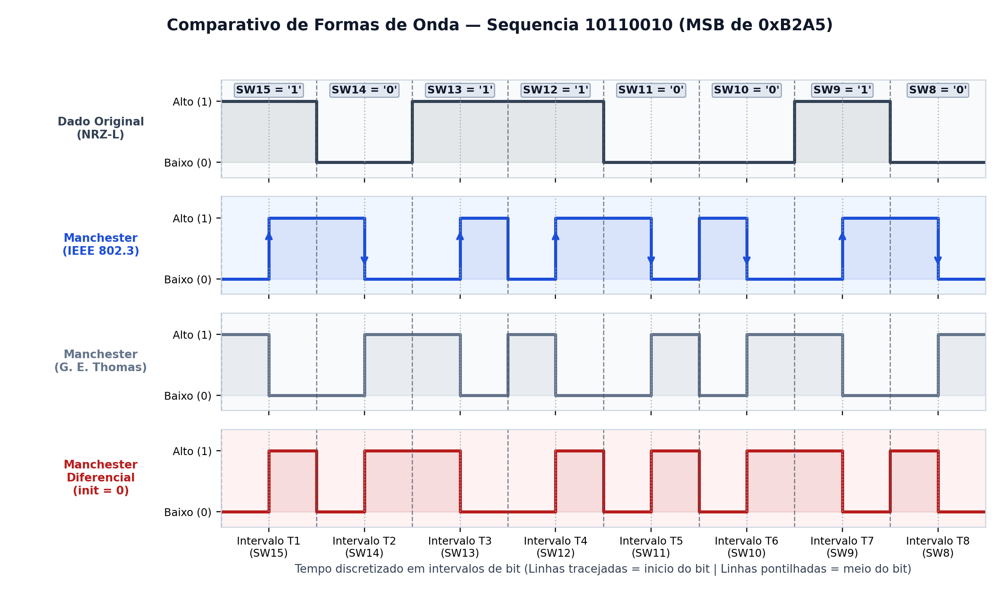
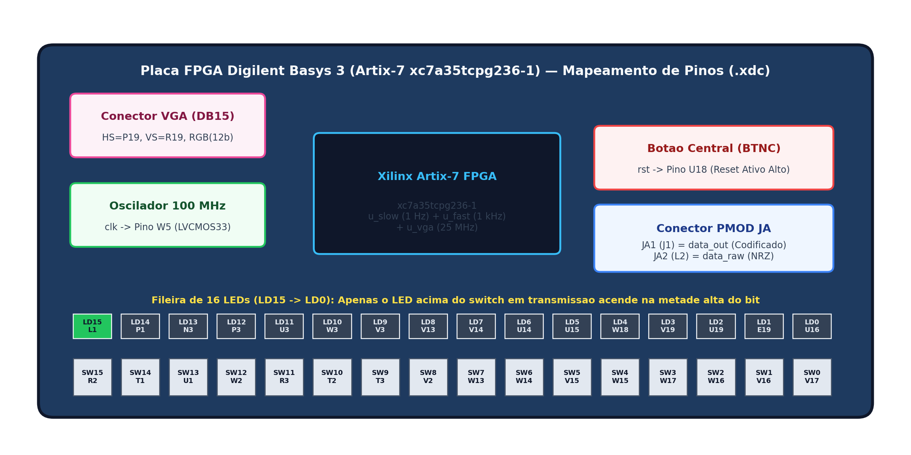

-D97706?style=flat-square)


# Codificação de Linha Manchester e Manchester Diferencial em VHDL (FPGA Basys 3)

> **Trabalho Prático** da disciplina de **Comunicação de Dados - Sistemas Reconfiguráveis**
> **Faculdade Engenheiro Salvador Arena (CEFSA)** — **Prof. Dr. Vinícius S. Borges** — Semestre **2026/2**

## 👥 Integrantes (Grupo 8)

| Nome Completo | Registro Acadêmico (RA) |
| :--- | :---: |
| **Arthur Benevides** | `082230016` |
| **Fernando Montanher** | `082230010` |
| **Guilherme Costa** | `081240041` |
| **Juan Haddad** | `081240043` |
| **Murillo Ando** | `082240042` |

---

## 💡 Entendendo do Zero (Para quem nunca viu o assunto)

Se você nunca estudou telecomunicações ou FPGAs, **não se preocupe**: esta seção explica toda a ideia do projeto em menos de 3 minutos!

### 1. O Problema: Como enviar `0` e `1` por um fio sem perder a conta?
Tudo no computador (textos, fotos, vídeos) é uma fila de bits **`0`** e **`1`**. Para mandar esses bits de um aparelho para outro através de um fio de cobre, precisamos transformá-los em eletricidade (tensão elétrica):
* A ideia mais óbvia (chamada **NRZ — *Non-Return-to-Zero***) é usar **0 Volts (apagado)** para o bit `0` e **3,3 Volts (aceso)** para o bit `1`.
* **Mas existe uma armadilha grave:** imagine que você precisa enviar dez bits `0` seguidos (`0000000000`). O fio ficará parado em `0 Volts` o tempo todo! Quem está do outro lado olhando o fio não tem como saber se passaram 9, 10 ou 11 zeros (os relógios das duas pontas saem de sincronia) — ou até se o cabo foi desconectado.

### 2. A Solução: Códigos Manchester (O "Metrônomo" Embutido)
Para resolver isso de uma vez por todas, a **Codificação Manchester** divide o tempo de cada bit exatamente ao meio (**1ª metade** e **2ª metade**) e cria uma regra de ouro:

> **Regra de Ouro:** **SEMPRE haverá uma mudança de nível (de aceso para apagado, ou de apagado para aceso) exatamente no MEIO de cada bit!**

Essa mudança obrigatória no meio de todo bit funciona como a batida de um **metrônomo embutido no próprio sinal** (chamamos isso de **sinal autossincronizante**). Não importa se você enviar mil zeros seguidos: o sinal vai continuar batendo no meio de cada bit! Além disso, como todo bit passa metade do tempo em nível alto (`3,3 V`) e metade em nível baixo (`0 V`), a média elétrica do sinal é equilibrada (**sem componente DC**).

### 3. Qual a diferença entre os 2 projetos deste repositório?

Neste repositório construímos as duas versões clássicas dessa tecnologia:

| Codificação | Como ela representa o Bit `0` | Como ela representa o Bit `1` | Onde é usada no mundo real? |
| :--- | :--- | :--- | :--- |
| **1. Manchester Clássico (Padrão IEEE 802.3)** | Começa **Alto (`1`)** e **DESCE (↓)** no meio para **Baixo (`0`)** | Começa **Baixo (`0`)** e **SOBE (↑)** no meio para **Alto (`1`)** | Redes **Ethernet 10BASE-T**, etiquetas RFID, controles remotos infravermelhos |
| **2. Manchester Diferencial (Padrão IEEE 802.5)** | **INVERTE** o nível logo no **início** do bit (e inverte de novo no meio) | **MANTÉM** o mesmo nível em que terminou o bit anterior (e só inverte no meio) | Redes industriais **Token Ring**, barramentos automotivos e cabos de par trançado |

> **Por que existe o Manchester Diferencial?**
> No Manchester Clássico, o bit depende de saber o que é "subir" e o que é "descer". Se um técnico instalar um cabo de dois fios invertido sem querer, todas as subidas viram descidas e todos os `1`s viram `0`s! Já no **Manchester Diferencial**, o que importa é apenas **se houve ou não mudança no início do bit** — mesmo que você inverta os fios de cabeça para baixo, uma mudança continua sendo uma mudança e o sistema funciona sem nenhum erro!



---

### 4. Como testamos isso na prática? (A Placa FPGA Basys 3)

Em vez de usar um programa de computador comum, nós usamos uma **FPGA** (*Field-Programmable Gate Array*) na placa educacional **Digilent Basys 3**. Na linguagem **VHDL**, nós descrevemos um **circuito digital físico real** dentro do chip.

Para você conseguir **ver** o código funcionando de todas as formas possíveis, a placa lê as **16 chaves mecânicas (`SW15` até `SW0`)** — onde você escolhe livremente os 16 bits (`1` = chave para cima, `0` = chave para baixo) — e transmite essa sequência em **3 saídas ao mesmo tempo**:

1. **👀 Nos 16 LEDs da placa (Velocidade Humana = 1 segundo por bit):**
   Cada LED fica exatamente acima da sua chave. O circuito percorre da esquerda (`LD15`) para a direita (`LD0`), gastando **1 segundo em cada bit** (`0,5 s` na primeira metade + `0,5 s` na segunda metade). Assim você enxerga a olho nu o LED piscando no meio do bit!
2. **📈 No Conector PMOD `JA` (Velocidade de Bancada = 1.000 bits por segundo / 1 kHz):**
   O olho humano não acompanha 1.000 piscadas por segundo, mas um **osciloscópio** (como o **Digilent Analog Discovery 3**) congela a onda na tela! Nos pinos `JA1` e `JA2` da placa, enviamos o sinal em **1 kHz** (`1 ms` por bit) para desenhar o gráfico elétrico real.
3. **🖥️ No Monitor VGA (640×480 @ 60 Hz com Cores Pulsantes):**
   Conectando um monitor VGA na placa, a tela inteira muda de cor a cada `0,5 s` acompanhando o nível elétrico do sinal codificado.



---

## 📖 Glossário Rápido (Dicionário para Iniciantes)

* **Bit (`0` ou `1`):** Menor unidade de informação digital (`0` = chave abaixada / `0 V`; `1` = chave levantada / `3,3 V`).
* **FPGA (*Field-Programmable Gate Array*):** Chip eletrônico reconfigurável onde os blocos internos se conectam fisicamente para formar o circuito que desenhamos.
* **VHDL:** Linguagem usada para descrever circuitos digitais que serão sintetizados dentro da FPGA.
* **Vivado:** Programa oficial da AMD/Xilinx usado para simular o código VHDL e gerar o arquivo `.bit` que grava a placa.
* **Testbench (`_tb.vhd`):** Arquivo de teste virtual que injeta sinais no nosso circuito dentro do simulador e confere automaticamente (com comandos `assert`) se a resposta está certa.
* **Constraints (`.xdc`):** Arquivo que amarra cada variável do código VHDL a um pino físico real da placa Basys 3 (ex.: dizer que `clk` é o pino `W5`).
* **PMOD:** Conectores pretos de 12 furos nas laterais da placa Basys 3 usados para ligar instrumentos externos, como pontas de osciloscópio.

---

## 📂 Estrutura Completa do Repositório

Cada um dos dois projetos (`manchester/` e `manchester_diferencial/`) é **100% independente e autocontido**: possui seus próprios códigos VHDL, testbench, arquivo `.xdc`, projeto do Vivado (`.xpr`), documentação em PDF, tutoriais passo a passo e pastas dedicadas para as saídas PMOD e VGA.

```text
modulacao_manchester_vhdl_fpga/
├── README.md                                      # Este guia principal (visão geral, explicação do zero e índice)
│
├── manchester/                                    # PROJETO 1: Codificação Manchester Clássica (IEEE 802.3)
│   ├── README.md                                  # Explicação detalhada e guia rápido do Projeto 1
│   ├── src/
│   │   ├── manchester.vhd                         # Núcleo do codificador Manchester parametrizável
│   │   ├── manchester_top.vhd                     # Topo integrando LEDs (1 Hz), PMOD (1 kHz) e VGA
│   │   └── vga_pulse.vhd                          # Controlador de vídeo VGA 640x480 @ 60Hz
│   ├── sim/
│   │   └── manchester_tb.vhd                      # Testbench com checagem automática (assert)
│   ├── constraints/
│   │   └── manchester.xdc                         # Pinagem física da placa Basys 3
│   ├── vivado_project/
│   │   ├── manchester.xpr                         # Projeto do Vivado pronto para abrir
│   │   └── manchester_top.bit                     # Bitstream pronto para gravar direto na placa
│   ├── docs/
│   │   ├── documentacao_projeto.pdf               # Arquitetura interna, portas, generics e pinagem
│   │   ├── tutorial_simulacao.pdf                 # Passo a passo para rodar a simulação no Vivado
│   │   ├── tutorial_placa.pdf                     # Passo a passo para gravar e testar na Basys 3
│   │   └── midia/                                 # Diagramas de blocos e prints da simulação
│   └── saidas/
│       ├── pmod_osciloscopio/                     # Saída rápida (1 kHz) nos pinos JA1 e JA2 + Tutorial AD3
│       └── vga/                                   # Saída de vídeo 640x480 @ 60Hz com cores pulsantes
│
├── manchester_diferencial/                        # PROJETO 2: Codificação Manchester Diferencial
│   ├── README.md                                  # Explicação detalhada e guia rápido do Projeto 2
│   ├── src/
│   │   ├── manchester_dif.vhd                     # Núcleo do codificador Manchester Diferencial
│   │   ├── manchester_dif_top.vhd                 # Topo integrando LEDs (1 Hz), PMOD (1 kHz) e VGA
│   │   └── vga_pulse.vhd                          # Controlador de vídeo VGA 640x480 @ 60Hz
│   ├── sim/
│   │   └── manchester_dif_tb.vhd                  # Testbench validando estado inicial e regras 0/1
│   ├── constraints/
│   │   └── manchester_dif.xdc                     # Pinagem física da placa Basys 3
│   ├── vivado_project/
│   │   └── manchester_diferencial.xpr             # Projeto do Vivado pronto para abrir
│   ├── docs/
│   │   ├── documentacao_projeto.pdf               # Arquitetura interna, portas, generics e pinagem
│   │   ├── tutorial_simulacao.pdf                 # Passo a passo para rodar a simulação no Vivado
│   │   ├── tutorial_placa.pdf                     # Passo a passo para gravar e testar na Basys 3
│   │   └── midia/                                 # Diagramas de blocos e prints da simulação
│   └── saidas/
│       ├── pmod_osciloscopio/                     # Saída para osciloscópio (JA1 e JA2) + Tutorial AD3
│       └── vga/                                   # Saída VGA com cores pulsantes
│
└── relatorio_final/                               # Relatório Acadêmico Consolidado
    └── relatorio.pdf                              # Relatório Técnico Final (10 páginas)
```

---

## 🧭 Índice de Navegação Rápida

### 1. Pastas dos Projetos e Periféricos
* 📁 [**Projeto 1 — Codificação Manchester (IEEE 802.3)**](./manchester/)
  * 📡 [Saída PMOD para Osciloscópio (Manchester)](./manchester/saidas/pmod_osciloscopio/)
  * 🖥️ [Saída VGA com Cores Pulsantes (Manchester)](./manchester/saidas/vga/)
* 📁 [**Projeto 2 — Codificação Manchester Diferencial**](./manchester_diferencial/)
  * 📡 [Saída PMOD para Osciloscópio (Manchester Diferencial)](./manchester_diferencial/saidas/pmod_osciloscopio/)
  * 🖥️ [Saída VGA com Cores Pulsantes (Manchester Diferencial)](./manchester_diferencial/saidas/vga/)

### 2. Tabela de Todos os PDFs (Documentação, Tutoriais e Relatório)

| Escopo | Documentação Técnica | Tutorial de Simulação | Tutorial de Placa (LEDs) | Tutorial PMOD (Osciloscópio) | Tutorial VGA (Monitor) |
| :--- | :---: | :---: | :---: | :---: | :---: |
| **Manchester (IEEE 802.3)** | [📘 Abrir PDF](./manchester/docs/documentacao_projeto.pdf) | [🧪 Abrir PDF](./manchester/docs/tutorial_simulacao.pdf) | [🔌 Abrir PDF](./manchester/docs/tutorial_placa.pdf) | [📈 Abrir PDF](./manchester/saidas/pmod_osciloscopio/docs/tutorial_pmod.pdf) | [🖥️ Abrir PDF](./manchester/saidas/vga/docs/tutorial_vga.pdf) |
| **Manchester Diferencial** | [📘 Abrir PDF](./manchester_diferencial/docs/documentacao_projeto.pdf) | [🧪 Abrir PDF](./manchester_diferencial/docs/tutorial_simulacao.pdf) | [🔌 Abrir PDF](./manchester_diferencial/docs/tutorial_placa.pdf) | [📈 Abrir PDF](./manchester_diferencial/saidas/pmod_osciloscopio/docs/tutorial_pmod.pdf) | [🖥️ Abrir PDF](./manchester_diferencial/saidas/vga/docs/tutorial_vga.pdf) |

* 📄 [**Relatório Técnico Final Consolidado (`relatorio_final/relatorio.pdf`)**](./relatorio_final/relatorio.pdf) — Documento completo de 10 páginas contendo fundamentação teórica, gráficos de Densidade Espectral de Potência (PSD), arquitetura de hardware, simulações no Vivado, capturas reais no osciloscópio **Analog Discovery 3** e tabelas comparativas (`NRZ-L` × `NRZ-I` × `Manchester` × `Manchester Diferencial`).

---

## 🛠️ Ferramentas e Equipamentos Utilizados

* **Software de FPGA:** AMD/Xilinx **Vivado Design Suite 2025.2** (compatível com versões 2023.1+)
* **Linguagem de Hardware:** **VHDL** (`IEEE.STD_LOGIC_1164` e `IEEE.NUMERIC_STD`)
* **Simulador:** **Vivado Simulator (`xsim`)**
* **Placa de Desenvolvimento:** **Digilent Basys 3** (FPGA Xilinx Artix-7 `xc7a35tcpg236-1`, clock de 100 MHz no pino `W5`)
* **Osciloscópio / Instrumentação USB:** **Digilent Analog Discovery 3** operado via software **Digilent WaveForms**
* **Monitor Externo:** Monitor com entrada **VGA** (640×480 @ 60 Hz)

---

## 🚀 Roteiro Passo a Passo: Como Reproduzir Tudo

Se você acabou de clonar este repositório, siga esta ordem:

1. **Simule no Computador (sem precisar da placa):**
   * Abra o arquivo [`manchester/vivado_project/manchester.xpr`](./manchester/vivado_project/manchester.xpr) no Vivado.
   * No menu lateral esquerdo (*Flow Navigator*), clique em **Run Simulation → Run Behavioral Simulation**.
   * Veja o passo a passo ilustrado no [Tutorial de Simulação](./manchester/docs/tutorial_simulacao.pdf).
2. **Grave na Placa Basys 3 e Veja nos LEDs:**
   * Conecte a Basys 3 via USB, abra o *Hardware Manager* no Vivado e programe o arquivo [`manchester_top.bit`](./manchester/vivado_project/manchester_top.bit).
   * Mude as chaves `SW15..SW0`, aperte o botão central `BTNC` e observe os LEDs `LD15..LD0` piscando a 1 segundo por bit ([Tutorial de Placa](./manchester/docs/tutorial_placa.pdf)).
3. **Meça a Onda Real no Osciloscópio (Analog Discovery 3):**
   * Conecte o fio **Laranja (`1+`)** do Analog Discovery 3 no pino **`JA1`** da Basys 3 e os fios de terra (`1-` Laranja/Branco e `GND` Preto) no pino **`JA5` (`GND`)**.
   * Veja o guia detalhado na pasta [Saída PMOD](./manchester/saidas/pmod_osciloscopio/).
4. **Compare com o Manchester Diferencial:**
   * Repita o processo na pasta [`manchester_diferencial/`](./manchester_diferencial/) e compare ambos no [Relatório Final](./relatorio_final/relatorio.pdf).
