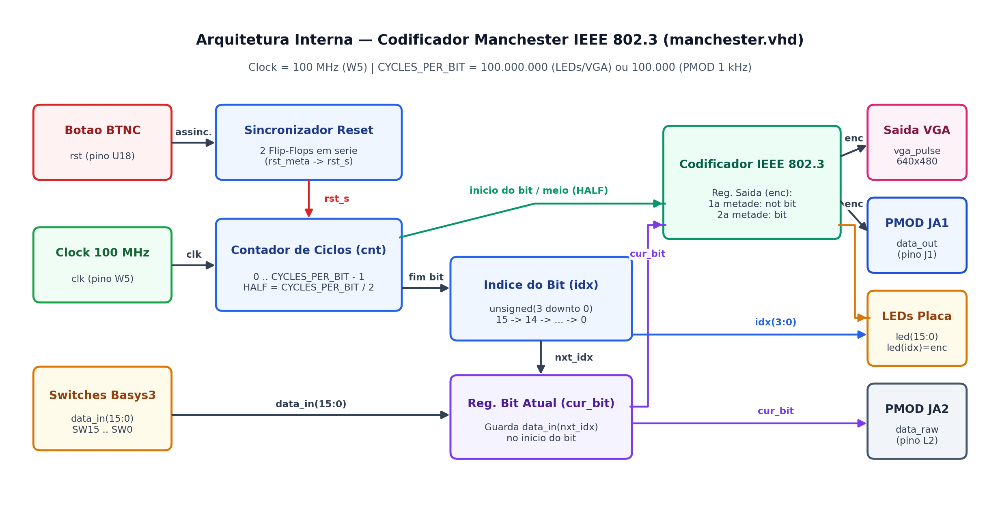
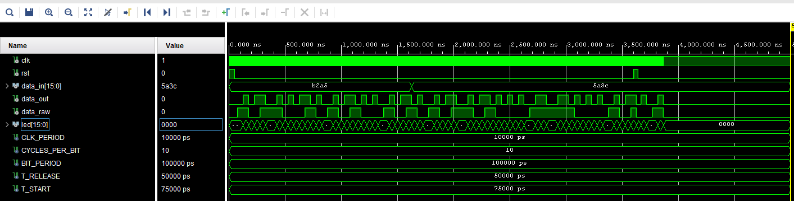
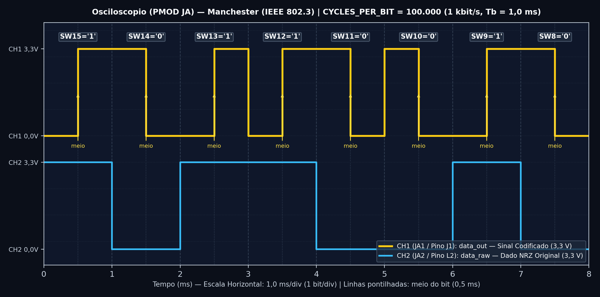

# Projeto 1 — Codificação Manchester (Padrão IEEE 802.3)

Implementação completa em **VHDL** do codificador de linha **Manchester (IEEE 802.3 — Ethernet)**, incluindo simulação auto-verificável no **Vivado Simulator** e validação prática na placa **Digilent Basys 3** utilizando **LEDs** (1 Hz), **Osciloscópio Analog Discovery 3 via PMOD** (1 kHz) e **Monitor VGA** (640×480 @ 60 Hz).

---

## 📐 Como Funciona o Código Manchester (IEEE 802.3)?

Imagine que cada bit tem duração total $T_b$ (configurada no código pelo parâmetro `CYCLES_PER_BIT`). O circuito divide cada bit em **duas metades iguais** (`HALF = CYCLES_PER_BIT / 2`):

* **Para transmitir o bit `'0'`:**
  * **1ª metade do bit:** o sinal fica em **Nível Alto (`'1'` = 3,3 V / LED aceso)**;
  * **2ª metade do bit:** o sinal cai para **Nível Baixo (`'0'` = 0 V / LED apagado)**;
  * **O que acontece no meio do bit?** Uma **transição de DESCIDA (Alto → Baixo)**.
* **Para transmitir o bit `'1'`:**
  * **1ª metade do bit:** o sinal fica em **Nível Baixo (`'0'` = 0 V / LED apagado)**;
  * **2ª metade do bit:** o sinal sobe para **Nível Alto (`'1'` = 3,3 V / LED aceso)**;
  * **O que acontece no meio do bit?** Uma **transição de SUBIDA (Baixo → Alto)**.

| Bit no Switch (`SW`) | 1ª Metade do Bit | 2ª Metade do Bit | Transição no Meio do Bit | Como o LED se comporta (1 s por bit) |
| :---: | :---: | :---: | :---: | :--- |
| **`0`** (chave abaixada) | `'1'` (3,3 V) | `'0'` (0 V) | **Descida (↓)** | Começa **ACESO** por `0,5 s` → fica **APAGADO** por `0,5 s` |
| **`1`** (chave levantada) | `'0'` (0 V) | `'1'` (3,3 V) | **Subida (↑)** | Começa **APAGADO** por `0,5 s` → fica **ACESO** por `0,5 s` |

---

## 🧩 Arquitetura Interna do Circuito

O diagrama abaixo mostra exatamente como o arquivo [`src/manchester.vhd`](./src/manchester.vhd) funciona por dentro:



1. **Sincronizador de Reset (`rst_meta` → `rst_s`):** Quando você aperta o botão central `BTNC` na placa, o sinal passa por 2 flip-flops para evitar falhas elétricas de metaestabilidade.
2. **Contador de Tempo (`cnt`) e Ponteiro de Bit (`idx`):** Conta os pulsos do relógio de 100 MHz da placa. Ao terminar um bit, passa automaticamente para a próxima chave da esquerda para a direita (`SW15` → `SW14` → ... → `SW0` → volta ao `SW15`).
3. **Memória do Bit Atual (`cur_bit`):** Fotografa o valor da chave apenas no início do bit. Se você mexer na chave no meio da transmissão daquele bit, ele não gera erro na onda!
4. **Dupla Velocidade no Topo (`manchester_top.vhd`):**
   * Instância **`u_slow`** (`100.000.000` ciclos = **1 segundo por bit**): ligada aos **LEDs** e ao **VGA** para visualização a olho nu.
   * Instância **`u_fast`** (`100.000` ciclos = **1 milissegundo por bit / 1 kHz**): ligada ao conector **PMOD (`JA1` e `JA2`)** para visualização perfeita no osciloscópio.

---

## 🧪 Resultados Obtidos

### 1. Simulação Comportamental no Vivado Simulator
Na simulação com `CYCLES_PER_BIT = 10` (`100 ns` por bit), transmitimos a palavra `0xB2A5` (`1011_0010_1010_0101`), trocamos dinamicamente para `0x5A3C` (`0101_1010_0011_1100`) e testamos o botão de reset:



### 2. Medição Real no Osciloscópio (Digilent Analog Discovery 3)
Captura obtida no software **WaveForms** medindo o pino **`JA1`** (`data_out` a 1 kHz, escala de `2,5 ms/div`), comprovando os níveis de `0 V` a `3,3 V` e as transições exatas a cada `0,5 ms`:



---

## 📂 Estrutura desta Pasta

```text
manchester/
├── README.md                                  # Este guia do Projeto 1
├── src/
│   ├── manchester.vhd                         # Núcleo codificador Manchester (IEEE 802.3)
│   ├── manchester_top.vhd                     # Topo para a placa Basys 3 (LEDs 1 Hz + PMOD 1 kHz + VGA)
│   └── vga_pulse.vhd                          # Controlador VGA 640x480 @ 60Hz
├── sim/
│   └── manchester_tb.vhd                      # Testbench auto-verificável com assert
├── constraints/
│   └── manchester.xdc                         # Pinagem física completa da Basys 3
├── vivado_project/
│   ├── manchester.xpr                         # Projeto Vivado pronto para abrir
│   └── manchester_top.bit                     # Bitstream pronto para gravar na FPGA
├── docs/
│   ├── documentacao_projeto.pdf               # Documentação técnica detalhada do circuito
│   ├── tutorial_simulacao.pdf                 # Tutorial passo a passo da simulação
│   ├── tutorial_placa.pdf                     # Tutorial passo a passo da gravação na placa
│   └── midia/                                 # Diagramas e capturas de tela
└── saidas/
    ├── pmod_osciloscopio/                     # Guia e arquivos da saída para osciloscópio (JA1/JA2)
    └── vga/                                   # Guia e arquivos da saída para monitor VGA
```

---

## 📚 Documentos em PDF deste Projeto

* 📘 [**Documentação Técnica (`docs/documentacao_projeto.pdf`)**](./docs/documentacao_projeto.pdf)
* 🧪 [**Tutorial de Simulação (`docs/tutorial_simulacao.pdf`)**](./docs/tutorial_simulacao.pdf)
* 🔌 [**Tutorial de Gravação na Placa (`docs/tutorial_placa.pdf`)**](./docs/tutorial_placa.pdf)
* 📈 [**Tutorial da Saída PMOD / Osciloscópio (`saidas/pmod_osciloscopio/docs/tutorial_pmod.pdf`)**](./saidas/pmod_osciloscopio/docs/tutorial_pmod.pdf)
* 🖥️ [**Tutorial da Saída VGA (`saidas/vga/docs/tutorial_vga.pdf`)**](./saidas/vga/docs/tutorial_vga.pdf)

---

## 🚀 Como Executar Rapidamente

1. **Para Simular:** Abra `vivado_project/manchester.xpr` no Vivado e clique em **Run Simulation → Run Behavioral Simulation**.
2. **Para Gravar na Basys 3:** Em **Open Hardware Manager → Program Device**, selecione `vivado_project/manchester_top.bit`.
3. **Para Ver no Osciloscópio e no VGA:** Acesse os guias específicos em [`saidas/pmod_osciloscopio/`](./saidas/pmod_osciloscopio/) e [`saidas/vga/`](./saidas/vga/).
4. **Próximo Passo:** Conheça o [**Projeto 2 — Codificação Manchester Diferencial**](../manchester_diferencial/).
