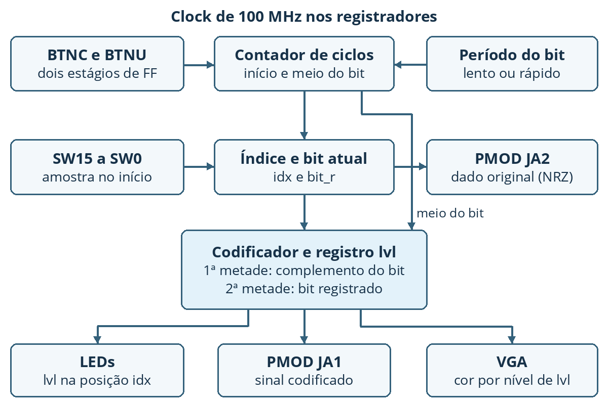

# Documentação técnica - Manchester (IEEE 802.3)

**Faculdade Engenheiro Salvador Arena**  
Disciplina: Comunicação de Dados — Sistemas Reconfiguráveis  
Professor: Vinicius Borges  
7º Semestre — Grupo 3

| Integrante | RA | GitHub |
|---|---|---|
| Emanuel Carneiro da Silva | 082230017 | https://github.com/emanuel71silva |
| José Gabriel de Morais Souza | 082230001 | https://github.com/Gabriieu |
| Lucas Daiki Honda Kuniyosi | 082230020 | https://github.com/LucasKuniyosi |

## 1. Visão geral

O módulo manchester recebe 16 switches e transmite SW15 até SW0 ciclicamente.
Bit 0: primeira metade alta e segunda baixa; bit 1: primeira metade baixa e segunda alta. Adota-se explicitamente a convenção IEEE 802.3. O mesmo estado registrado alimenta PMOD, LEDs e cor VGA.
Cada projeto tem sua própria cópia do controlador VGA e não depende do outro projeto.

## 2. Diagrama de blocos

O clock de 100 MHz alimenta todos os registradores. Os botões passam por dois
flip-flops. period_r seleciona a duração vigente; cnt detecta início e meio do bit;
idx seleciona o switch, bit_r retém seu valor e lvl armazena o nível codificado.
O controlador VGA é um ramo paralelo que fornece sincronismos e região visível.

## 3. Interface

| Porta | Direção / tipo | Função |
|---|---|---|
| clk | in std_logic | Clock de 100 MHz |
| rst | in std_logic | BTNC ativo alto, sincronizado internamente |
| fast | in std_logic, padrão 0 | BTNU: 0 lento, 1 rápido |
| data_in | in std_logic_vector(15 downto 0) | SW15..SW0 |
| data_out | out std_logic | Nível codificado registrado |
| data_raw | out std_logic | Bit registrado, referência NRZ |
| led | out std_logic_vector(15 downto 0) | Nível na posição atual; demais zeros |
| vgaRed | out std_logic_vector(3 downto 0) | Componente vermelho |
| vgaGreen | out std_logic_vector(3 downto 0) | Componente verde |
| vgaBlue | out std_logic_vector(3 downto 0) | Componente azul |
| Hsync | out std_logic | Sincronismo horizontal ativo baixo |
| Vsync | out std_logic | Sincronismo vertical ativo baixo |

## 4. Parâmetros e temporização

| Parâmetro | Valor padrão | Significado |
|---|---|---|
| CYCLES_PER_BIT | 100.000.000 | 1 s por bit a 100 MHz |
| FAST_CYCLES_PER_BIT | 10.000 | 100 µs por bit, 10 kbit/s |
| MAX_CYCLES | Maior dos dois generics | Limite do contador |
| CLK_PERIOD no TB | 10 ns | Período do clock simulado |
| TB_CYCLES_PER_BIT no TB | 2 | Contagem reduzida para simular |
| BIT_PERIOD no TB | 20 ns | Produto das duas constantes anteriores |

Os dois generics devem ser pares e >= 2, condição verificada por assert.
Tbit = N / 100.000.000 segundos; Tmetade = Tbit/2; Rbit = 1/Tbit.
O contador para o modo lento cabe em 27 bits. Um quadro lento dura 16 s;
um quadro rápido dura 1,6 ms. Taxa de bits não é a frequência de uma onda quadrada
única: a periodicidade observada depende dos dados e do código.

## 5. Processos e sequência interna

p_sync amostra rst e fast em dois estágios, marcados com ASYNC_REG. Não há debounce.
p_tx usa variáveis para calcular o próximo estado e atribui os registradores na borda
positiva. No reset: cnt recebe CYCLES_PER_BIT−1, idx recebe 0, period_r recebe o período
lento e bit_r, lvl e led_r recebem zero. A primeira borda de transmissão efetiva avança
idx de 0 para 15. O reset é síncrono após o sincronizador, portanto não atua instantaneamente.

Quando cnt = period_r−1, inicia-se um novo bit: cnt vira 0, idx decrementa (ou retorna
para 15) e data_in(v_idx) é capturado em bit_r. A seleção fast_sync atualiza period_r
somente nesse limite. O bit já iniciado mantém sua duração, mesmo que BTNU mude.
Quando cnt = period_r/2−1, a atribuição da próxima borda inicia a segunda metade.
Nos demais ciclos, o contador incrementa e o nível permanece.

Para Manchester, a primeira metade recebe NOT bit e a segunda recebe bit.
Se h = 0 na primeira metade e h = 1 na segunda, a função é bit XNOR h:

| bit | h | nível |
|---|---|---|
| 0 | 0 | 1 |
| 0 | 1 | 0 |
| 1 | 0 | 0 |
| 1 | 1 | 1 |

O vetor temporário de LEDs é zerado a cada atualização, recebendo v_lvl somente em
v_idx. Quando lvl = 0, todos os LEDs estão apagados; a posição atual continua em idx.
data_out, data_raw e led vêm de registradores. Os switches são amostrados diretamente:
a retenção por bit impede mudança lógica durante o intervalo, mas não elimina
metastabilidade se um switch mudar próximo à borda de captura. set_false_path apenas
retira caminhos da análise de timing e não funciona como sincronizador.

## 6. VGA

vga_sync usa clock-enable a cada quatro ciclos de 100 MHz, sem criar um clock na lógica.
São 800 pixels totais por linha (640 visíveis, 16 front porch, 96 sync, 48 back porch)
e 525 linhas por quadro (480 visíveis, 10 front porch, 2 sync, 33 back porch).
A taxa é 25.000.000/(800×525), aproximadamente 59,52 Hz. Os sincronismos são ativos baixos.
RGB é registrado em branco quando video_on e lvl estão altos e preto nos demais casos.
Os sincronismos recebem o mesmo estágio adicional de registro para alinhamento.
O reset do codificador não reinicia os contadores VGA; o monitor mantém o sincronismo.

## 7. Mapeamento físico completo

Os sinais abaixo usam LVCMOS33. O clock da Basys 3 tem período de 10 ns. No conector JA, as posições 5 e 11 são GND.

| Função na Basys 3 | Porta VHDL | Terminal FPGA |
|---|---|---|
| Clock | `clk` | W5 |
| BTNC | `rst` | U18 |
| BTNU | `fast` | T18 |
| JA1, sinal codificado | `data_out` | J1 |
| JA2, dado NRZ | `data_raw` | L2 |
| VGA, sincronismo horizontal | `Hsync` | P19 |
| VGA, sincronismo vertical | `Vsync` | R19 |

| Índice n | SWn / `data_in[n]` | LDn / `led[n]` |
|---|---|---|
| 15 | R2 | L1 |
| 14 | T1 | P1 |
| 13 | U1 | N3 |
| 12 | W2 | P3 |
| 11 | R3 | U3 |
| 10 | T2 | W3 |
| 9 | T3 | V3 |
| 8 | V2 | V13 |
| 7 | W13 | V14 |
| 6 | W14 | U14 |
| 5 | V15 | U15 |
| 4 | W15 | W18 |
| 3 | W17 | V19 |
| 2 | W16 | U19 |
| 1 | V16 | E19 |
| 0 | V17 | U16 |

| Índice n | `vgaRed[n]` | `vgaGreen[n]` | `vgaBlue[n]` |
|---|---|---|---|
| 0 | G19 | J17 | N18 |
| 1 | H19 | H17 | L18 |
| 2 | J19 | G17 | K18 |
| 3 | N19 | D17 | J18 |

## 8. Testbench, limites e dependências

O testbench usa B2C5 e 4D3A, verifica as duas metades, LEDs, NRZ, captura no início,
repetição e reset. A alteração de padrão no meio de SW8 testa estabilidade do bit corrente.
Os checks ocorrem em 1/4 e 3/4 do período para evitar coincidência com a borda.
Fast fica em 0 e as portas VGA ficam open na instância: não há verificação automática
da seleção de velocidade ou do vídeo nesta versão. Esses casos exigem testes adicionais.

Biblioteca: IEEE.STD_LOGIC_1164. Dependência de implementação: vga_sync.vhd.
Ambiente real: Vivado 2025.2, Windows 11 Education 25H2, Basys 3 xc7a35tcpg236-1.
Não se inclui display de sete segmentos, que é sugestão opcional do enunciado.
As evidências experimentais estão no [relatório técnico](../../relatorio_final/relatorio.pdf).

## Referências

[1] BORGES, Vinicius. Enunciado: Trabalho Prático - Codificação de Linha Manchester em VHDL (Vivado). Material fornecido, 8 p.

[2] BORGES, Vinicius. Guia de Documentação do Trabalho. Material fornecido, 11 p.

[3] BORGES, Vinicius. Guia de Entrega via GitHub. Material fornecido, 5 p.

[4] DIGILENT. Basys-3-Master.xdc. Disponível em: https://raw.githubusercontent.com/Digilent/digilent-xdc/master/Basys-3-Master.xdc . Consultado em 19 nov. 2026.

[5] DIGILENT. Getting started with the Analog Discovery 3. Disponível em: https://files.digilent.com/manuals/WaveForms/3.24.4/start10.html . Consultado em 19 nov. 2026.

[6] Código VHDL e testbench deste projeto, nas pastas src/ e sim/.
