# Tutorial de implementação na placa - Manchester (IEEE 802.3)

**Faculdade Engenheiro Salvador Arena**  
Disciplina: Comunicação de Dados — Sistemas Reconfiguráveis  
Professor: Vinicius Borges  
7º Semestre — Grupo 3

| Integrante | RA | GitHub |
|---|---|---|
| Emanuel Carneiro da Silva | 082230017 | https://github.com/emanuel71silva |
| José Gabriel de Morais Souza | 082230001 | https://github.com/Gabriieu |
| Lucas Daiki Honda Kuniyosi | 082230020 | https://github.com/LucasKuniyosi |

## 1. Preparação

Use Basys 3 com xc7a35tcpg236-1, cabo USB de dados, drivers de programação e Vivado
2025.2. Primeiro conclua o [tutorial de simulação](tutorial_simulacao.pdf). Confirme o top
manchester e somente constraints/manchester.xdc ativo. Preserve os generics físicos:
CYCLES_PER_BIT = 100.000.000 e FAST_CYCLES_PER_BIT = 10.000.

## 2. Síntese

Clique Run Synthesis. Ao concluir, abra Open Synthesized Design, confira mensagens,
peça e top. Não avance se houver erros de elaboração, entidades ausentes ou portas incompatíveis.

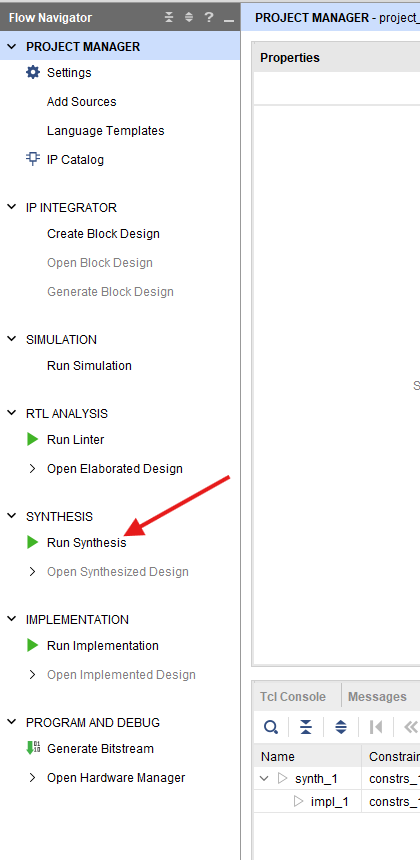

*Comando Run Synthesis; interface comum aos dois projetos.*

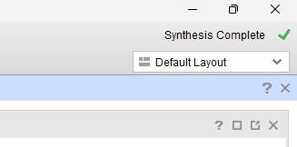

*Indicação Synthesis Complete; recorte sem identificação do projeto.*

## 3. Implementação

Execute Run Implementation. Abra Open Implemented Design e confira o clock de 10 ns e as atribuições de pinos.
Investigue cada aviso relevante; não contorne UCIO/NSTD rebaixando sua severidade.
Os false paths de entradas assíncronas não comprovam ausência de metastabilidade.

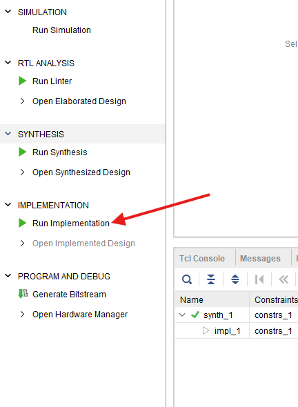

*Comando Run Implementation.*

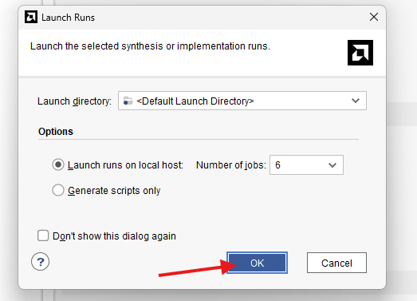

*Confirmação de execução; não é o resultado da implementação.*

A análise detalhada de timing não integra este tutorial. A conclusão da implementação e a programação não equivalem, por si só, à aprovação temporal.

## 4. Bitstream

Execute Generate Bitstream e aguarde a conclusão. Registre o caminho e a data do .bit.
Confira que pertence ao projeto atual, sobretudo ao alternar entre as duas codificações.

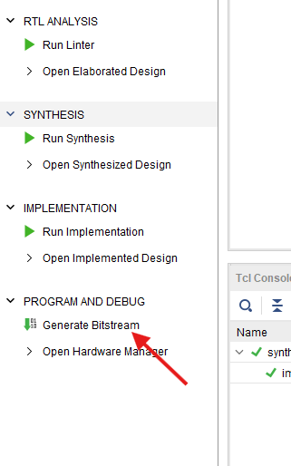

*Comando Generate Bitstream.*

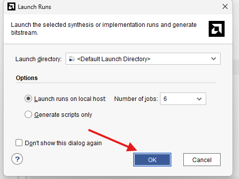

*Diálogo de lançamento da geração do bitstream; não é a confirmação de término.*

Os prints seguintes comprovam que foi selecionado e programado um arquivo .bit. Não foi fornecido o resumo final da geração.

## 5. Conectar e programar

Conecte a Basys 3 ao computador pela porta de programação USB, com cabo de dados,
e ligue-a. Abra Hardware Manager > Open Target > Auto Connect. Confira o FPGA detectado.
Escolha Program Device, selecione o .bit recém-gerado e clique Program. Confira a mensagem
de sucesso e o LED DONE. Não pressione PROG como start: o reset do circuito é BTNC.
A configuração por JTAG precisa ser refeita após desligar a placa, salvo se a memória
não volátil tiver sido programada separadamente, procedimento fora deste tutorial.

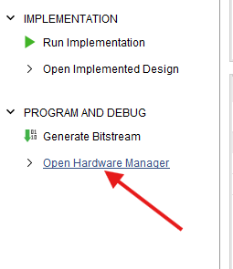

*Abertura do Hardware Manager.*

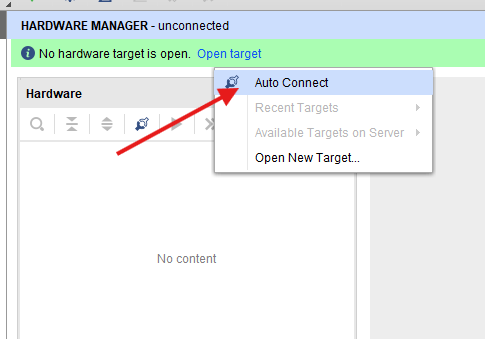

*Open Target > Auto Connect.*

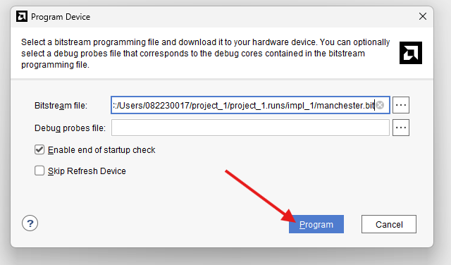

*Seleção do bitstream manchester.bit.*

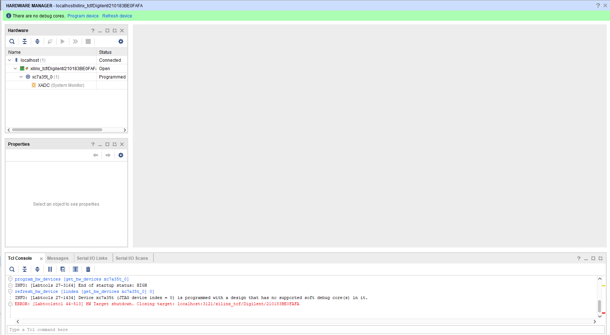

*FPGA com estado Programmed após programação do projeto.*

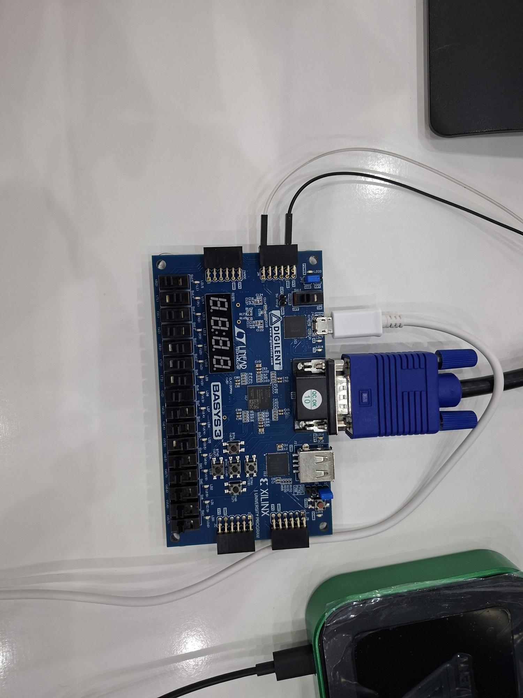

*Montagem da Basys 3 com cabos conectados; foto compartilhada da bancada, sem identificar a codificação carregada.*

## 6. Operação

| Elemento | Função |
|---|---|
| SW15..SW0 | Sequência de 16 bits, para cima = 1 |
| LD15..LD0 | Nível codificado do bit na posição correspondente |
| BTNC / U18 | Reset; soltar reinicia em SW15 |
| BTNU / T18 | Manter pressionado para rápido; solto para lento |
| JA1 / J1 | Sinal codificado |
| JA2 / L2 | Dado original registrado |

No lento, cada bit dura 1 s e cada metade 0,5 s; um quadro dura 16 s. A troca de
velocidade aguarda o próximo bit e pode demorar aproximadamente 1 s. No rápido,
a persistência visual pode fazer vários LEDs parecerem acesos: isso não prova que
mais de um esteja alto no mesmo instante.

## 7. Sequência de testes

1. Solte BTNU, ajuste os switches para 0000 hexadecimal, pressione e solte BTNC.
2. Observe LD15 até LD0 e o retorno a LD15; grave pelo menos 20 s para mostrar o ciclo.
3. Repita com FFFF, AAAA (1010 repetido) e B2C5. Registre o padrão exibido.
4. Pressione BTNC durante a transmissão; após a latência de sincronização, LEDs e PMOD
   devem ficar baixos. Solte e confirme reinício em SW15.
5. Altere um switch logo após seu bit começar. O bit atual não deve ser modificado;
   observe a próxima visita à mesma posição sem reprogramar a placa.
6. Pressione e solte BTNU, registrando a mudança; confira os tempos no osciloscópio.

Bit 0: primeira metade alta e segunda baixa; bit 1: primeira metade baixa e segunda alta. Adota-se explicitamente a convenção IEEE 802.3.

## 8. Registro e diagnóstico

O grupo confirmou o funcionamento dos dois projetos nos testes realizados.
Se nada acender, confira BTNC solto, top, .bit, clock W5 e pinos dos LEDs.
Se tudo parecer aceso, solte BTNU e aguarde o fim do bit. Se a placa não aparecer,
confira alimentação, cabo de dados e drivers. Não use simulação bem-sucedida como
prova de programação ou de ligação física correta.

## Vídeo de demonstração

Registre no vídeo a sequência dos LEDs, o reset, a alteração de switches, as duas formas de onda no osciloscópio e a alternância de cores na VGA. Para o relatório, tire uma foto da placa em operação e identifique o bitstream usado. Indique os tempos dos trechos no [índice do vídeo](../../relatorio_final/README.md).
