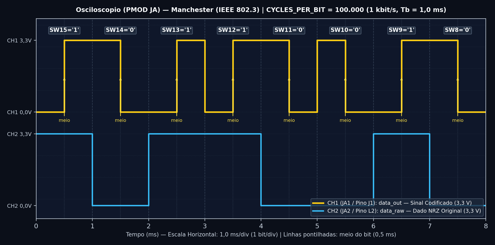

# Saída PMOD para Osciloscópio — Codificação Manchester (IEEE 802.3)

Esta pasta contém os arquivos e o passo a passo para conectar um osciloscópio (como o **Digilent Analog Discovery 3**) ao conector **PMOD `JA`** da placa **Basys 3** e visualizar a onda elétrica do código **Manchester (IEEE 802.3)** em tempo real.

---

## ⚡ Por que a saída PMOD usa 1 kHz em vez de 1 Hz?

Nos LEDs da placa, usamos **1 bit por segundo (1 Hz)** para que o olho humano consiga acompanhar cada piscada. Porém, no osciloscópio, 1 Hz é lento demais para formar uma imagem parada confortável. Por isso, o módulo [`manchester_top.vhd`](./src/manchester_top.vhd) possui uma segunda instância (`u_fast`) configurada com `CPB_SCOPE = 100_000`:

$$T_b = \frac{100.000}{100\text{ MHz}} = 1\text{ ms por bit} \implies f_{bit} = 1\text{ kHz (1.000 bits/s)}$$

Assim, cada bit dura **1,0 ms** (sendo **0,5 ms** na primeira metade e **0,5 ms** na segunda metade), enquanto os LEDs continuam rodando a 1 segundo por bit simultaneamente!

---

## 🔌 Como Conectar os Fios (Basys 3 + Analog Discovery 3)

Olhando a **Basys 3 de frente**, localize o conector preto **`JA`** no **topo da lateral esquerda** (logo abaixo do LED vermelho `POWER`).

| Pino no PMOD `JA` | Posição Física no Conector `JA` | Pino da FPGA | Sinal VHDL | Fio do Analog Discovery 3 (ou Osciloscópio) |
| :--- | :--- | :---: | :--- | :--- |
| **`JA1`** | **1º furo de baixo para cima** (fileira externa, marcado com `1`) | `J1` | **`data_out`** (Manchester 1 kHz) | **Fio Laranja liso (`1+` / Canal 1)** |
| **`JA2`** | **2º furo de baixo para cima** (logo acima do `JA1`) | `L2` | **`data_raw`** (Bit NRZ original 1 kHz) | **Fio Azul liso (`2+` / Canal 2)** |
| **`JA5` (`GND`)** | **5º furo de baixo para cima** (marcado como `GND` na placa) | `GND` | **Terra (0 V)** | **Fio Laranja/Branco (`1-`) + Fio Preto (`GND`)** |
| **`JA11` (`GND`)** | **5º furo da fileira interna** (ao lado do `JA5`) | `GND` | **Terra (0 V)** | **Fio Azul/Branco (`2-`)** |

> ⚠️ **Importante no Analog Discovery 3:** Sempre conecte os fios negativos listrados (`1-` Laranja/Branco e `2-` Azul/Branco) nos pinos **`GND`** (`JA5` / `JA11`) da Basys 3, pois as entradas do AD3 são diferenciais. Nunca conecte nada nos pinos `JA6` ou `JA12` (`3V3`).

---

## 📈 Configuração no Software WaveForms e Captura Real

1. Abra o **Digilent WaveForms** e clique em **`Scope`**.
2. Em **Channel 1 (`1+`)**: configure `Range = 1 V/div` e `Offset = -1.8 V`.
3. Em **Time (Base de Tempo)**: configure `Base = 2.5 ms/div` (ou `1 ms/div`).
4. Em **Trigger**: selecione `Mode = Repeated`, `Source = Channel 1`, `Condition = Rising` (`1.65 V`).

### Como ler o gráfico acima:
* O sinal oscila de **0 V** (nível lógico `'0'`) até **3,3 V** (nível lógico `'1'`).
* Os pulsos estreitos duram **0,5 ms** (meio bit) e os pulsos largos duram **1,0 ms** (duas metades iguais vizinhas quando ocorre troca de `'0'` para `'1'` ou de `'1'` para `'0'`).
* Em **todo centro de bit** há uma transição garantida: **descida (`3,3 V → 0 V`)** quando o switch vale `'0'` e **subida (`0 V → 3,3 V`)** quando o switch vale `'1'`.

---

## 📄 Documentação Completa

* 📈 [**Tutorial Completo da Saída PMOD (`docs/tutorial_pmod.pdf`)**](./docs/tutorial_pmod.pdf)
