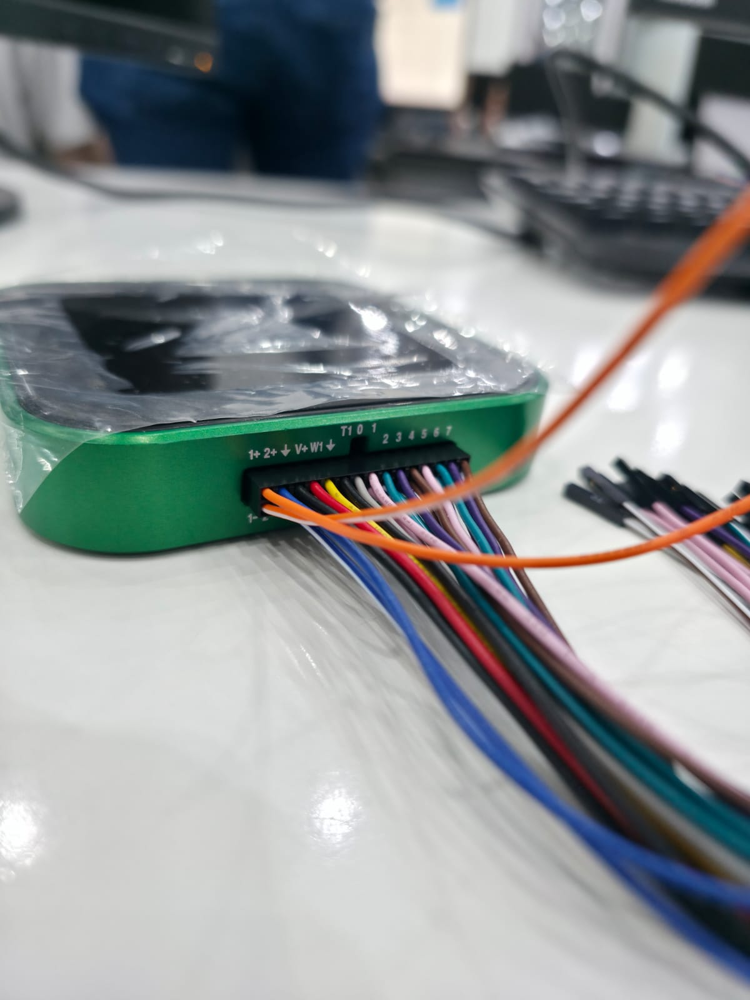
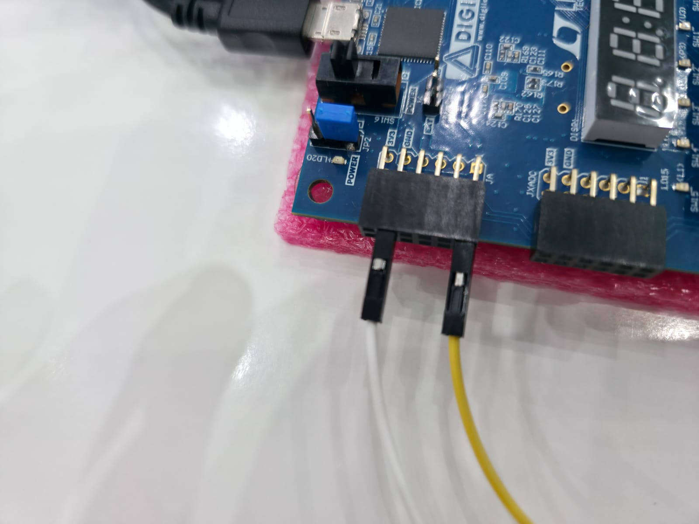
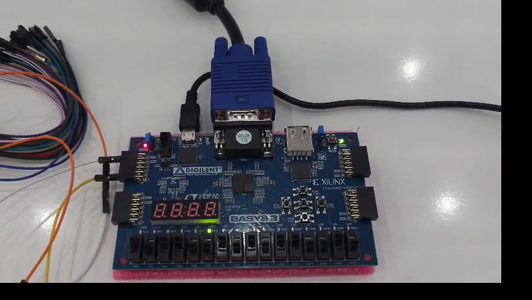
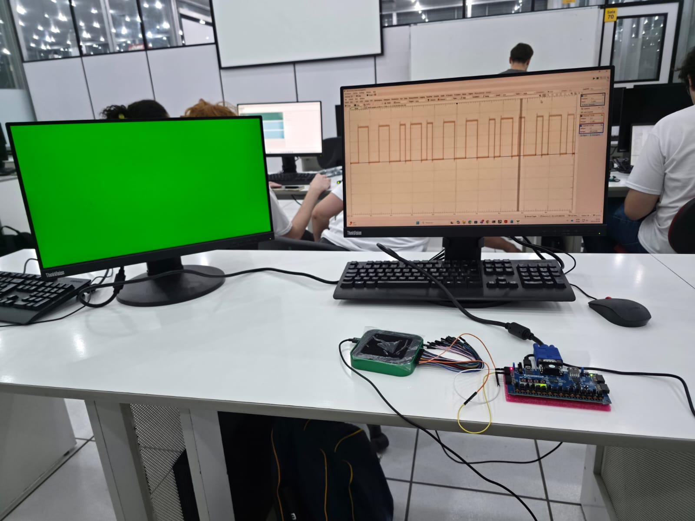
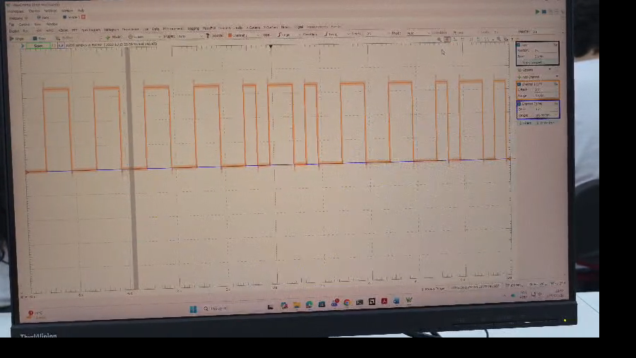

# Tutorial PMOD e osciloscópio — Manchester (IEEE 802.3)

**Faculdade Engenheiro Salvador Arena**  
Disciplina: Comunicação de Dados — Sistemas Reconfiguráveis  
Professor: Vinícius S. Borges  
Semestre 2026/2 — Grupo 1

| Integrante | RA |
|---|---|
| Eduardo Souza Urbanovicz Bastiani | 082230018 |
| João Vitor Maciel Nai | 082230004 |
| Ronaldo de Oliveira Santos | 082230031 |

Passo a passo para observar o sinal Manchester no osciloscópio (Analog Discovery 3 + WaveForms).

## 1. Pré-requisitos

| Item | Detalhe |
|---|---|
| Placa | Basys 3 gravada com `manchester.bit` ([tutorial da placa](../../../../docs/tutorial_placa/tutorial_placa.md)) |
| Osciloscópio | Digilent Analog Discovery 3 + WaveForms |
| Fios | Chicote do Analog Discovery e jumpers fêmea-fêmea |

O sinal codificado vem do mesmo top e do mesmo XDC usados pelos LEDs e pela VGA; não é necessário outro bitstream.

## 2. Conexão física

Faça as ligações com os equipamentos desligados. O conector **JA** tem duas fileiras de 6 pinos; em cada fileira, os dois pinos da ponta são **GND** e **3V3** (identificados na serigrafia da placa). **Nunca ligue um fio no 3V3.**

```
        Conector PMOD JA (vista de cima da placa)
   ┌─────┬─────┬─────┬─────┬─────┬─────┐
   │ 3V3 │ GND │ JA4 │ JA3 │ JA2 │ JA1 │   <- fileira de cima
   ├─────┼─────┼─────┼─────┼─────┼─────┤
   │ 3V3 │ GND │JA10 │ JA9 │ JA8 │ JA7 │   <- fileira de baixo
   └─────┴─────┴─────┴─────┴─────┴─────┘
```

| Terminal do Analog Discovery 3 | Liga em (Basys 3) | Sinal |
|---|---|---|
| **1+** (canal 1) | **JA1** (FPGA J1) | Sinal codificado (`data_out`) |
| **2+** (canal 2) | **JA2** (FPGA L2) | Dado original NRZ (`data_raw`) |
| **1−**, **2−** e **⏚** | **GND** do JA | Referência comum |

Não conecte as saídas **W1**, **W2**, **V+** ou **V−** do instrumento aos pinos da FPGA.



*Figura 1 — Conector do Analog Discovery 3: a serigrafia indica 1+, 2+, ⏚, V+, W1 na fileira de cima e 1−, 2− na de baixo. O fio laranja é o 1+ (canal 1).*



*Figura 2 — Conector JA na bancada: fio amarelo em JA1 (sinal codificado) e fio branco no GND do JA.*



*Figura 3 — Basys 3 em funcionamento com os fios do osciloscópio no conector JA e o cabo VGA conectado (quadro do vídeo `manchester_video_01.mp4`).*

Os ensaios registrados utilizaram o **canal 1**, com o sinal codificado em JA1. O canal 2 pode ser ligado em JA2 para observar o dado original (NRZ) ao mesmo tempo, sem nenhuma alteração no projeto.

## 3. Gravar o bitstream

Siga as seções 5 e 6 do [tutorial da placa](../../../../docs/tutorial_placa/tutorial_placa.md) (Hardware Manager → Program Device → `manchester.bit`).

## 4. Configurar o WaveForms

1. Ligue o Analog Discovery 3 no USB, abra o **WaveForms** e clique em **Scope**.
2. Habilite **Channel 1** (e **Channel 2**, se o NRZ estiver ligado). Acoplamento DC, **1 V/div**.
3. Escolha a base de tempo conforme o modo:

| Modo | Botão | Duração do bit | Base de tempo sugerida | Janela |
|---|---|---|---|---|
| Lento | BTNU solto | 1 s (0,5 s por metade) | 2 s/div, modo **Scan** | 20 s (> 1 quadro de 16 s) |
| Rápido | BTNU pressionado | 100 µs (50 µs por metade) | 200 µs/div, **Single** | 2 ms (> 1 quadro de 1,6 ms) |

4. Para o modo rápido, use *Trigger* em **Normal**, fonte **Channel 1**, borda de subida, nível **1,5 V**.

## 5. Capturar a forma de onda

1. Ajuste o padrão nos switches, por exemplo **`1011 0010 1011 0010`** (SW15 → SW0).
2. Pressione e solte **BTNC** para recomeçar em SW15.
3. No modo lento, clique em **Run** com Scan e acompanhe; no modo rápido, **segure o BTNU** e clique em **Single**.
4. Exporte a tela em **File → Export → Image**.



*Figura 4 — Bancada em funcionamento com o projeto Manchester: Analog Discovery 3 ligado ao JA da Basys 3, WaveForms exibindo o sinal codificado (monitor da direita) e a tela VGA em verde, nível 1 (monitor da esquerda).*



*Figura 5 — Captura do WaveForms com o sinal Manchester no canal 1 (modo lento, 1 s por bit). Cada bit tem uma transição no meio; os pulsos largos correspondem a pares de bits diferentes e os estreitos a bits iguais consecutivos.*

## 6. Resultado esperado

Cada bit tem **uma transição exatamente no meio**:

```
Bits:          1      0      1      1      0      0      1      0
NRZ (ch2):   ‾‾‾‾‾‾ ______ ‾‾‾‾‾‾ ‾‾‾‾‾‾ ______ ______ ‾‾‾‾‾‾ ______
Manch.(ch1): ___‾‾‾ ‾‾‾___ ___‾‾‾ ___‾‾‾ ‾‾‾___ ‾‾‾___ ___‾‾‾ ‾‾‾___
                ↑      ↓      ↑      ↑      ↓      ↓      ↑      ↓   <- meio do bit
```

- Bit **1** → **subida** no meio; bit **0** → **descida** no meio (IEEE 802.3).
- Entre dois bits iguais aparece uma transição extra **no início** do bit; entre bits diferentes, não.
- Os níveis vão de ≈ 0 V a ≈ 3,3 V. As durações citadas são calculadas a partir de 100 MHz e dos generics.

## 7. Diagnóstico

| Sintoma | O que conferir |
|---|---|
| Sinal constante | BTNC solto, fio em JA1 (e não em 3V3), bitstream correto |
| Sinal "invertido" | Confira os fios 1+ e 1− |
| Nada aparece no modo rápido | Base de tempo muito longa; use 200 µs/div e segure o BTNU |
| Velocidade não muda na hora | Esperado: a troca entra no início do próximo bit |
