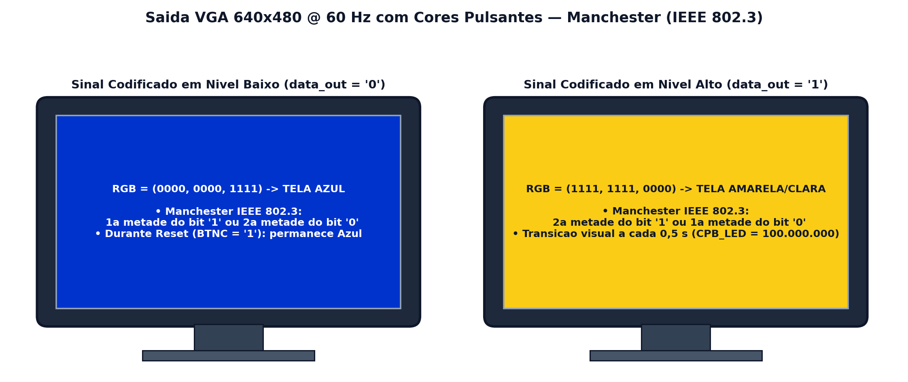

# Saída VGA com Cores Pulsantes — Codificação Manchester (IEEE 802.3)

Esta pasta contém o controlador de vídeo [`vga_pulse.vhd`](./src/vga_pulse.vhd) e o guia para observar o código **Manchester (IEEE 802.3)** em um **monitor VGA externo (640×480 @ 60 Hz)** conectado à placa **Basys 3**.

---

## 🖥️ Como Funciona a Visualização no Monitor VGA?

Para transformar os bits da codificação Manchester em uma demonstração visual de alto impacto em sala de aula ou laboratório, o controlador [`vga_pulse.vhd`](./src/vga_pulse.vhd) gera um sinal de vídeo de **640×480 pixels a 60 quadros por segundo** (usando um *pixel clock* de **25 MHz** obtido dividindo o clock de 100 MHz da Basys 3 por 4).

O módulo recebe o sinal codificado lento (`slow_out`, de **1 segundo por bit**) e pinta a **tela inteira do monitor** de acordo com o nível lógico instantâneo do código Manchester:

| Estado do Sinal Manchester (`data_out`) | Quando ocorre (Padrão IEEE 802.3) | Cor Exibida em Tela Cheia |
| :---: | :--- | :--- |
| **Nível Baixo (`'0'` = 0 V)** | • 2ª metade do bit `'0'` • 1ª metade do bit `'1'` • Enquanto o botão `BTNC` (Reset) estiver pressionado | **Azul / Magenta** (`vgaBlue = "1111"`) |
| **Nível Alto (`'1'` = 3,3 V)** | • 1ª metade do bit `'0'` • 2ª metade do bit `'1'` | **Amarelo / Ciano Claro** (`vgaRed/vgaGreen = "1111"`) |

### O que você observa na prática:
* Se uma chave estiver em **`'0'`** (abaixada), durante o 1 segundo daquele bit o monitor começa na cor **Clara (Alto)** por `0,5 s` e muda no meio para a cor **Escura/Azul (Baixo)** por `0,5 s`.
* Se uma chave estiver em **`'1'`** (levantada), o monitor começa na cor **Escura/Azul (Baixo)** por `0,5 s` e muda no meio para a cor **Clara (Alto)** por `0,5 s`.
* A mudança de cor no monitor acontece **exatamente no mesmo instante** em que o LED correspondente na placa Basys 3 acende ou apaga!

---

## 🔌 Pinos Utilizados na Basys 3

O conector **VGA (DB15)** fica na borda superior central da placa Basys 3:
* **Sincronismo Horizontal (`Hsync`):** Pino `P19`
* **Sincronismo Vertical (`Vsync`):** Pino `R19`
* **Canal Vermelho 4 bits (`vgaRed[3:0]`):** Pinos `N19`, `J19`, `H19`, `G19`
* **Canal Verde 4 bits (`vgaGreen[3:0]`):** Pinos `D17`, `G17`, `H17`, `J17`
* **Canal Azul 4 bits (`vgaBlue[3:0]`):** Pinos `J18`, `K18`, `L18`, `N18`

---

## 📄 Documentação Completa

* 🖥️ [**Tutorial Completo da Saída VGA (`docs/tutorial_vga.pdf`)**](./docs/tutorial_vga.pdf)
