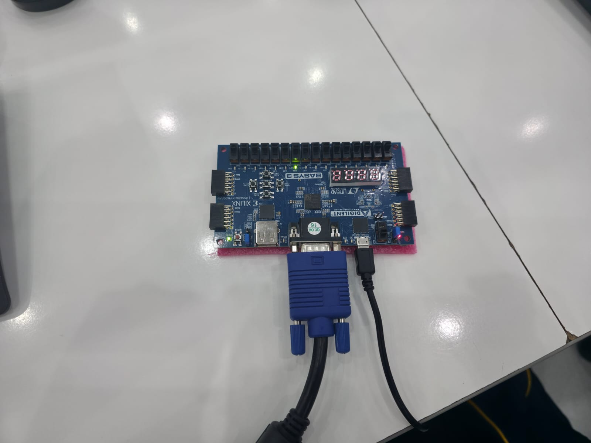
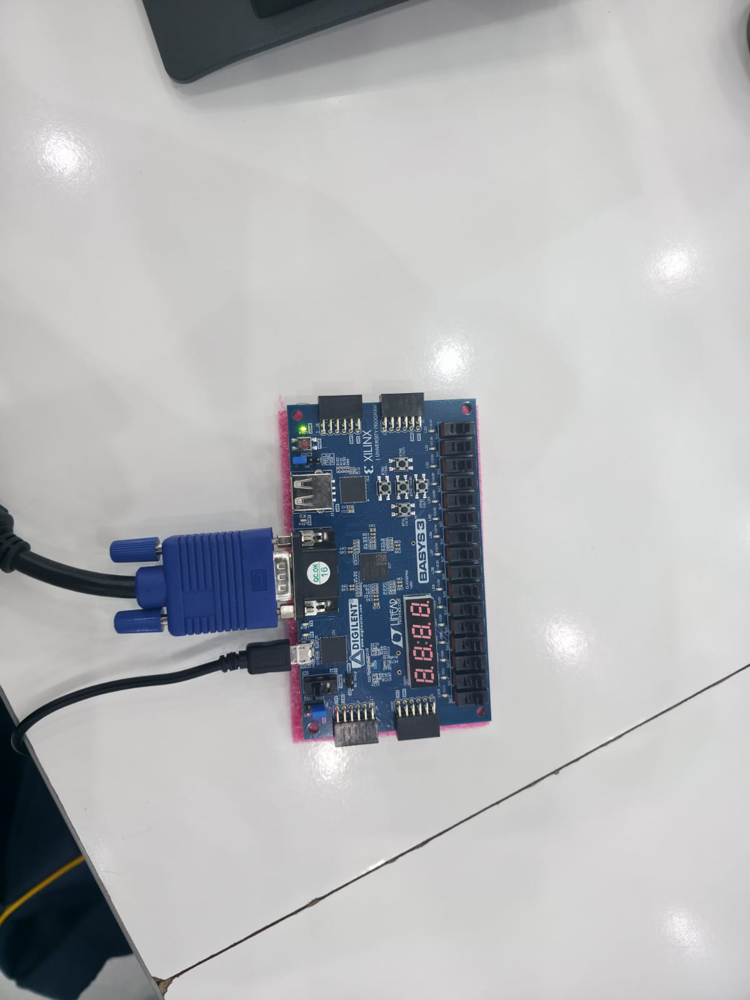
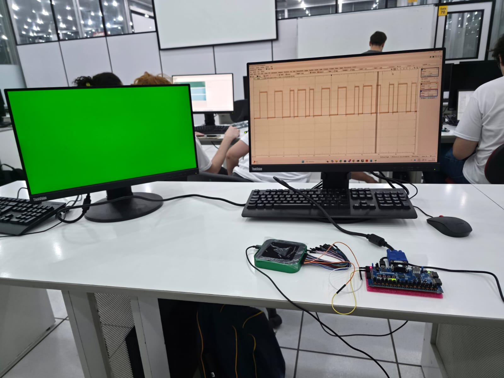
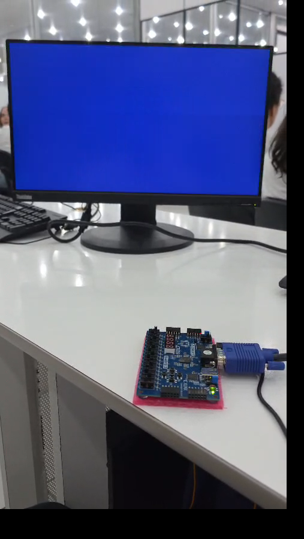

# Tutorial VGA — Manchester (IEEE 802.3)

**Faculdade Engenheiro Salvador Arena**  
Disciplina: Comunicação de Dados — Sistemas Reconfiguráveis  
Professor: Vinícius S. Borges  
Semestre 2026/2 — Grupo 1

| Integrante | RA |
|---|---|
| Eduardo Souza Urbanovicz Bastiani | 082230018 |
| João Vitor Maciel Nai | 082230004 |
| Ronaldo de Oliveira Santos | 082230031 |

Passo a passo para ver o sinal Manchester piscando na tela de um monitor VGA.

## 1. Pré-requisitos

| Item | Detalhe |
|---|---|
| Placa | Basys 3 + cabo micro-USB |
| Monitor | Qualquer monitor com entrada **VGA** (para monitor só HDMI, é preciso conversor ativo VGA → HDMI) |
| Cabo | Cabo VGA (conector DB-15) |
| Bitstream | `manchester.bit` ([tutorial da placa](../../../../docs/tutorial_placa/tutorial_placa.md)) |

## 2. Conexão física

1. Com a placa desligada (chave POWER em OFF), ligue o cabo VGA no conector VGA da Basys 3 e no monitor.
2. Ligue o monitor e a placa e selecione **VGA** como entrada do monitor.

*Figura 1 — Basys 3 com o cabo VGA (azul) e o cabo micro-USB conectados.*

*Figura 2 — Outra vista da montagem, com a placa programada (LED DONE aceso).*

## 3. Gravar o bitstream

Siga as seções 5 e 6 do [tutorial da placa](../../../../docs/tutorial_placa/tutorial_placa.md). Não é preciso trocar o top nem o XDC: o top `manchester` já instancia `vga_sync`. Logo após a gravação o monitor recebe imagem (640x480, ≈ 59,5 Hz; o monitor pode indicar 60 Hz).

## 4. Observar

1. Deixe o **BTNU solto** (1 s por bit). No modo rápido a tela troca de cor rápido demais para ser vista.
2. Aperte e solte o **BTNC** para recomeçar em SW15.
3. A tela inteira alterna entre **azul** e **verde** a cada meio segundo, acompanhando o LED ativo.

| Switch do bit atual | 1ª metade (0,5 s) | 2ª metade (0,5 s) |
|---|---|---|
| 1 | azul | verde |
| 0 | verde | azul |

A cor nem sempre muda na fronteira entre bits (só entre bits iguais), mas **sempre muda no meio do bit**. Enquanto o **BTNC** está pressionado, a tela fica **azul** (sinal em nível baixo) e o sincronismo continua ativo.

## 5. Resultado esperado

*Figura 3 — Monitor da esquerda com a tela inteira em **verde** (sinal em nível 1), ao lado do WaveForms exibindo o mesmo sinal no monitor da direita.*

*Figura 4 — Tela inteira em **azul** (sinal em nível 0), com a Basys 3 e o cabo VGA em primeiro plano (quadro do vídeo `manchester_video_02.mp4`).*

O vídeo de demonstração com a tela alternando está listado em [relatorio_final/README.md](../../../../../relatorio_final/README.md).

## 6. Problemas comuns

| Problema | Solução |
|---|---|
| "Sem sinal" | Selecione a entrada VGA no monitor e confira o cabo e o `.bit` |
| "Fora de faixa" / *Out of range* | Alguns monitores rejeitam 25 MHz (o padrão exato é 25,175 MHz); tente outro monitor |
| Faixas ou cor média no vídeo | Modo rápido ativo ou efeito da câmera; solte o BTNU e compare com o osciloscópio |
| Tela sempre da mesma cor | Confira se o BTNC não está pressionado e se o `.bit` gravado é deste projeto |
