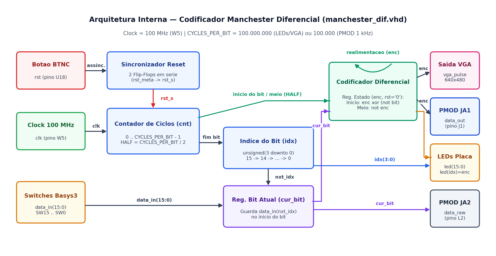
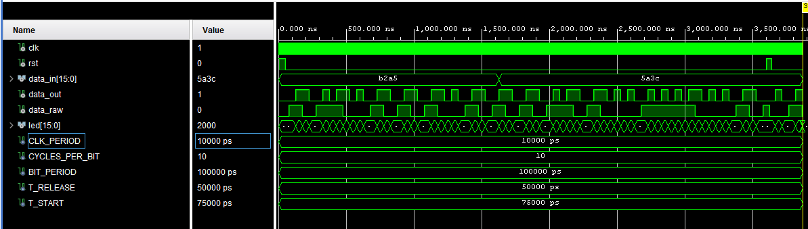
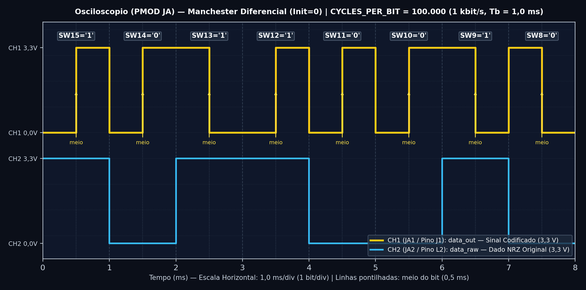

# Projeto 2 — Codificação Manchester Diferencial

Implementação completa em **VHDL** do codificador de linha **Manchester Diferencial (IEEE 802.5)**, incluindo simulação auto-verificável no **Vivado Simulator** e validação prática na placa **Digilent Basys 3** utilizando **LEDs** (1 Hz), **Osciloscópio Analog Discovery 3 via PMOD** e **Monitor VGA** (640×480 @ 60 Hz).

---

## 📐 Como Funciona o Manchester Diferencial?

Diferentemente do Manchester Clássico (que olha se a transição no meio do bit sobe ou desce), no **Manchester Diferencial** a transição no meio do bit serve **exclusivamente para manter o relógio sincronizado**. A informação (`'0'` ou `'1'`) é guardada na **fronteira de início de cada bit**, comparando com o nível em que terminou o bit anterior:

* **Estado Inicial após o Reset (`BTNC`):** O sinal começa padronizado em **Nível Baixo (`'0'`)**.
* **Para transmitir o bit `'0'`:**
  * **No INÍCIO do bit:** **INVERTE** o nível em relação ao final do bit anterior (`enc <= not enc`);
  * **No MEIO do bit:** **INVERTE** novamente (transição obrigatória de sincronismo).
* **Para transmitir o bit `'1'`:**
  * **No INÍCIO do bit:** **MANTÉM** o mesmo nível em que terminou o bit anterior (`enc <= enc`);
  * **No MEIO do bit:** **INVERTE** o nível (transição obrigatória de sincronismo).

| Bit no Switch (`SW`) | Fronteira de Início do Bit | Meio do Bit ($T_b/2$) | Expressão na 1ª Metade | Expressão na 2ª Metade |
| :---: | :---: | :---: | :---: | :---: |
| **`0`** (chave abaixada) | **Com transição (inverte)** | **Com transição (inverte)** | `enc <= enc xor (not cur_bit)` | `enc <= not enc` |
| **`1`** (chave levantada) | **Sem transição (mantém)** | **Com transição (inverte)** | `enc <= enc xor (not cur_bit)` | `enc <= not enc` |

> **Vantagem Principal:** Como o receptor só precisa detectar **se houve ou não mudança de nível no início do bit**, o Manchester Diferencial é **100% imune à inversão dos fios de transmissão**!

---

## 🧩 Arquitetura Interna do Circuito

Veja no diagrama abaixo como o arquivo [`src/manchester_dif.vhd`](./src/manchester_dif.vhd) possui um **elo de realimentação (memória de 1 bit no registrador `enc`)**, pois cada novo bit depende do nível final do bit anterior:



---

## 🧪 Resultados Obtidos

### 1. Simulação Comportamental no Vivado Simulator
Simulação com `CYCLES_PER_BIT = 10` (`100 ns` por bit) testando `0xB2A5`, troca dinâmica para `0x5A3C` e pulso de reset assíncrono:



### 2. Medição Real no Osciloscópio (Digilent Analog Discovery 3)
Captura obtida no software **WaveForms** medindo a saída da placa Basys 3, evidenciando os pulsos curtos (quando há inversão no início e no meio para bits `'0'`) e os pulsos duplos (quando o nível é mantido na fronteira de entrada de um bit `'1'`):



---

## 📂 Estrutura desta Pasta

```text
manchester_diferencial/
├── README.md                                  # Este guia do Projeto 2
├── src/
│   ├── manchester_dif.vhd                     # Núcleo codificador Manchester Diferencial
│   ├── manchester_dif_top.vhd                 # Topo para a placa Basys 3 (LEDs 1 Hz + PMOD 1 kHz + VGA)
│   └── vga_pulse.vhd                          # Controlador VGA 640x480 @ 60Hz
├── sim/
│   └── manchester_dif_tb.vhd                  # Testbench auto-verificável com assert
├── constraints/
│   └── manchester_dif.xdc                     # Pinagem física completa da Basys 3
├── vivado_project/
│   └── manchester_diferencial.xpr             # Projeto Vivado pronto para abrir
├── docs/
│   ├── documentacao_projeto.pdf               # Documentação técnica detalhada do circuito
│   ├── tutorial_simulacao.pdf                 # Tutorial passo a passo da simulação
│   ├── tutorial_placa.pdf                     # Tutorial passo a passo da gravação na placa
│   └── midia/                                 # Diagramas e capturas de tela
└── saidas/
    ├── pmod_osciloscopio/                     # Guia e arquivos da saída para osciloscópio (JA1/JA2)
    └── vga/                                   # Guia e arquivos da saída para monitor VGA
```

---

## 📚 Documentos em PDF deste Projeto

* 📘 [**Documentação Técnica (`docs/documentacao_projeto.pdf`)**](./docs/documentacao_projeto.pdf)
* 🧪 [**Tutorial de Simulação (`docs/tutorial_simulacao.pdf`)**](./docs/tutorial_simulacao.pdf)
* 🔌 [**Tutorial de Gravação na Placa (`docs/tutorial_placa.pdf`)**](./docs/tutorial_placa.pdf)
* 📈 [**Tutorial da Saída PMOD / Osciloscópio (`saidas/pmod_osciloscopio/docs/tutorial_pmod.pdf`)**](./saidas/pmod_osciloscopio/docs/tutorial_pmod.pdf)
* 🖥️ [**Tutorial da Saída VGA (`saidas/vga/docs/tutorial_vga.pdf`)**](./saidas/vga/docs/tutorial_vga.pdf)

---

## ➡️ Próximo Passo

Após explorar os dois projetos, acesse o [**Relatório Técnico Final Consolidado (`../relatorio_final/relatorio.pdf`)**](../relatorio_final/relatorio.pdf) para ver a análise comparativa completa entre **Manchester**, **Manchester Diferencial**, **NRZ-L** e **NRZ-I**.
