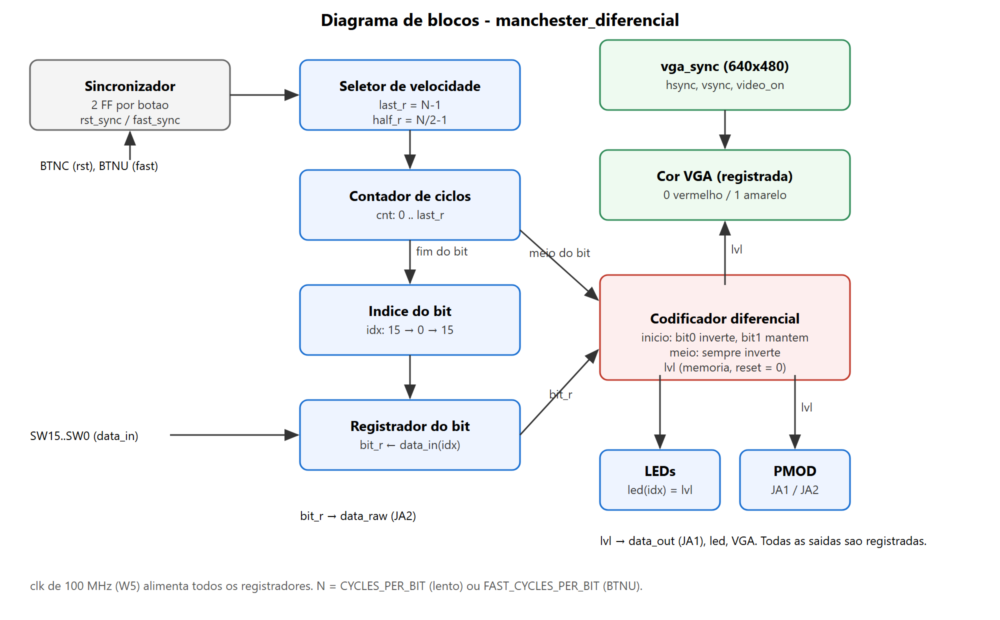

# Documentação técnica — Manchester Diferencial

**Faculdade Engenheiro Salvador Arena**  
Disciplina: Comunicação de Dados — Sistemas Reconfiguráveis  
Professor: Vinícius S. Borges  
Semestre 2026/2 — Grupo 1

| Integrante | RA |
|---|---|
| Eduardo Souza Urbanovicz Bastiani | 082230018 |
| João Vitor Maciel Nai | 082230004 |
| Ronaldo de Oliveira Santos | 082230031 |

## 1. Visão geral

O módulo `manchester_diferencial` recebe um vetor de 16 bits pela porta `data_in` (switches SW15..SW0) e transmite esses bits um de cada vez, do mais significativo (SW15) para o menos significativo (SW0). Após SW0, a transmissão recomeça automaticamente em SW15.

Cada bit é codificado em **Manchester Diferencial**: há **sempre uma inversão no meio do bit** (sincronismo); no **início** do bit, **bit 0 inverte o nível** e **bit 1 mantém o nível anterior**. Como a regra depende do último nível transmitido, o circuito o memoriza em um registrador. **O nível da saída após o reset é baixo.**

O mesmo nível registrado (`lvl`) alimenta simultaneamente:

- **LEDs:** só o LED acima do switch em transmissão mostra o sinal (aceso = alto); os demais ficam apagados;
- **PMOD JA1:** sinal codificado (`data_out`); **PMOD JA2:** dado original NRZ (`data_raw`);
- **VGA:** tela inteira **vermelha** em nível 0 e **amarela** em nível 1.

A duração do bit é de 1 s no modo normal. Enquanto o botão **BTNU** está pressionado, a duração passa a 100 µs (modo rápido, para o osciloscópio). O botão **BTNC** é o reset. O projeto tem a própria cópia do controlador VGA e não depende do projeto Manchester.

## 2. Diagrama de blocos

*Figura 1 — Diagrama de blocos do módulo manchester_diferencial.*

O clock de 100 MHz alimenta todos os registradores. Os botões passam por dois flip-flops (sincronizador). O seletor de velocidade define `last_r` e `half_r`; o contador `cnt` detecta o fim e o meio do bit; `idx` seleciona o switch; `bit_r` retém o valor do bit durante todo o intervalo; o codificador lê e atualiza `lvl` (que também é a memória do último nível), que segue para LEDs, PMOD e VGA. O controlador `vga_sync` é um ramo paralelo que fornece os sincronismos e a indicação de região visível.

## 3. Interface (entradas e saídas)

| Porta | Direção / tipo | Função | Pino |
|---|---|---|---|
| `clk` | in `std_logic` | Clock de 100 MHz | W5 |
| `rst` | in `std_logic` | Reset, botão BTNC, ativo alto, sincronizado internamente | U18 |
| `fast` | in `std_logic` (padrão `'0'`) | BTNU: `0` = lento (1 s/bit), `1` = rápido (100 µs/bit) | T18 |
| `data_in` | in `std_logic_vector(15 downto 0)` | Sequência de bits, SW15..SW0 (para cima = 1) | seção 7 |
| `data_out` | out `std_logic` | Sinal codificado, registrado | JA1 (J1) |
| `data_raw` | out `std_logic` | Bit em transmissão (referência NRZ), registrado | JA2 (L2) |
| `led` | out `std_logic_vector(15 downto 0)` | Nível codificado só na posição `idx`; demais em zero | seção 7 |
| `vgaRed`, `vgaGreen`, `vgaBlue` | out `std_logic_vector(3 downto 0)` | Cor da tela (4 bits por componente) | seção 7 |
| `Hsync`, `Vsync` | out `std_logic` | Sincronismos VGA, ativos em nível baixo | P19, R19 |

O componente `vga_sync` tem a entrada `clk` e as saídas `hsync`, `vsync` e `video_on` (`'1'` dentro da área visível).

## 4. Parâmetros e temporização

| Parâmetro | Valor padrão | Significado |
|---|---|---|
| `CYCLES_PER_BIT` (generic) | 100.000.000 | Ciclos por bit no modo lento: 1 s por bit, 0,5 s por metade |
| `FAST_CYCLES_PER_BIT` (generic) | 10.000 | Ciclos por bit no modo rápido: 100 µs por bit (10 kbit/s) |
| `MAX_CYCLES` (constante) | maior dos dois generics | Limite do contador |
| `COLOR_LOW` (constante) | `x"F00"` (vermelho) | Cor da tela em nível 0 (formato `x"RGB"`) |
| `COLOR_HIGH` (constante) | `x"FF0"` (amarelo) | Cor da tela em nível 1 |
| `CLK_PERIOD` (testbench) | 10 ns | Período do clock simulado |
| `TB_CYCLES_PER_BIT` (testbench) | 2 | Valor passado ao generic na simulação |
| `BIT_PERIOD` (testbench) | 20 ns | `TB_CYCLES_PER_BIT × CLK_PERIOD` |

Os dois generics devem ser **pares e ≥ 2**, para que as duas metades tenham exatamente a mesma duração; a condição é verificada por `assert ... severity failure`. Valem as relações `Tbit = N / 100 MHz`, `Tmetade = Tbit / 2` e `Rbit = 1 / Tbit`. Um quadro completo (16 bits) dura 16 s no modo lento e 1,6 ms no rápido. No testbench, o mesmo módulo é instanciado com `CYCLES_PER_BIT => 2` pelo `generic map`, sem alterar o código do circuito.

## 5. Funcionamento interno

Todo o circuito é síncrono: os registradores são atualizados na borda de subida do clock (a cada 10 ns), e o tempo é medido pela contagem de ciclos.

### 5.1 Sincronizador (`p_sync`)

`rst` e `fast` são assíncronos em relação ao clock. Cada um passa por dois flip-flops em série (`rst_meta → rst_sync`, `fast_meta → fast_sync`), marcados com o atributo `ASYNC_REG` para que o Vivado os posicione lado a lado. Não há *debounce*: a duração do bit (1 s) torna os repiques do botão irrelevantes para o reset.

### 5.2 Contador de ciclos e detecção do meio do bit

`cnt` conta de `0` até `last_r` e volta a `0`:

- `cnt = last_r` → fim do bit atual e **início** do próximo;
- `cnt = half_r` → o ciclo seguinte já pertence à **2ª metade** (meio do bit).

`last_r` (N − 1) e `half_r` (N/2 − 1) são **registradores com valores pré-calculados**. Uma versão anterior calculava `period − 1` e `period / 2 − 1` a cada ciclo; esse caminho combinacional ultrapassava 10 ns e gerava violação de timing. Com os valores registrados, a comparação é direta e o projeto fecha timing com folga de +2,239 ns.

### 5.3 Seleção de velocidade

No início de cada bit, `fast_sync` define se `last_r`/`half_r` recebem os valores do modo rápido ou do lento. Como a troca só ocorre no limite entre bits, nenhum bit fica com metades de durações diferentes; a nova velocidade entra no bit seguinte (até 1 s de espera).

### 5.4 Índice do bit e registrador do bit

`idx` decrementa a cada início de bit (15 → 14 → … → 0 → 15). No mesmo instante, `data_in(idx)` é copiado para `bit_r`. O codificador usa `bit_r`, não o switch, de modo que **alterar um switch no meio de um bit não modifica o bit em andamento**; a mudança vale na próxima vez que aquele bit for transmitido. Os switches não passam por sincronizador: a captura uma vez por bit garante a consistência lógica, mas não elimina metaestabilidade se o switch mudar exatamente na borda de captura. O `set_false_path` do XDC apenas retira esses caminhos da análise de timing.

### 5.5 Codificador Manchester Diferencial

O registrador `lvl` guarda o nível atual da saída e funciona como memória do último nível transmitido:

| Instante | bit = 0 | bit = 1 |
|---|---|---|
| Início do bit | `lvl ← NOT lvl` (transição) | `lvl ← lvl` (sem transição) |
| Meio do bit | `lvl ← NOT lvl` | `lvl ← NOT lvl` |

No reset, `lvl ← '0'` (nível baixo, exigido pelo enunciado). O nível **não** é reiniciado na passagem de SW0 para SW15: a sequência é contínua e o primeiro bit de cada quadro parte do nível final do quadro anterior. Ao contrário do Manchester, a saída depende do passado; por isso não há uma tabela-verdade de duas entradas, e sim uma máquina com um bit de estado.

Na placa, o novo LED ativo começa no mesmo estado em que o LED anterior terminou se o novo bit for 1, e no estado oposto se o novo bit for 0; dentro de cada posição, o LED sempre muda de estado no meio.

### 5.6 LEDs e saídas registradas

A cada ciclo, um vetor temporário é zerado e só a posição `idx` recebe o nível: `led(idx) = lvl`. O LED ativo percorre LD15 → LD0. `data_out`, `data_raw`, `led`, a cor VGA e os sincronismos saem diretamente de flip-flops, o que evita *glitches* que não aparecem nos LEDs mas apareceriam no osciloscópio.

### 5.7 VGA

`vga_sync` usa um *clock enable* a cada 4 ciclos (25 MHz), sem criar um novo clock. Horizontal: 640 visíveis + 16 + 96 (sync) + 48 = 800 pixels; vertical: 480 + 10 + 2 (sync) + 33 = 525 linhas. A taxa é 25 MHz / (800 × 525) ≈ **59,52 Hz**. No módulo principal, dentro da área visível a cor é `COLOR_HIGH` (amarelo) se `lvl = '1'` e `COLOR_LOW` (vermelho) se `lvl = '0'`; fora dela a cor é preta, como exige o padrão. O reset do codificador não reinicia o VGA, que mantém o sincronismo.

### 5.8 Reset e início da transmissão

Com `rst_sync = '1'`: `cnt ← N − 1`, `idx ← 0`, `bit_r`, `lvl` e `led_r ← 0`, e `last_r`/`half_r` voltam ao modo lento. Todas as saídas ficam em nível baixo e a tela, vermelha; o nível de referência do codificador volta a baixo. No primeiro ciclo após a liberação, o contador "termina" esse bit fictício, `idx` passa de 0 para 15 e começa a transmissão de SW15. Somando os dois estágios do sincronizador, SW15 começa 3 ciclos (30 ns) após soltar o BTNC.

## 6. Verificação (testbench)

`sim/manchester_diferencial_tb.vhd` usa os padrões `B2C5` (1011 0010 1100 0101) e `4D3A` (0100 1101 0011 1010) e verifica com `assert`:

1. reset ativo: `data_out`, `data_raw` e LEDs em zero;
2. 1º quadro com `B2C5`; no **meio do bit SW8** o vetor muda para `4D3A`: o bit corrente não pode mudar e os seguintes já usam o novo padrão;
3. 2º quadro: retorno cíclico a SW15;
4. reset no meio do bit SW12: saídas em zero e reinício em SW15 a partir do nível baixo.

Os dois padrões contêm bits iguais consecutivos (`00`, `11`) e alternados (`0101`), evidenciando os dois casos da regra de início. O testbench mantém um modelo de referência `prev_lvl` (zero após o reset, atualizado com o nível final de cada bit) e confere a **presença de transição no início de bits 0** e a **ausência de transição no início de bits 1**. O sinal `tb_prev_lvl` pode ser adicionado ao waveform.

Em cada bit também são conferidas as duas metades (a 1/4 e 3/4 do período, longe das bordas), a transição no meio, a posição e o nível do LED ativo e o `data_raw`. A entrada `fast` fica em `'0'` e as portas VGA ficam `open`: a troca de velocidade e o vídeo são verificados na placa, não automaticamente.

## 7. Mapeamento físico (Basys 3)

Todos os sinais usam **LVCMOS33**. Clock com `create_clock` de 10 ns.

| Bit | Switch | Pino | LED | Pino |
|-----|--------|------|-----|------|
| 15 | SW15 | R2 | LD15 | L1 |
| 14 | SW14 | T1 | LD14 | P1 |
| 13 | SW13 | U1 | LD13 | N3 |
| 12 | SW12 | W2 | LD12 | P3 |
| 11 | SW11 | R3 | LD11 | U3 |
| 10 | SW10 | T2 | LD10 | W3 |
| 9 | SW9 | T3 | LD9 | V3 |
| 8 | SW8 | V2 | LD8 | V13 |
| 7 | SW7 | W13 | LD7 | V14 |
| 6 | SW6 | W14 | LD6 | U14 |
| 5 | SW5 | V15 | LD5 | U15 |
| 4 | SW4 | W15 | LD4 | W18 |
| 3 | SW3 | W17 | LD3 | V19 |
| 2 | SW2 | W16 | LD2 | U19 |
| 1 | SW1 | V16 | LD1 | E19 |
| 0 | SW0 | V17 | LD0 | U16 |

| Sinal | Pino(s) FPGA | Observação |
|---|---|---|
| `clk` | W5 | Oscilador de 100 MHz |
| `rst` | U18 | BTNC |
| `fast` | T18 | BTNU |
| `data_out` | J1 | PMOD JA1 |
| `data_raw` | L2 | PMOD JA2 |
| GND | — | JA5 / JA11 (não é porta VHDL) |
| `vgaRed[0..3]` | G19, H19, J19, N19 | |
| `vgaGreen[0..3]` | J17, H17, G17, D17 | |
| `vgaBlue[0..3]` | N18, L18, K18, J18 | |
| `Hsync` / `Vsync` | P19 / R19 | |

## 8. Resultados de implementação

Dados extraídos dos relatórios de implementação do Vivado (*Report Timing Summary* e *Report Utilization*, gerados em `vivado_project/Manchester_diferencial.runs/impl_1/` ao executar a implementação):

| Item | Valor |
|---|---|
| WNS (setup) | +2,239 ns — *All user specified timing constraints are met* |
| WHS (hold) | +0,122 ns |
| Slice LUTs | 86 de 20.800 (0,41%) |
| Slice Registers | 93 de 41.600 (0,22%) |

## 9. Dependências e ambiente

| Item | Detalhe |
|---|---|
| Vivado | AMD Vivado 2026.1 (síntese, implementação e XSim) |
| Sistema operacional | Windows 11 |
| Placa | Digilent Basys 3, `xc7a35tcpg236-1` |
| Biblioteca VHDL | `IEEE.STD_LOGIC_1164` |
| Arquivos | `src/manchester_diferencial.vhd` (top), `src/vga_sync.vhd`, `sim/manchester_diferencial_tb.vhd`, `constraints/manchester_diferencial.xdc` |

O display de sete segmentos, sugestão opcional do enunciado, não é utilizado.

## Referências

[1] BORGES, Vinícius. *Enunciado: Trabalho Prático — Codificação de Linha Manchester em VHDL (Vivado)*. Material fornecido, 8 p.

[2] BORGES, Vinícius. *Guia de Documentação do Trabalho*. Material fornecido, 11 p.

[3] BORGES, Vinícius. *Guia de Entrega via GitHub*. Material fornecido, 5 p.

[4] DIGILENT. *Basys-3-Master.xdc*. Disponível em: https://github.com/Digilent/digilent-xdc .

[5] DIGILENT. *Basys 3 Reference Manual*. Disponível em: https://digilent.com/reference/programmable-logic/basys-3/reference-manual .
