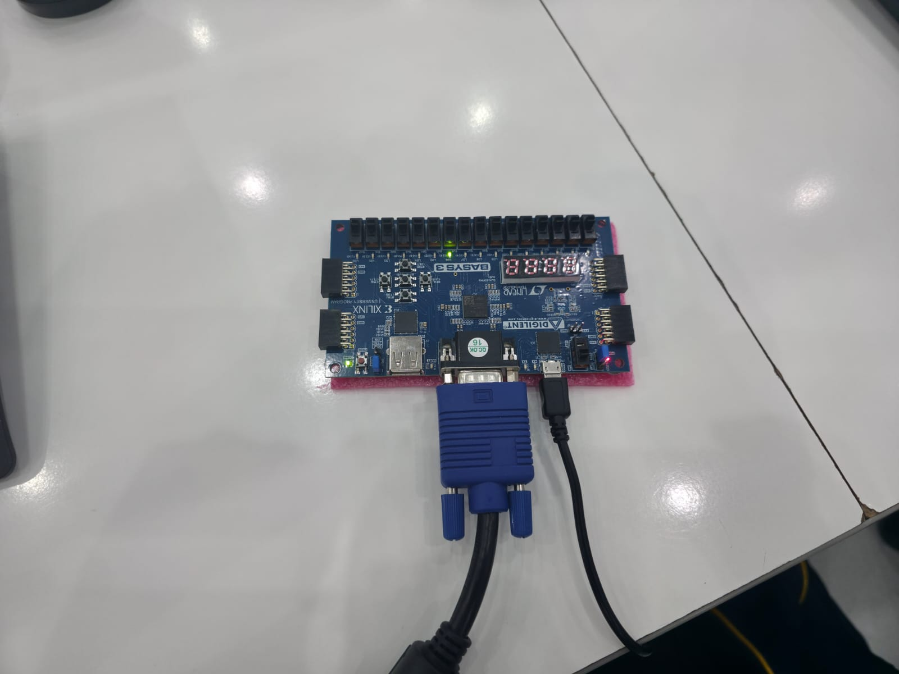
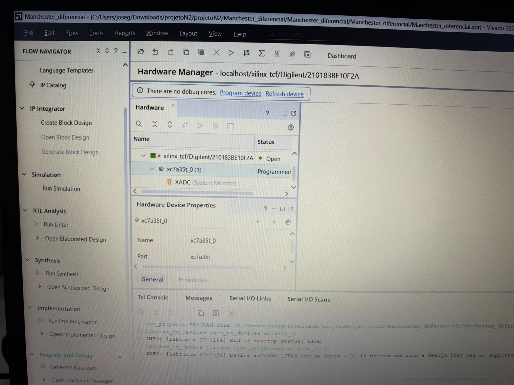
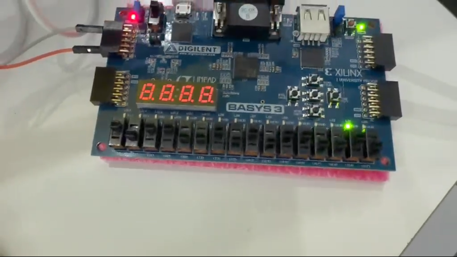
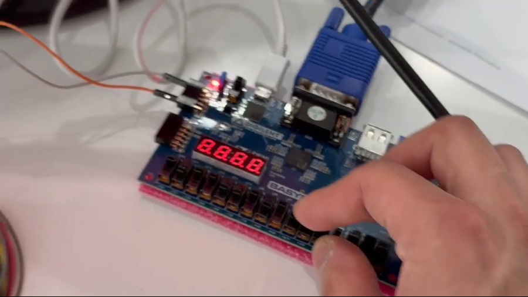

# Tutorial de gravação na placa — Manchester Diferencial

**Faculdade Engenheiro Salvador Arena**  
Disciplina: Comunicação de Dados — Sistemas Reconfiguráveis  
Professor: Vinícius S. Borges  
Semestre 2026/2 — Grupo 1

| Integrante | RA |
|---|---|
| Eduardo Souza Urbanovicz Bastiani | 082230018 |
| João Vitor Maciel Nai | 082230004 |
| Ronaldo de Oliveira Santos | 082230031 |

Este passo a passo mostra como gerar o *bitstream*, gravá-lo na Basys 3 e testar o funcionamento com switches, LEDs e botões.

## 1. Pré-requisitos

| Item | Detalhe |
|---|---|
| Placa | Digilent **Basys 3** (Artix-7 `xc7a35tcpg236-1`) |
| Cabo | **Micro-USB de dados** (alimenta e programa a placa) |
| Software | AMD Vivado 2026.1 |
| Drivers | Instalados com o Vivado (*Install Cable Drivers*) |
| Projeto | `manchester_diferencial/vivado_project/Manchester_diferencial.xpr`, já simulado ([tutorial de simulação](../tutorial_simulacao/tutorial_simulacao.md)) |

Confira que o top é `manchester_diferencial`, que só `constraints/manchester_diferencial.xdc` está ativo e que os generics físicos estão preservados: `CYCLES_PER_BIT = 100_000_000` e `FAST_CYCLES_PER_BIT = 10_000`.

## 2. Síntese (Run Synthesis)

A síntese traduz o VHDL em portas lógicas e flip-flops.

1. No *Flow Navigator*, clique em **Run Synthesis** → OK.
2. Aguarde o fim ("synth_design Complete" no canto superior direito).
3. Não avance se houver erros de elaboração, entidades ausentes ou portas incompatíveis (aba *Messages*).

## 3. Implementação (Run Implementation)

A implementação decide onde cada parte do circuito fica dentro do chip e como as partes se ligam.

1. Clique em **Run Implementation** → OK.
2. Ao terminar, abra **Open Implemented Design → Report Timing Summary**.
3. Confira: **WNS positivo** e a frase *All user specified timing constraints are met*. Neste projeto: **WNS = +2,239 ns**, WHS = +0,122 ns, 86 LUTs e 93 flip-flops.

## 4. Geração do bitstream (Generate Bitstream)

1. Clique em **Generate Bitstream** → OK.
2. Ao aparecer *Bitstream Generation successfully completed*, escolha **Open Hardware Manager** → OK.

O arquivo fica em `vivado_project/Manchester_diferencial.runs/impl_1/manchester_diferencial.bit` após a geração. Essa pasta é recriada pelo Vivado a cada execução e não é versionada no repositório (ver `.gitignore`). Ao alternar entre os dois projetos, confira que o `.bit` pertence ao projeto atual.

## 5. Conectar a placa

1. Com a chave **POWER** em OFF, ligue o cabo micro-USB no conector **PROG/UART** da placa e no computador.
2. Coloque a chave **POWER** em ON: o LED vermelho de alimentação acende.
3. Se for usar a VGA, ligue também o cabo VGA (seção [Saída VGA](../../saidas/vga/README.md)).



*Figura 1 — Basys 3 com o cabo micro-USB e o cabo VGA conectados (montagem de bancada usada nos dois projetos).*

## 6. Programar a placa (Program Device)

1. No Hardware Manager, clique em **Open Target → Auto Connect**. O dispositivo **`xc7a35t_0`** aparece na lista *Hardware*.
2. Clique em **Program Device → xc7a35t_0**.
3. Em *Bitstream file*, selecione `manchester_diferencial.bit`. Deixe *Debug probes file* vazio.
4. Clique em **Program**. Ao terminar, o status passa a **Programmed** e o LED verde **DONE** da placa acende.



*Figura 2 — Hardware Manager do projeto `Manchester_diferencial`: dispositivo `xc7a35t_0` com status **Programmed** e, no Tcl Console, `End of startup status: HIGH`.*

A gravação por JTAG fica na memória volátil da FPGA: ao desligar a placa, é preciso gravar novamente. Não use o botão PROG como start; o reset do circuito é o **BTNC**.

## 7. Mapeamento de uso na placa

```
 LD15 LD14 LD13 LD12 LD11 LD10 LD9 LD8 LD7 LD6 LD5 LD4 LD3 LD2 LD1 LD0   <- LEDs (sinal codificado)
 SW15 SW14 SW13 SW12 SW11 SW10 SW9 SW8 SW7 SW6 SW5 SW4 SW3 SW2 SW1 SW0   <- switches (bits)
 ------------- ordem de transmissão: da esquerda para a direita ------------->

                 [BTNU]  = modo rápido (enquanto pressionado)
          [BTNL] [BTNC] [BTNR]      BTNC = reset
                 [BTND]
```

| Elemento | Função |
|---|---|
| **SW15 … SW0** | Bits da mensagem. Para cima = 1. SW15 é transmitido primeiro. |
| **LD15 … LD0** | Só o LED **acima do switch em transmissão** fica ativo: aceso = nível alto, apagado = nível baixo. Os outros ficam apagados. |
| **BTNC** (U18) | Reset. Pressionado: transmissão parada, LEDs apagados. Ao soltar: recomeça em SW15. |
| **BTNU** (T18) | Modo rápido (100 µs por bit) enquanto pressionado; solto, 1 s por bit. |
| **JA1 / JA2** | Sinal codificado / dado original ([saída PMOD](../../saidas/pmod_osciloscopio/README.md)). |
| **VGA** | Tela vermelha (0) / amarela (1) ([saída VGA](../../saidas/vga/README.md)). |

**Como ler o LED ativo:** no modo lento, cada bit dura 1 s, 0,5 s por metade. No Manchester Diferencial:

- o LED ativo **sempre muda de estado no meio** do bit;
- na passagem para a posição seguinte, o novo LED **começa no mesmo estado** em que o anterior terminou se o novo bit for **1**, e **no estado oposto** se o novo bit for **0**;
- após o reset, o nível de referência é **baixo**.

Exemplo com SW15 = 1 e SW14 = 0, logo após o reset:

| Momento | LD15 | LD14 | LD13 a LD0 |
|---|---|---|---|
| Bit de SW15 (1), 1ª metade | apagado (mantém o nível baixo do reset) | apagado | apagados |
| Bit de SW15 (1), 2ª metade | **aceso** (inverte no meio) | apagado | apagados |
| Bit de SW14 (0), 1ª metade | apagado | apagado (inverte no início: alto → baixo) | apagados |
| Bit de SW14 (0), 2ª metade | apagado | **aceso** (inverte no meio) | apagados |



*Figura 3 — Projeto diferencial em funcionamento: um único LED aceso, na posição do bit em transmissão (quadro do vídeo `diferencial_video_01.mp4`).*

## 8. Como testar

Após cada mudança de padrão, aperte e solte o **BTNC** para recomeçar em LD15 (opcional, mas facilita acompanhar). Mantenha o **BTNU solto**.

| Teste | Switches (SW15 → SW0) | O que se espera em cada LED ativo |
|---|---|---|
| Todos 0 | `0000 0000 0000 0000` | Toda posição tem transição no início e no meio: o LED ativo inverte duas vezes por bit (cada novo LED começa oposto ao anterior) |
| Todos 1 | `1111 1111 1111 1111` | Só há transição no meio: cada novo LED começa no mesmo estado em que o anterior terminou |
| Alternados | `1010 1010 1010 1010` | Alterna os dois casos acima a cada posição |
| Enunciado | `1011 0010 1011 0010` | Bits 0 invertem no início e bits 1 mantêm; todos invertem no meio |
| Reset | qualquer | Segurando BTNC: tudo apagado. Soltando: recomeça em LD15 |
| Troca sem regravar | mude um switch durante a transmissão | A mudança só aparece na próxima vez que aquele bit for transmitido |
| Velocidade | segure BTNU | LEDs parecem acesos ao mesmo tempo (persistência visual); confira no osciloscópio |

Ao pressionar o **BTNC**, todos os LEDs se apagam; ao soltar, a transmissão recomeça em SW15 a partir do nível baixo.



*Figura 4 — Alteração dos switches durante a transmissão, sem regravar a placa (quadro do vídeo `diferencial_video_01.mp4`).*

Vídeos de referência: ver [relatorio_final/README.md](../../../relatorio_final/README.md).

## 9. Diagnóstico

| Sintoma | O que conferir |
|---|---|
| Nada acende | BTNC solto, top correto, `.bit` correto, LED DONE aceso |
| Vários LEDs parecem acesos | BTNU deve estar solto (modo lento); aguarde o fim do bit |
| Placa não aparece no Hardware Manager | Chave POWER, cabo de dados (não só de carga), drivers |
| Velocidade não muda na hora | Esperado: a troca entra no início do próximo bit (até 1 s) |

Com a placa funcionando, siga para as saídas [PMOD (osciloscópio)](../../saidas/pmod_osciloscopio/README.md) e [VGA](../../saidas/vga/README.md).
