# Tutorial de criação e simulação — Manchester Diferencial

**Faculdade Engenheiro Salvador Arena**  
Disciplina: Comunicação de Dados — Sistemas Reconfiguráveis  
Professor: Vinicius Borges  
7º Semestre — Grupo 3

| Integrante | RA | GitHub |
|---|---|---|
| Emanuel Carneiro da Silva | 082230017 | https://github.com/emanuel71silva |
| José Gabriel de Morais Souza | 082230001 | https://github.com/Gabriieu |
| Lucas Daiki Honda Kuniyosi | 082230020 | https://github.com/LucasKuniyosi |

## 1. Objetivo e ambiente

Crie um projeto independente, defina os tops de implementação e simulação e verifique a codificação no Vivado Simulator.

| Item | Ambiente registrado |
|---|---|
| Vivado | 2025.2, 64 bits |
| Sistema operacional | Windows 11 Education, versão 25H2 |
| Compilação do Windows | 26200.9711 |
| FPGA | xc7a35tcpg236-1, Basys 3 |
| Top de implementação | manchester_dif |
| Top de simulação | manchester_dif_tb |

As imagens foram fornecidas pelo grupo. Telas genéricas do assistente podem ser usadas nos dois projetos; quando uma tela mostra nomes do outro projeto, isso é indicado na legenda. Os caminhos locais e o nome project_2 vistos nos prints são exemplos da máquina utilizada, não nomes obrigatórios.

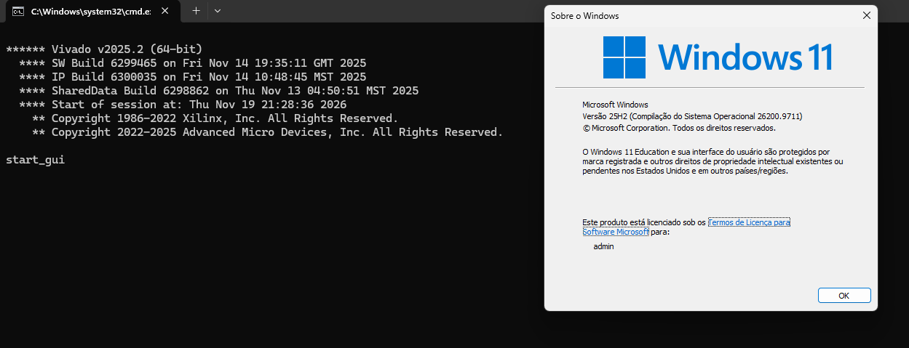

*Figura 1 — Vivado 2025.2 e Windows 11 utilizados.*

## 2. Abrir o assistente

Se `vivado_project/manchester_dif.xpr` já estiver disponível, escolha **Open Project** na tela inicial do Vivado, abra o arquivo e avance à etapa 19. Para gerar o .xpr com as fontes já organizadas, abra o Tcl Console, entre em `vivado_project/` e execute `source criar_projeto.tcl`. O [README do projeto Vivado](../vivado_project/README.md) inclui o comando em modo batch.

Para criar o projeto manualmente, clique em **Create Project** como na figura.

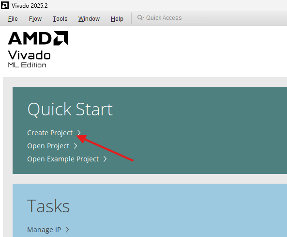

*Figura 2 — Abrir o assistente.*

## 3. Avançar na apresentação

Na tela Create a New Vivado Project, clique em **Next**.

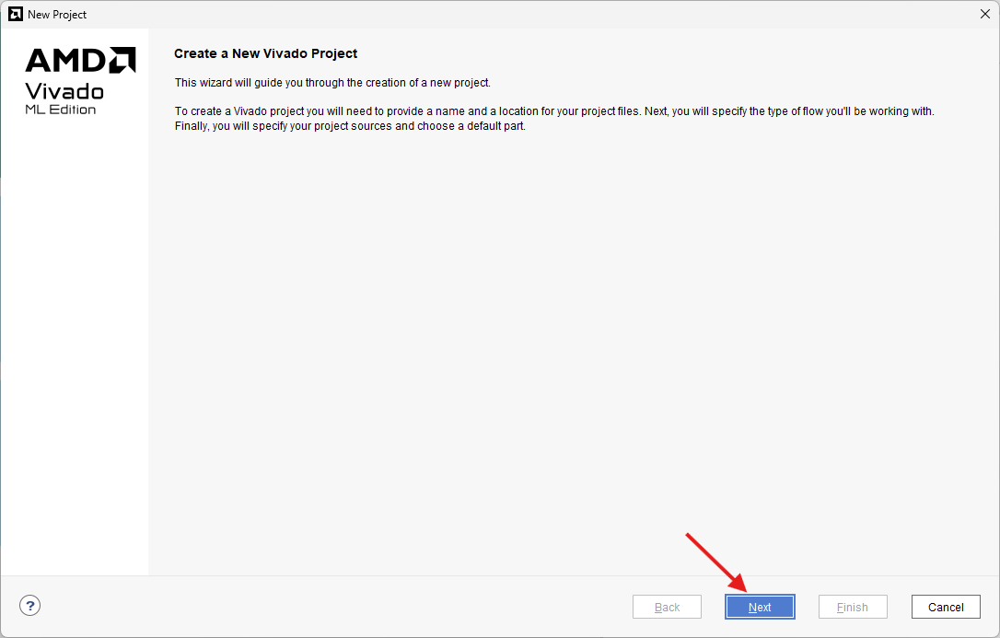

*Figura 3 — Avançar na apresentação.*

## 4. Definir nome e pasta

Informe **manchester_dif** como nome e escolha uma pasta persistente dentro de vivado_project/. O print usa project_2. Com **Create project subdirectory** marcado, o Vivado cria mais uma subpasta; ajuste o caminho para não duplicar pastas sem necessidade.

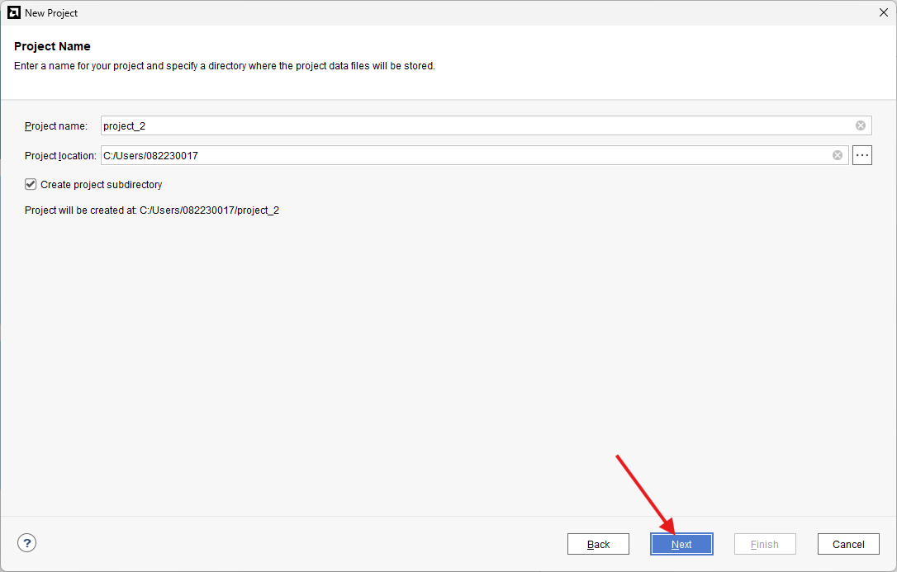

*Figura 4 — Definir nome e pasta.*

## 5. Selecionar RTL Project

Selecione **RTL Project** e marque **Do not specify sources at this time**, como no print. As fontes serão adicionadas após concluir o assistente. Clique em Next.

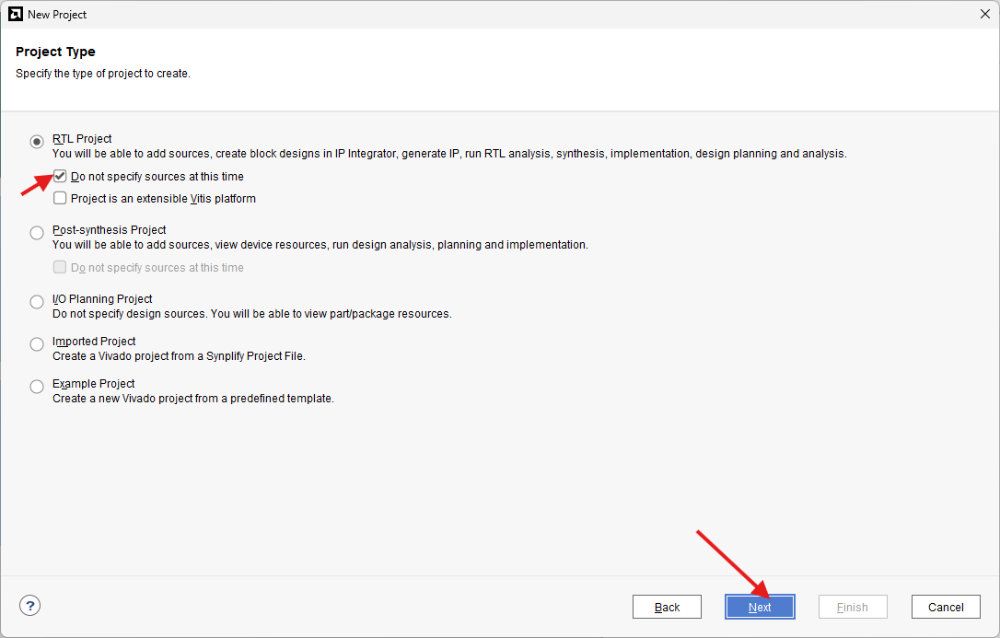

*Figura 5 — Selecionar RTL Project.*

## 6. Escolher o FPGA

Na aba Parts, pesquise **xc7a35tcpg236-1**, selecione o componente e clique em Next. Não selecione apenas uma família semelhante.

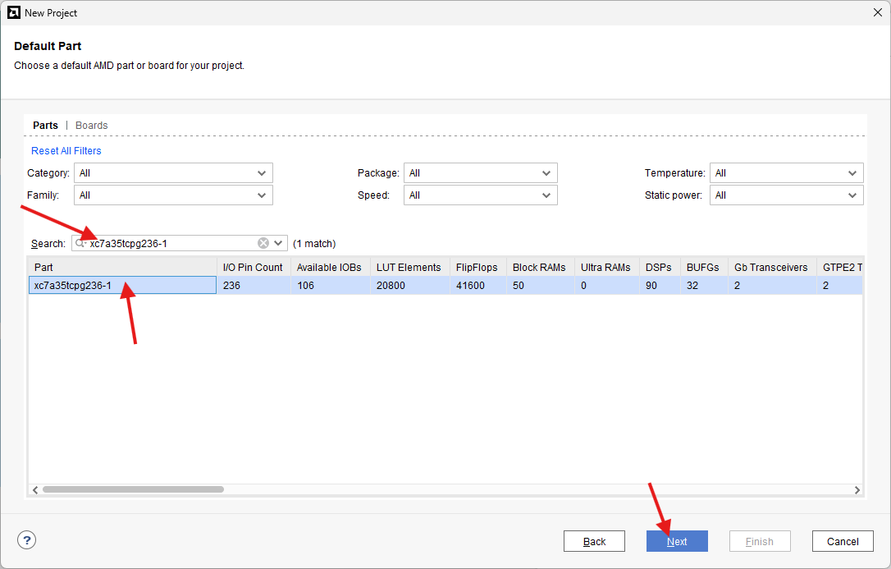

*Figura 6 — Escolher o FPGA.*

## 7. Conferir o resumo

Confirme Artix-7, encapsulamento cpg236 e speed grade -1; conclua com **Finish**.

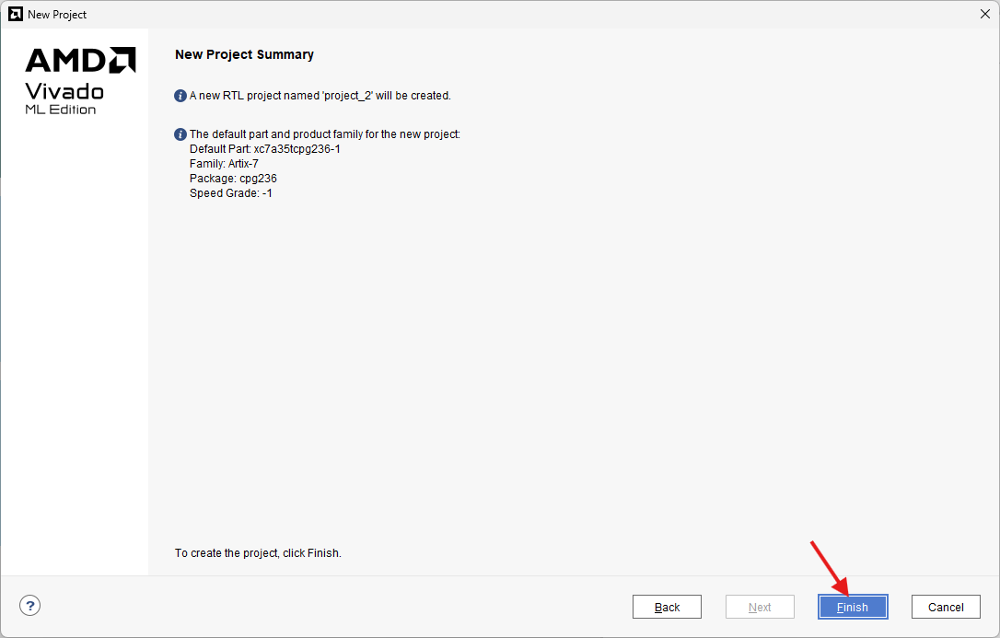

*Figura 7 — Conferir o resumo.*

## 8. Abrir Add Sources

Com o projeto aberto, clique em **Add Sources**, no painel Project Manager.

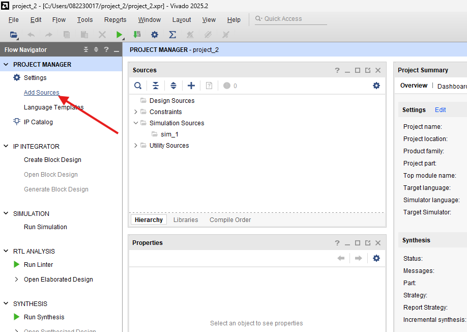

*Figura 8 — Abrir Add Sources.*

## 9. Selecionar fontes de implementação

Marque **Add or create design sources** e clique em Next.

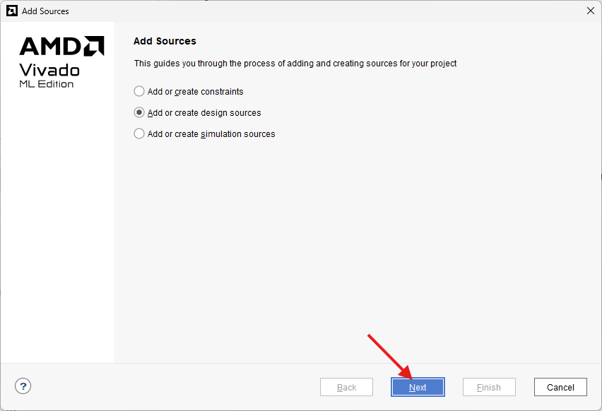

*Figura 9 — Selecionar fontes de implementação.*

## 10. Selecionar Add Files

Clique em **Add Files** para localizar os VHDLs.

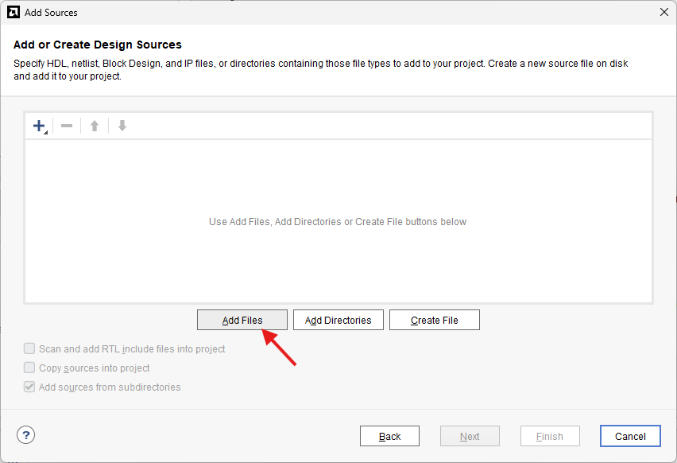

*Figura 10 — Selecionar Add Files.*

## 11. Escolher os dois VHDLs

Selecione somente **manchester_dif.vhd** e **vga_sync.vhd**. O arquivo **manchester_dif_tb.vhd** será adicionado como fonte de simulação em outra etapa. Os dois VHDLs de implementação atendem LEDs, PMOD e VGA simultaneamente.

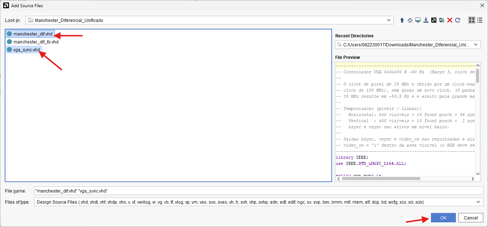

*Figura 11 — Escolher os dois VHDLs.*

## 12. Concluir as fontes

Após confirmar a seleção e conferir os arquivos, clique em **Finish**. A captura mostra a posição do botão, não comprova por si só que a lista foi preenchida. Mantendo **Copy sources into project** desmarcado, os VHDLs devem permanecer no caminho referenciado; não apague a pasta de origem.

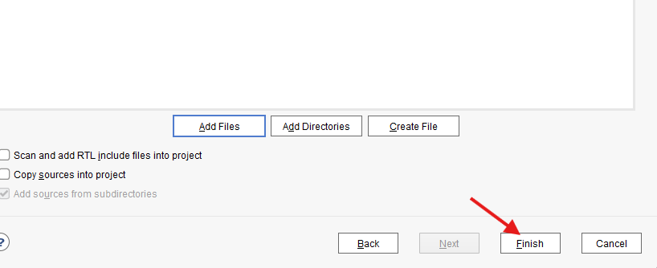

*Figura 12 — Concluir as fontes.*

## 13. Adicionar constraints

Abra Add Sources novamente, selecione **Add or create constraints** e avance.

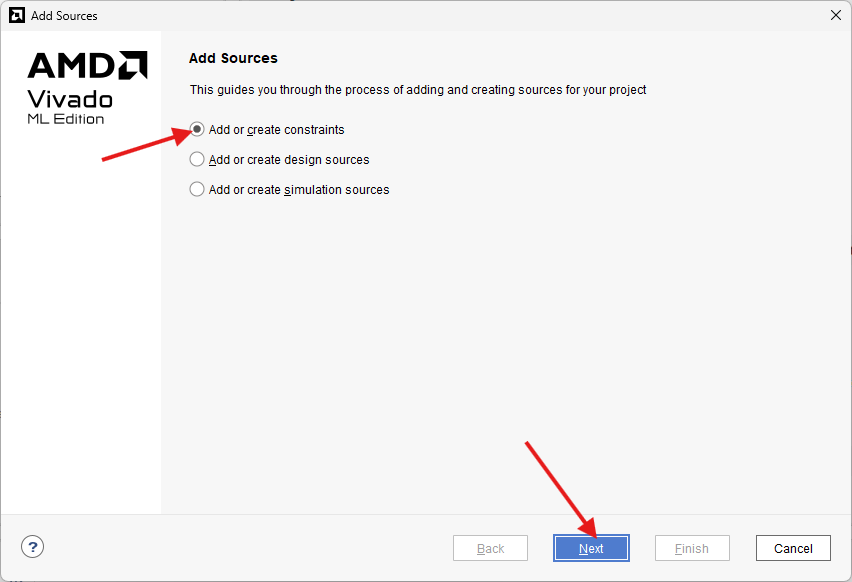

*Figura 13 — Adicionar constraints.*

## 14. Localizar o XDC

Mantenha constrs_1 como conjunto ativo e clique em **Add Files**.

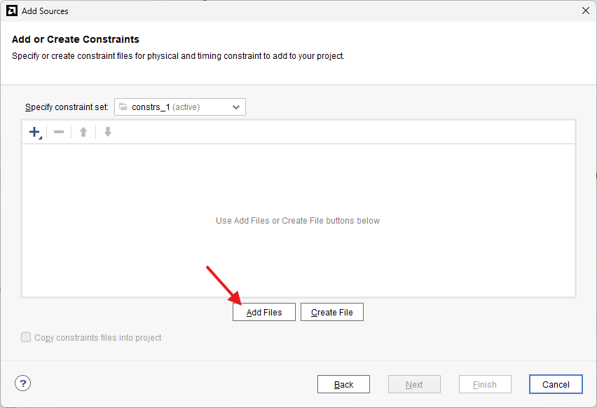

*Figura 14 — Localizar o XDC.*

## 15. Escolher o XDC

Adicione somente **manchester_dif.xdc** e finalize. Não misture constraints de Manchester com as do diferencial e não acrescente os antigos XDCs específicos de VGA/PMOD. A imagem abaixo mostra manchester.xdc, do outro projeto; para este projeto escolha manchester_dif.xdc. 

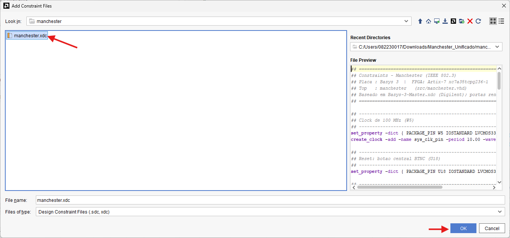

*Figura 15 — Escolher o XDC. Exemplo da interface com arquivos Manchester; substituir pelos nomes diferenciais indicados no texto.*

## 16. Adicionar o testbench

Abra Add Sources, selecione **Add or create simulation sources** e clique em Next.

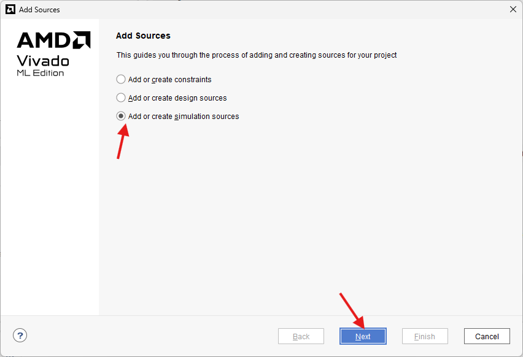

*Figura 16 — Adicionar o testbench.*

## 17. Selecionar o arquivo de simulação

Mantenha sim_1 e clique em **Add Files**.

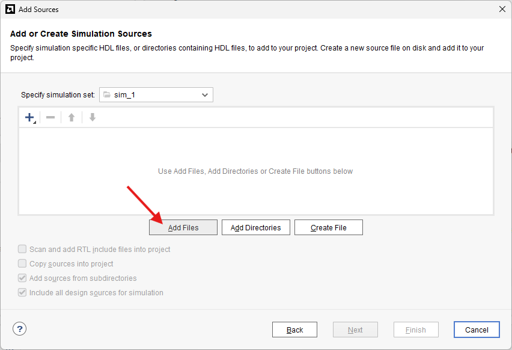

*Figura 17 — Selecionar o arquivo de simulação.*

## 18. Escolher o testbench

Adicione **manchester_dif_tb.vhd** e clique em Finish. A imagem mostra manchester_tb.vhd como exemplo da operação; o nome correto aqui é manchester_dif_tb.vhd. 

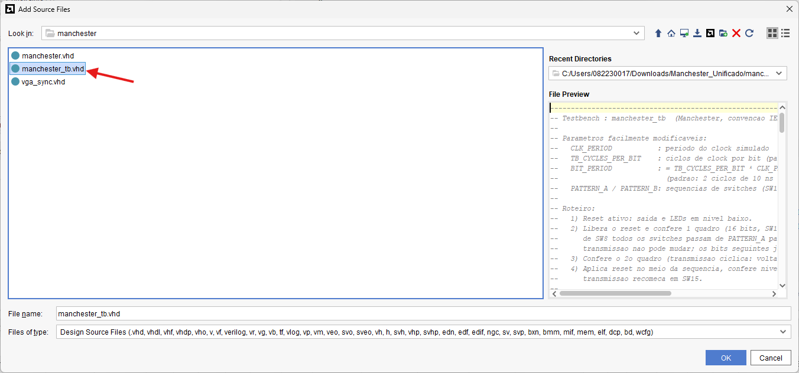

*Figura 18 — Escolher o testbench. Exemplo da interface com arquivos Manchester; substituir pelos nomes diferenciais indicados no texto.*

## 19. Conferir a hierarquia e os tops

Em Design Sources, o top deve ser **manchester_dif**, com **u_vga: vga_sync** abaixo dele. Em Simulation Sources, o top deve ser **manchester_dif_tb**, com a instância **dut: manchester_dif**. Use o botão direito e **Set as Top** se necessário. O testbench nunca deve ser top de síntese.

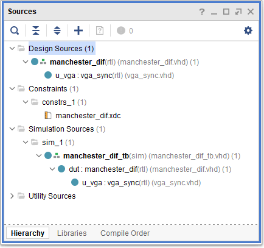

*Figura 19 — Hierarquia real do projeto manchester_diferencial.*

## 20. Conferir os parâmetros

O testbench fornecido declara CLK_PERIOD = 10 ns, TB_CYCLES_PER_BIT = 2 e BIT_PERIOD = 20 ns. A relação é **BIT_PERIOD = TB_CYCLES_PER_BIT × CLK_PERIOD**. Cada metade dura 10 ns. O generic map altera apenas a instância simulada; não é necessário reduzir o generic físico para simular.

Os padrões são B2C5 (1011 0010 1100 0101) e 4D3A (0100 1101 0011 1010). O testbench altera o vetor durante SW8 e verifica a estabilidade do bit em curso. A entrada fast fica em 0; VGA e mudança de velocidade não são verificadas automaticamente por esse testbench.

## 21. Iniciar a simulação

Abra **Run Simulation > Run Behavioral Simulation**. Aguarde compilação e elaboração. Caso apareçam erros, confira fontes, top e biblioteca work antes de continuar.

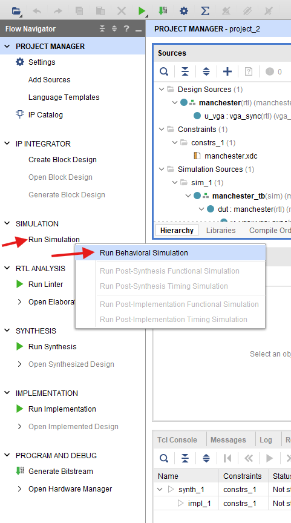

*Figura 20 — Comando Run Behavioral Simulation; tela capturada no projeto Manchester. O comando é o mesmo no diferencial.*

## 22. Executar até o final e organizar os sinais

Execute **Run All**; alternativamente, na Tcl Console da simulação, use `run all`. O testbench encerra a geração de clock quando sim_done fica verdadeiro. Um avanço inicial de 1000 ns pode terminar antes do fim dos testes: não o confunda com conclusão.

Na janela Scope, selecione dut e adicione **idx, bit_r, cnt, period_r e lvl** por Add to Wave Window. Acrescente também **clk, rst, data_in, data_raw, data_out, led, tb_bit_idx e tb_bit**. Reinicie e execute novamente para registrar os sinais adicionados. Mostre idx em decimal e os vetores em binário ou hexadecimal. Salve a configuração de waveform.

Use Zoom Fit para visão geral e amplie dois a quatro bits para verificar as metades. A lista tb_bit_idx corresponde à referência do testbench; dut/idx comprova o índice interno do circuito.

## 23. Interpretar o diferencial

No início de um bit 0, o nível deve inverter em relação ao fim do bit anterior. No início de um bit 1, deve permanecer igual. No meio de qualquer bit, deve inverter. Após reset, o nível de referência é zero. Observe especialmente pares 00, 11, 01 e 10 e a passagem SW0→SW15, na qual o nível anterior não é reinicializado.

O grupo informou que o diferencial passou nos testes. A captura está identificada como manchester_dif_tb e mostra uma janela de 1000 ns, com clock de 10 ns e período de bit de 20 ns.

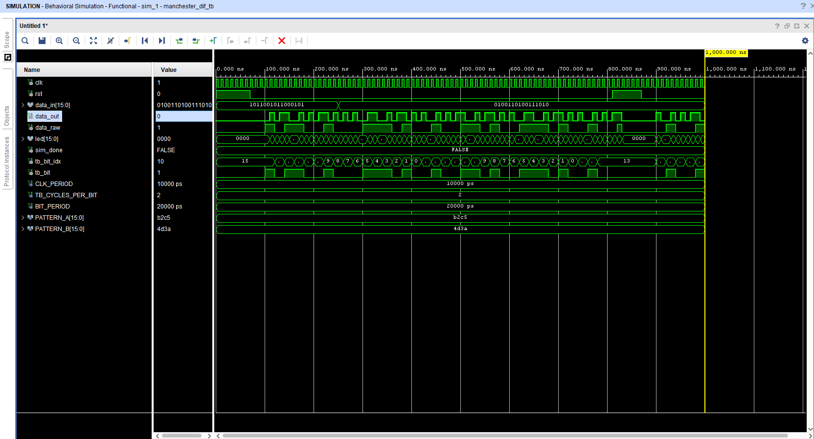

*Waveform do Manchester Diferencial, identificado pelo testbench manchester_dif_tb.*

## 24. Resultado e próximo passo

Ao fim do **Run All**, `sim_done` deve ficar verdadeiro e a Tcl Console deve mostrar **SIMULACAO CONCLUIDA: nenhum erro** para Manchester Diferencial. Registre a forma de onda e a mensagem final. A imagem disponível acima é a visualização inicial do waveform.

Siga o [tutorial de placa](tutorial_placa.pdf) para sintetizar, gerar o bitstream e programar a Basys 3.
