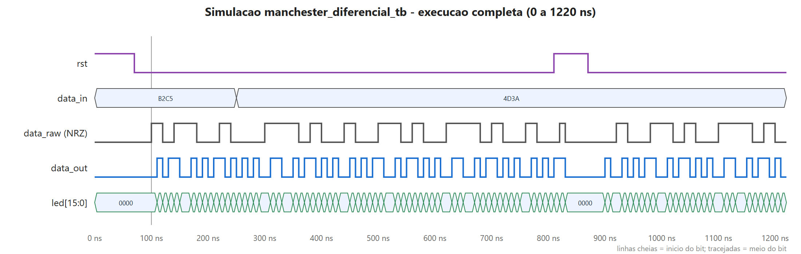
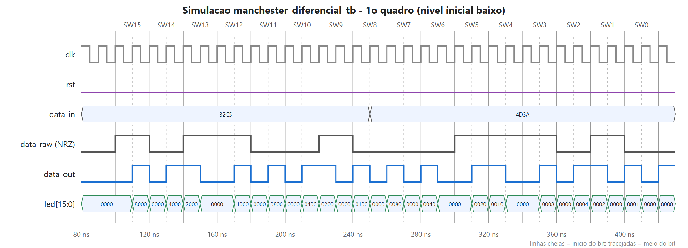

# Tutorial de simulação — Manchester Diferencial

**Faculdade Engenheiro Salvador Arena**  
Disciplina: Comunicação de Dados — Sistemas Reconfiguráveis  
Professor: Vinícius S. Borges  
Semestre 2026/2 — Grupo 1

| Integrante | RA |
|---|---|
| Eduardo Souza Urbanovicz Bastiani | 082230018 |
| João Vitor Maciel Nai | 082230004 |
| Ronaldo de Oliveira Santos | 082230031 |

Este passo a passo mostra como abrir o projeto, simular o codificador Manchester Diferencial no Vivado Simulator e conferir o resultado, sem precisar da placa.

## 1. Pré-requisitos

| Item | Detalhe |
|---|---|
| Vivado | AMD Vivado 2026.1, 64 bits (a edição gratuita atende) |
| Sistema operacional | Windows 11 |
| Arquivos | A pasta `manchester_diferencial/` completa (com `src/`, `sim/`, `constraints/` e `vivado_project/`) |
| Top de implementação | `manchester_diferencial` |
| Top de simulação | `manchester_diferencial_tb` |

Não é preciso ter a placa conectada para simular.

## 2. Abrir o projeto

1. Abra o Vivado.
2. Na tela inicial, clique em **Open Project**.
3. Navegue até `manchester_diferencial/vivado_project/` e abra **`Manchester_diferencial.xpr`**.

O projeto referencia os arquivos por caminho relativo (`../src/`, `../sim/`, `../constraints/`). Por isso, copie sempre a pasta `manchester_diferencial/` inteira; mover somente o `.xpr` quebra as referências.

### 2.1 Alternativa: criar o projeto do zero

1. **Create Project → Next**; nome `Manchester_diferencial`, pasta `manchester_diferencial/vivado_project/`.
2. **RTL Project**, marque *Do not specify sources at this time* → Next.
3. Em *Parts*, pesquise e selecione **`xc7a35tcpg236-1`** → Next → Finish.
4. **Add Sources → Add or create design sources → Add Files**: `src/manchester_diferencial.vhd` e `src/vga_sync.vhd`.
5. **Add Sources → Add or create constraints → Add Files**: `constraints/manchester_diferencial.xdc`.
6. **Add Sources → Add or create simulation sources → Add Files**: `sim/manchester_diferencial_tb.vhd`.

## 3. Estrutura dos arquivos no Vivado

Na aba **Sources** aparecem três grupos:

| Grupo | Conteúdo | Função |
|---|---|---|
| **Design Sources** | `manchester_diferencial` (**negrito** = top), com `u_vga : vga_sync` dentro | Circuito que vai para a placa |
| **Constraints** | `manchester_diferencial.xdc` | Mapeamento dos pinos |
| **Simulation Sources → sim_1** | `manchester_diferencial_tb` (**negrito**), com `dut : manchester_diferencial` dentro | Testbench, só existe na simulação |

Se algum arquivo aparecer com ícone vermelho de "arquivo não encontrado", confira se as pastas `src/`, `sim/` e `constraints/` estão ao lado de `vivado_project/`. O testbench nunca deve ser top de síntese.

## 4. Configurar a simulação

1. Confira se `manchester_diferencial_tb` está em negrito em *Simulation Sources → sim_1*. Se não estiver, clique com o botão direito → **Set as Top**.
2. **Tempo de simulação:** o padrão do Vivado é 1000 ns, mas o testbench termina em **1220 ns**. Use uma das opções:
   - **Settings → Simulation → aba Simulation** → altere `xsim.simulate.runtime` para **`2us`** → OK; ou
   - deixe o padrão e, após abrir a simulação, clique em **Run All** (ou digite `run all` no *Tcl Console*). O testbench para o clock sozinho quando termina.

Parâmetros no início de `sim/manchester_diferencial_tb.vhd`:

| Constante | Valor | Significado |
|---|---|---|
| `CLK_PERIOD` | 10 ns | Período do clock simulado (100 MHz, igual à placa) |
| `TB_CYCLES_PER_BIT` | 2 | Ciclos por bit, passados ao circuito pelo `generic map` |
| `BIT_PERIOD` | 20 ns | `TB_CYCLES_PER_BIT × CLK_PERIOD`; cada metade dura 10 ns |
| `PATTERN_A` | `x"B2C5"` = 1011 0010 1100 0101 | Padrão inicial dos switches |
| `PATTERN_B` | `x"4D3A"` = 0100 1101 0011 1010 | Padrão aplicado no meio do bit SW8 |

Os dois padrões têm bits iguais consecutivos (`00`, `11`) e alternados (`0101`), cobrindo os dois casos da regra de transição no início do bit, como pede o enunciado.

O `generic map` altera apenas a instância simulada; o código do circuito continua com 100.000.000 ciclos por bit para a placa.

## 5. Executar a simulação

1. No *Flow Navigator*, clique em **Run Simulation → Run Behavioral Simulation**.
2. Aguarde a compilação e a elaboração (alguns segundos).
3. Clique em **Run All** (▶ com barra) se não tiver ajustado o tempo no passo 4.

## 6. Conferir a mensagem no Tcl Console

Na aba **Tcl Console** deve aparecer:

```
Note: SIMULACAO CONCLUIDA: nenhum erro (Manchester Diferencial).
Time: 1220 ns  Iteration: 0  Process: /manchester_diferencial_tb/p_stim
```

Essa saída foi obtida executando o testbench no Vivado 2026.1; o registro completo está em [log_simulacao_xsim.txt](log_simulacao_xsim.txt). Em caso de falha, aparecem linhas como `ERRO em 245000 ps: SW12 (bit '1'): NAO deveria haver transicao no INICIO do bit`, indicando o instante e o bit com problema.

## 7. Visualizar o waveform

### 7.1 Adicionar os sinais

1. Na aba **Scope**, expanda `manchester_diferencial_tb` e clique em **`dut`**.
2. Na aba **Objects**, selecione `idx`, `bit_r`, `cnt` e `lvl` → botão direito → **Add to Wave Window**.
3. Clique em **Restart** (⏮) e depois em **Run All** para preencher os sinais adicionados.
4. Salve a configuração (**File → Save Waveform Configuration**) para não repetir o processo.

| Sinal | O que mostra |
|---|---|
| `clk` | Clock de 10 ns |
| `rst` | Reset (1 = pressionado) |
| `tb_bit_idx` / `dut/idx` | Índice do bit em transmissão (15 → 0) |
| `tb_bit` / `dut/bit_r` | Bit atual (valor do switch capturado) |
| `data_out` | Sinal codificado em Manchester Diferencial |
| `tb_prev_lvl` | Nível final do bit anterior (referência do testbench) |
| `data_raw` | Dado original (NRZ) |
| `led[15:0]` | Vetor dos LEDs |

Dica: botão direito em `tb_bit_idx` → **Radix → Unsigned Decimal**; em `data_in` e `led` → **Radix → Hexadecimal**.

### 7.2 Ajustar a escala de tempo

- **Zoom Fit**: mostra a simulação inteira (0 a 1220 ns).
- **Ctrl + roda do mouse**: aproxima ou afasta.
- Para ver o 1º quadro, aproxime a região de **100 ns a 420 ns** (16 bits de 20 ns).

### 7.3 Visão geral



*Figura 1 — Execução completa do testbench (0 a 1220 ns), gerada a partir do VCD exportado pelo XSim.*

Na visão geral aparecem o reset inicial, a troca `B2C5 → 4D3A`, os dois quadros, o segundo pulso de reset (810 a 870 ns), após o qual a transmissão recomeça do nível baixo; durante o pulso, `data_out` e `led` ficam em zero, e o reinício da transmissão.

## 8. Como ler a forma de onda e resultado esperado



*Figura 2 — Primeiro quadro (100 a 420 ns). Linhas cheias marcam o início de cada bit e tracejadas o meio.*

Confira no waveform:

1. **Nível após o reset:** `data_out` está em 0 antes do primeiro bit.
2. **Transição no meio de todos os bits:** `data_out` sempre muda 10 ns após o início de cada bit.
3. **Bit 1 → sem transição no início:** SW15 = 1 começa no mesmo nível em que o sinal estava (baixo) e sobe no meio.
4. **Bit 0 → transição no início:** SW14 = 0 parte de alto (fim de SW15) e desce no início; depois sobe no meio.
5. **Bits iguais consecutivos:** em `00` e `11` a regra se repete bit a bit; observe SW13/SW12 (`11`) e SW11/SW10 (`00`).
6. **Passagem SW0 → SW15:** o nível **não** é reiniciado entre quadros, só no reset.
7. **LEDs e troca de switches:** iguais ao Manchester — só `led(idx)` acompanha `data_out` e o bit SW8 não muda quando o vetor é trocado no meio dele.

**Resultado esperado:** mensagem `SIMULACAO CONCLUIDA: nenhum erro (Manchester Diferencial).` no Tcl Console e as formas de onda das Figuras 1 e 2.

Com a simulação validada, siga para o [tutorial de gravação na placa](../tutorial_placa/tutorial_placa.md).
