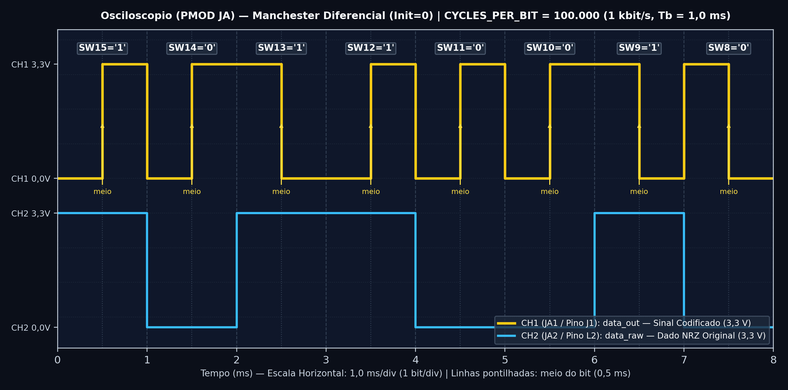

# Saída PMOD para Osciloscópio — Codificação Manchester Diferencial

Esta pasta contém os arquivos e o passo a passo para conectar o osciloscópio **Digilent Analog Discovery 3** ao conector **PMOD `JA`** da placa **Basys 3** e observar a onda elétrica do código **Manchester Diferencial**.

---

## 🔌 Como Conectar os Fios (Basys 3 + Analog Discovery 3)

No conector **`JA`** (localizado no **topo da lateral esquerda** da Basys 3, logo abaixo do LED `POWER`):

| Pino no PMOD `JA` | Posição Física no Conector `JA` | Pino da FPGA | Sinal VHDL | Fio do Analog Discovery 3 (ou Osciloscópio) |
| :--- | :--- | :---: | :--- | :--- |
| **`JA1`** | **1º furo de baixo para cima** (fileira externa, marcado com `1`) | `J1` | **`data_out`** (Manchester Diferencial) | **Fio Laranja liso (`1+` / Canal 1)** |
| **`JA2`** | **2º furo de baixo para cima** (logo acima do `JA1`) | `L2` | **`data_raw`** (Bit NRZ original) | **Fio Azul liso (`2+` / Canal 2)** |
| **`JA5` (`GND`)** | **5º furo de baixo para cima** (marcado como `GND` na placa) | `GND` | **Terra (0 V)** | **Fio Laranja/Branco (`1-`) + Fio Preto (`GND`)** |
| **`JA11` (`GND`)** | **5º furo da fileira interna** (ao lado do `JA5`) | `GND` | **Terra (0 V)** | **Fio Azul/Branco (`2-`)** |

---

## 📈 Captura Real no Osciloscópio (Digilent WaveForms)

### Como identificar os bits `'0'` e `'1'` no gráfico acima:
* **Bits `'0'`:** Geram **duas transições** por bit (uma na fronteira de início do bit e outra no meio), formando **dois pulsos estreitos** de meio período ($T_b/2$).
* **Bits `'1'`:** **Mantêm o nível** na fronteira de início do bit (unindo a segunda metade do bit anterior com a primeira metade do bit atual em um **pulso largo de período inteiro $T_b$**) e invertem apenas no meio do bit!

---

## 📄 Documentação Completa

* 📈 [**Tutorial Completo da Saída PMOD (`docs/tutorial_pmod.pdf`)**](./docs/tutorial_pmod.pdf)
