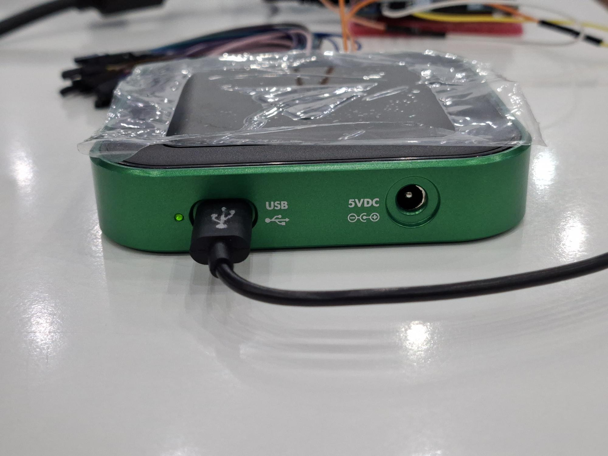
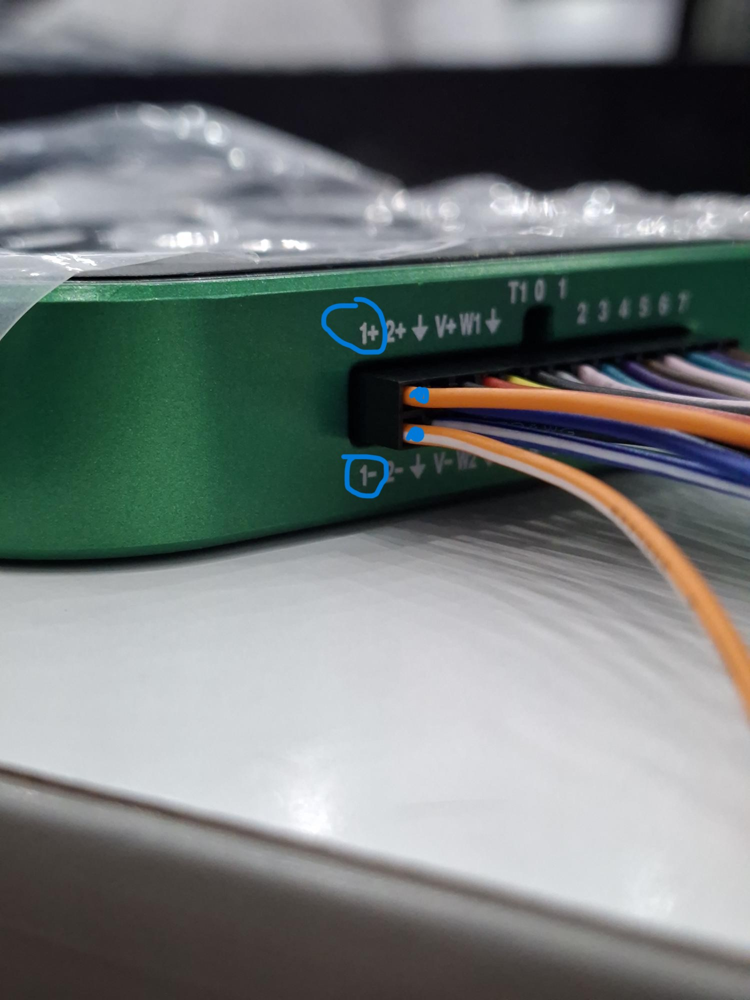
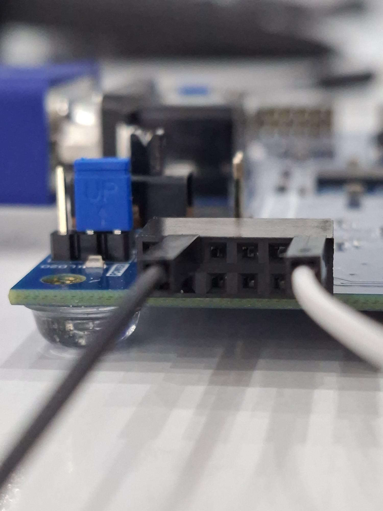
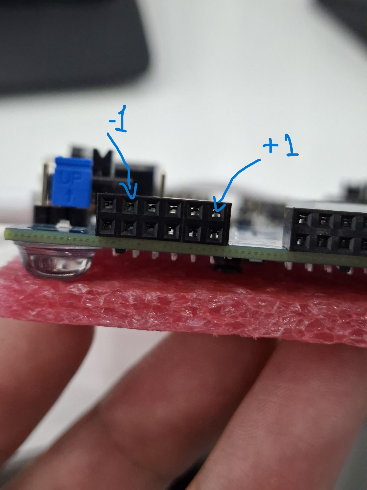
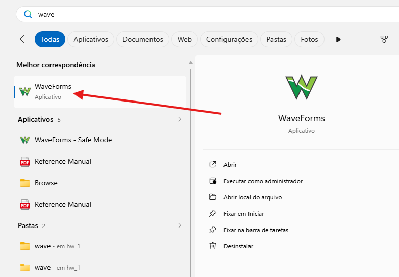
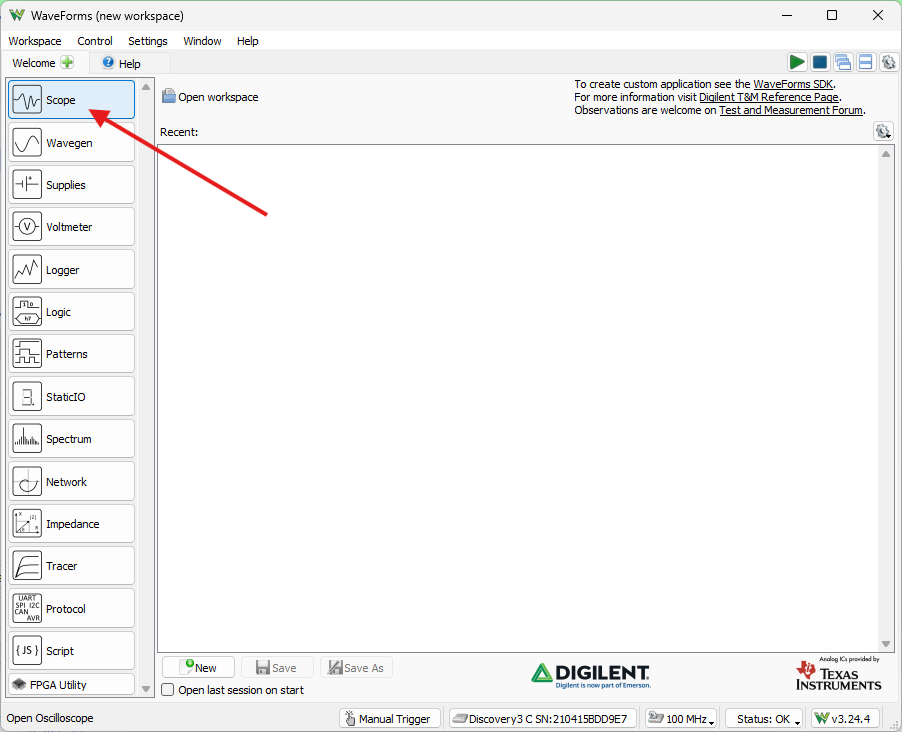
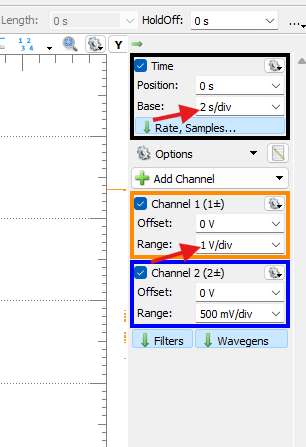
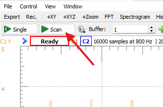
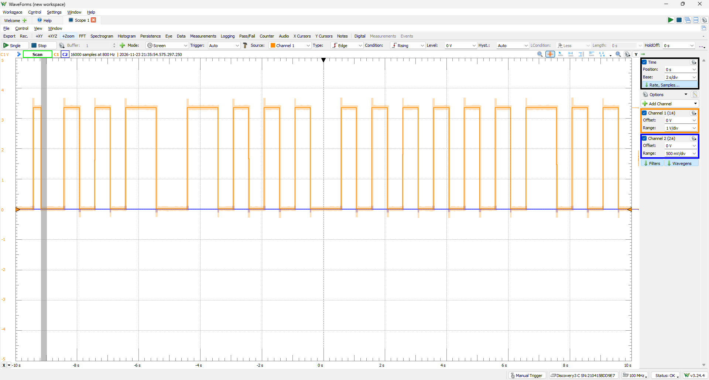
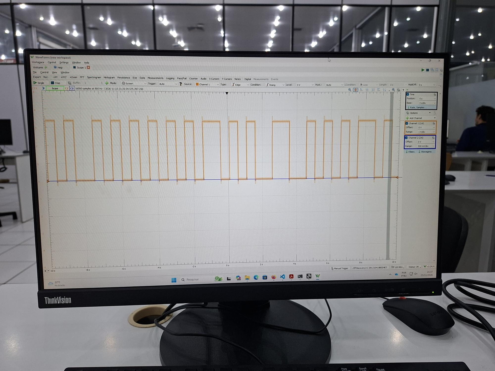

# Tutorial PMOD e osciloscópio — Manchester Diferencial

**Faculdade Engenheiro Salvador Arena**  
Disciplina: Comunicação de Dados — Sistemas Reconfiguráveis  
Professor: Vinicius Borges  
7º Semestre — Grupo 3

| Integrante | RA | GitHub |
|---|---|---|
| Emanuel Carneiro da Silva | 082230017 | https://github.com/emanuel71silva |
| José Gabriel de Morais Souza | 082230001 | https://github.com/Gabriieu |
| Lucas Daiki Honda Kuniyosi | 082230020 | https://github.com/LucasKuniyosi |

## 1. Preparação

Programe a Basys 3 com manchester_dif.bit. Use Analog Discovery 3, WaveForms 3.24.4 e fios de conexão. O sinal codificado está disponível no mesmo top e XDC usados pelos LEDs e VGA.

## 2. Ligações

| Terminal AD3 | Basys 3 | Função |
|---|---|---|
| 1+ | JA1, FPGA J1 | Sinal codificado |
| 1− | JA5 ou JA11 | Referência do CH1 |
| 2+ | JA2, FPGA L2 | Dado original (NRZ) |
| 2− | JA5 ou JA11 | Referência do CH2 |
| GND | GND da Basys 3 | Referência comum |

Faça as ligações com os equipamentos desligados. Confirme a numeração do JA; JA6 e JA12 são alimentação de 3,3 V. Não conecte saídas W1/W2 ou V+/V− do instrumento ao sinal da FPGA.

As fotos abaixo registram a montagem usada com CH1. Para a aquisição pedida no enunciado, complete a ligação de CH2 conforme a tabela.

*Analog Discovery 3 utilizado na bancada.*

*Identificação dos terminais do canal 1 no instrumento.*

*Conexão dos fios ao conector JA da Basys 3.*

*Detalhe do conector JA anotado pelo grupo.*

## 3. Configuração do WaveForms

1. Ligue o AD3 ao computador e abra WaveForms.
2. Selecione o instrumento e abra Scope.
3. Habilite CH1 e CH2 com acoplamento DC. Use 1 V/div nos dois canais como ponto de partida e ajuste o deslocamento vertical para distinguir os traços. Comece com 2 s/div para ver a sequência no modo lento.
4. Mantenha BTNU solto para usar o modo lento, com duração nominal calculada de 1 s por bit e 0,5 s por metade.
5. Use **Scan** para acompanhar a sequência. O ajuste de referência mostrado nas imagens usou 20 s de janela e 800 amostras/s. Para a captura detalhada, reduza a janela a alguns bits.
6. Selecione `B2C5` nos switches, da posição SW15 até SW0. Pressione e solte BTNC e observe a transmissão nos dois canais.

*Abertura do WaveForms no Windows.*

*Seleção do instrumento Scope.*

*Configuração registrada: base 2 s/div, CH1 1 V/div e CH2 500 mV/div.*

*Botão Scan para acompanhar a aquisição no modo lento.*

## 4. Captura para o relatório

O bit 0 inverte no início do intervalo e o bit 1 mantém o nível anterior. Ambos invertem no meio. Após o reset, o nível de referência é zero.

Compare o sinal codificado do CH1 com o dado original do CH2. Identifique a sequência e os limites dos bits, marque as transições centrais e exporte uma imagem do Scope que mostre os dois canais com a escala de tempo. Inclua a captura neste tutorial e na seção de resultados do [relatório](../../../../relatorio_final/relatorio.pdf).

*Aquisição parcial do Manchester Diferencial a 2 s/div. CH1 mostra o sinal codificado e CH2 permanece próximo de 0 V.*

*Fotografia da tela do WaveForms durante a observação diferencial.*

## 5. Velocidade e diagnóstico

BTNU pressionado seleciona o modo rápido (100 µs por bit, 50 µs por metade, valores calculados). Para observá-lo, reduza a base de tempo; 2 s/div é a configuração do ensaio lento documentado. A mudança entra no início do próximo bit.

Se CH1 ficar constante, confirme BTNC solto, a ligação em JA1 e o bitstream. Se CH2 ficar constante com o padrão misto, confira JA2 e a referência do canal. No modo rápido, experimente 50 µs/div e trigger de subida em CH1 próximo a 1,65 V.

## 6. Vídeo

Identifique esta codificação no vídeo e mostre o padrão dos switches usado na aquisição. Registre o tempo do trecho no [índice do vídeo](../../../../relatorio_final/README.md).
