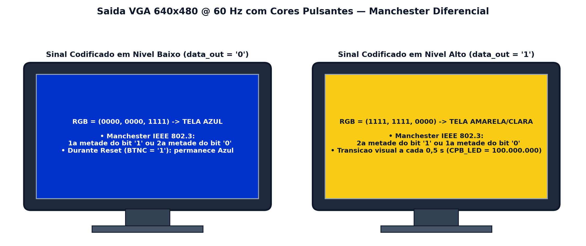

# Saída VGA com Cores Pulsantes — Codificação Manchester Diferencial

Esta pasta contém o controlador [`vga_pulse.vhd`](./src/vga_pulse.vhd) e as instruções para visualizar a **Codificação Manchester Diferencial** em um monitor **VGA externo (640×480 @ 60 Hz)**.

---

## 🖥️ Como Interpretar as Cores no Monitor?

O monitor exibe uma cor de tela cheia para o **nível baixo (`'0'`)** e outra cor contrastante para o **nível alto (`'1'`)**, acompanhando em tempo real o registrador diferencial `enc`:

* **Quando o próximo switch está em `'0'` (abaixado):**
  A cor da tela **troca imediatamente na fronteira de início do novo bit** e **troca novamente no meio do bit** (`0,5 s` depois).
* **Quando o próximo switch está em `'1'` (levantado):**
  A cor da tela **permanece a mesma em que terminou o bit anterior** durante os primeiros `0,5 s` do novo bit, e **só troca de cor no meio do bit**!

---

## 📄 Documentação Completa

* 🖥️ [**Tutorial Completo da Saída VGA (`docs/tutorial_vga.pdf`)**](./docs/tutorial_vga.pdf)
