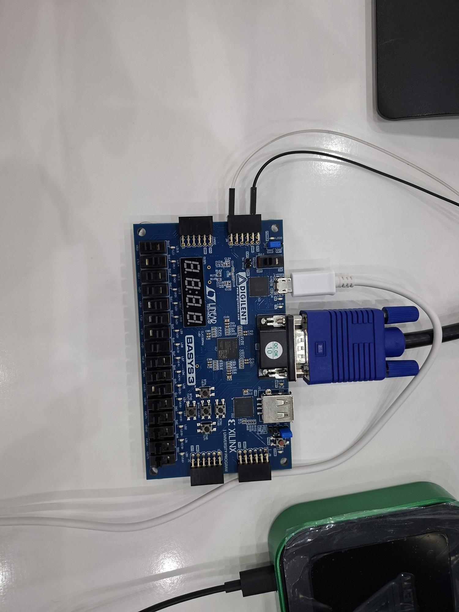
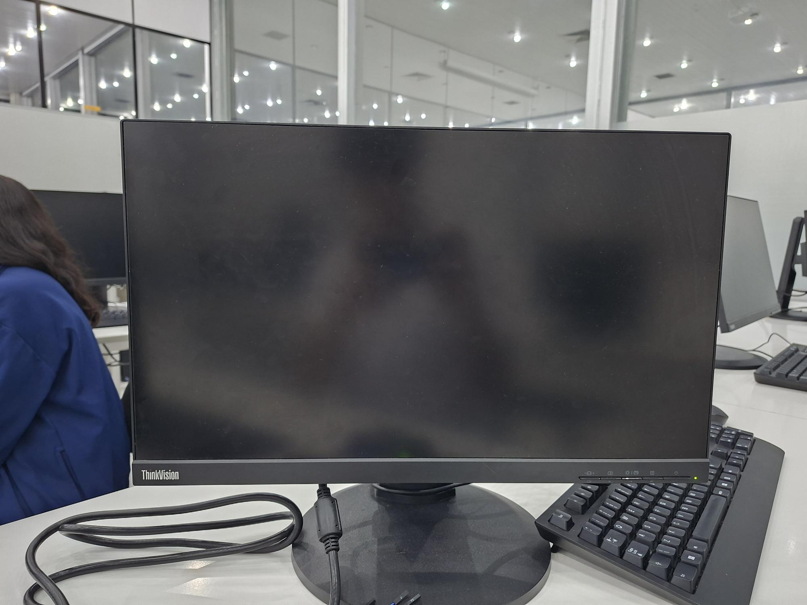
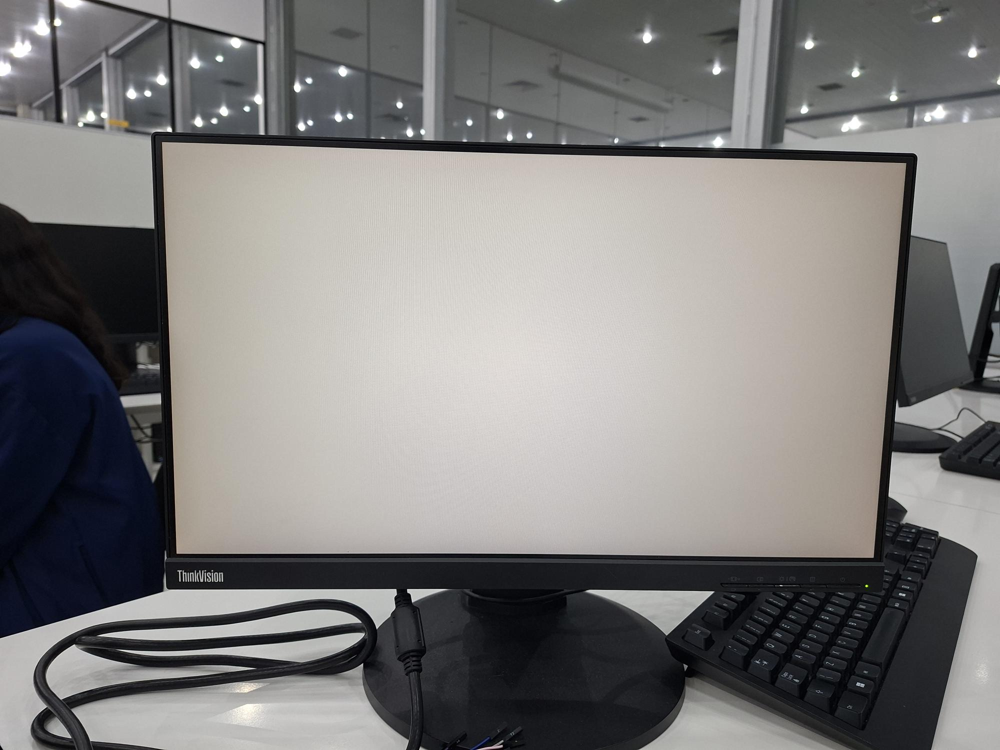

# Tutorial VGA - Manchester Diferencial

**Faculdade Engenheiro Salvador Arena**  
Disciplina: Comunicação de Dados — Sistemas Reconfiguráveis  
Professor: Vinicius Borges  
7º Semestre — Grupo 3

| Integrante | RA | GitHub |
|---|---|---|
| Emanuel Carneiro da Silva | 082230017 | https://github.com/emanuel71silva |
| José Gabriel de Morais Souza | 082230001 | https://github.com/Gabriieu |
| Lucas Daiki Honda Kuniyosi | 082230020 | https://github.com/LucasKuniyosi |

## 1. Preparação e montagem

Use Basys 3 já programada com manchester_dif, monitor com entrada VGA e cabo VGA.
Para monitores apenas HDMI, é necessário conversor ativo na direção VGA para HDMI;
um cabo passivo não converte o sinal. Ligue o cabo ao conector VGA da Basys 3 e
selecione VGA como entrada do monitor. Mantenha BTNU solto.

*Conector VGA e cabeamento da Basys 3.*

## 2. Projeto utilizado

Não troque o top nem o XDC. O top já instancia src/vga_sync.vhd e dirige as três
cores e Hsync/Vsync. A imagem esperada é 640×480, aproximadamente 59,5 Hz com clock
de pixel de 25 MHz. O monitor pode identificar esse modo como 60 Hz.
O sinal baixo produz preto; alto produz branco. Não há texto nem desenho de waveform.

## 3. Teste de nível e sequência

Com BTNU solto, selecione B2C5 e pressione/solte BTNC. Observe a tela por pelo menos
20 s e compare cada cor com o nível exibido nos LEDs. Cada metade dura 0,5 s.
A cor nem sempre muda na fronteira entre bits; a transição central sempre existe.
No reset, o codificador fica baixo e a tela preta, mas o sincronismo VGA continua ativo.

*Tela preta fotografada durante a bancada.*

*Tela branca fotografada durante a bancada.*

As fotos registram a montagem e as duas cores na bancada. A demonstração de cada codificação deve registrar a alternância de cores e identificar o bitstream carregado.

## 4. Registrar e diagnosticar

O grupo confirmou a alternância de cores no monitor.
Se aparecer Sem sinal, confira cabo, entrada do monitor, suporte ao modo, .bit e
mapeamento VGA. Preto durante BTNC pressionado é esperado. No rápido, a câmera e o
monitor podem mostrar faixas ou brilho médio; use lento para a demonstração de cores.
Não atribua faixas da câmera automaticamente a erro na codificação: compare com o Scope.

## Vídeo dos dois projetos

Grave a tela e os LEDs em modo lento para mostrar a alternância de cores com esta codificação. Indique o trecho no [índice do vídeo](../../../../relatorio_final/README.md).
