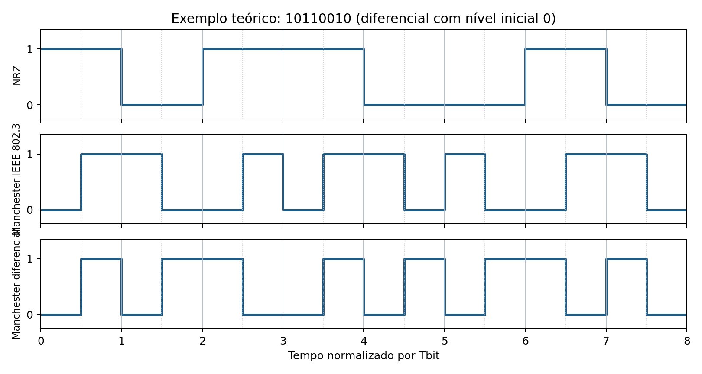
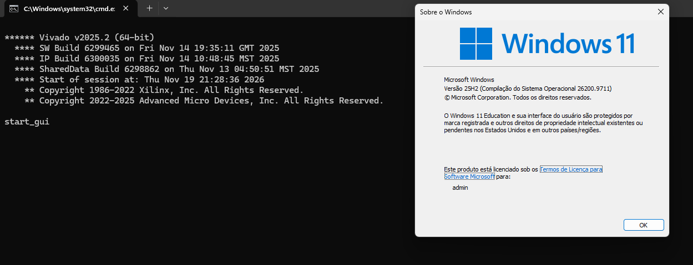
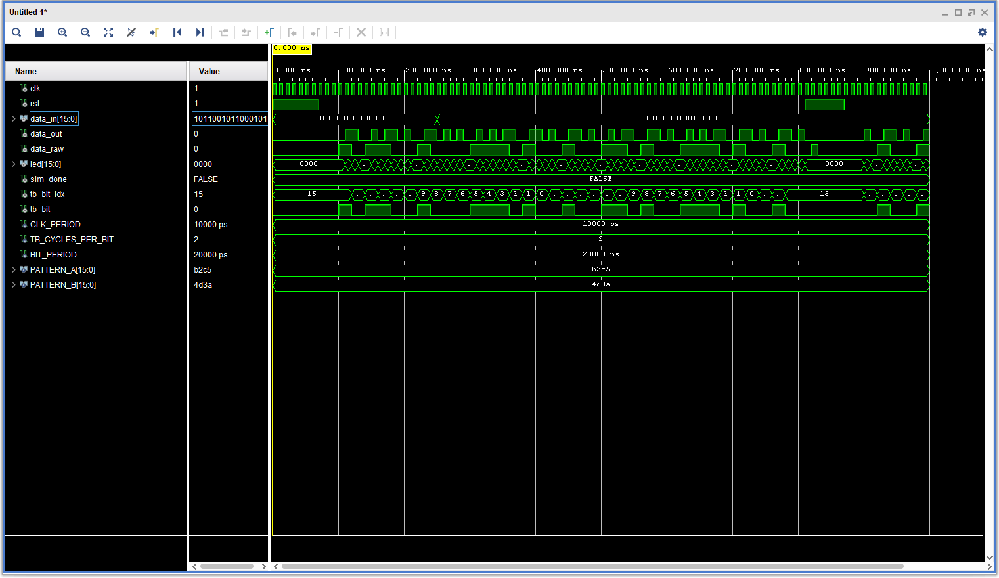
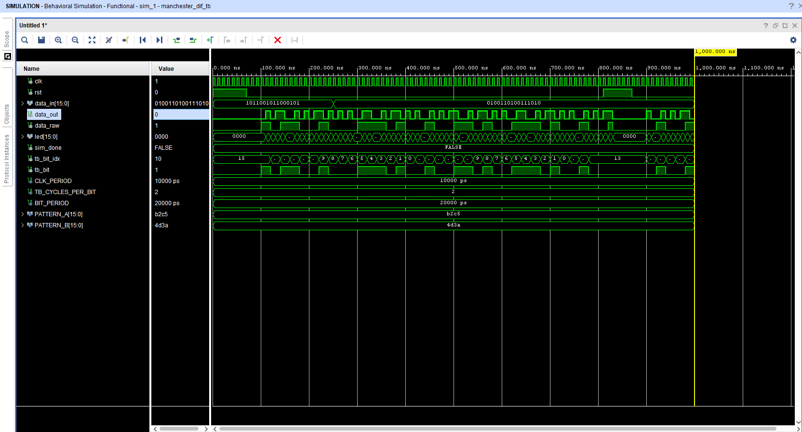
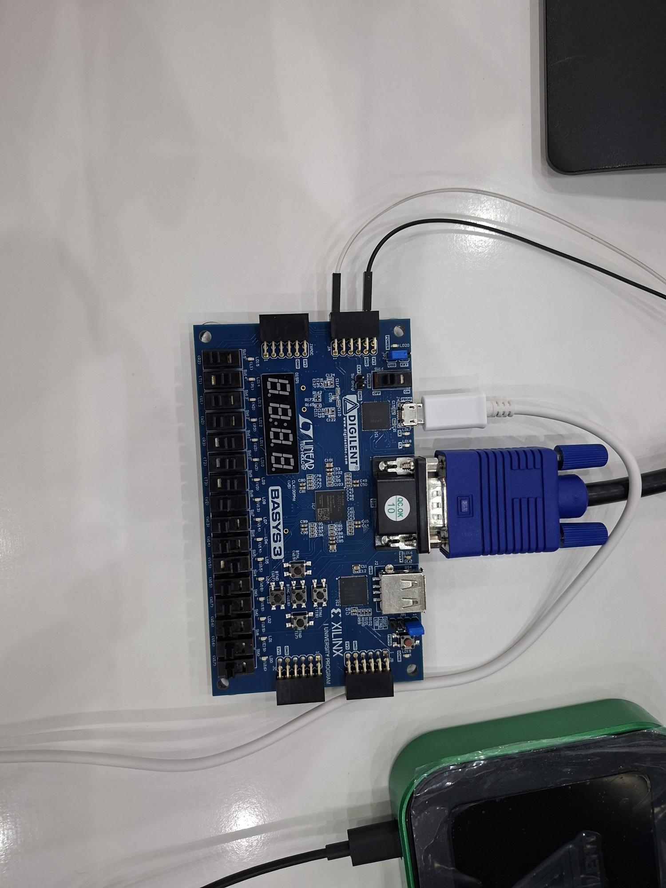
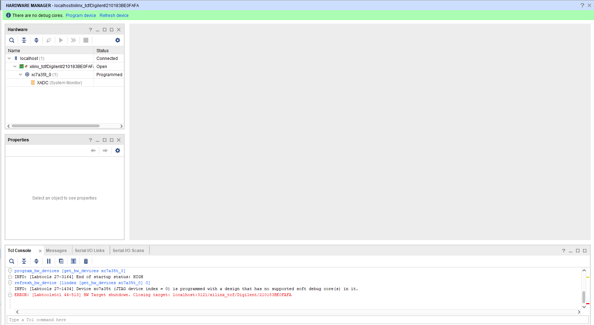
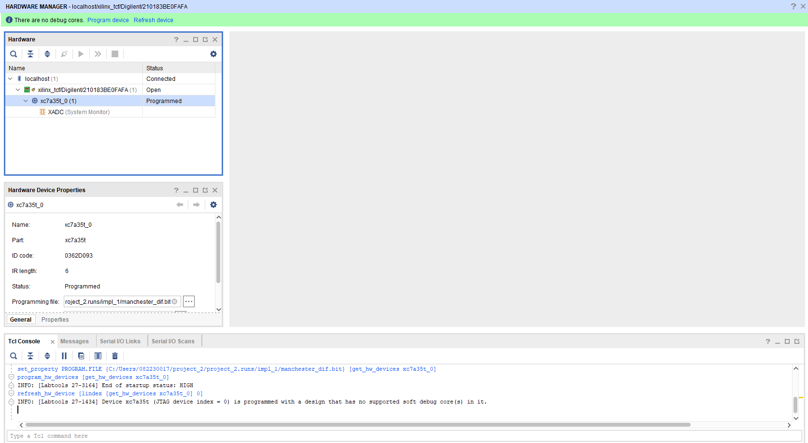
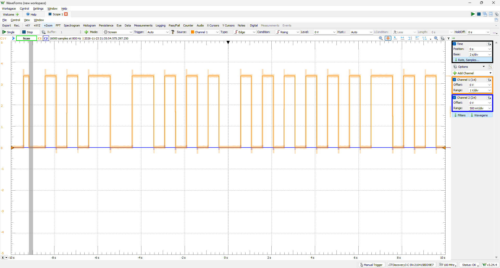
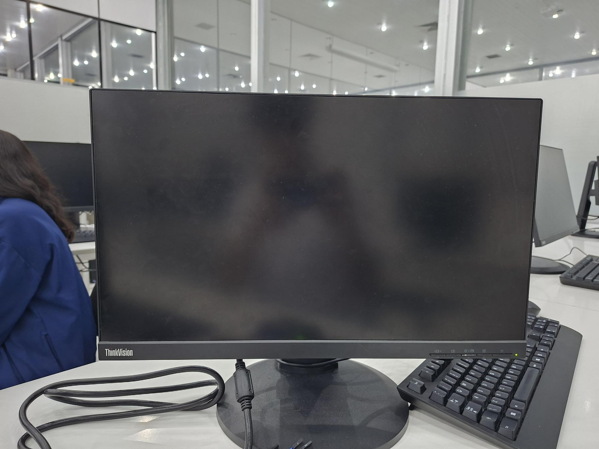
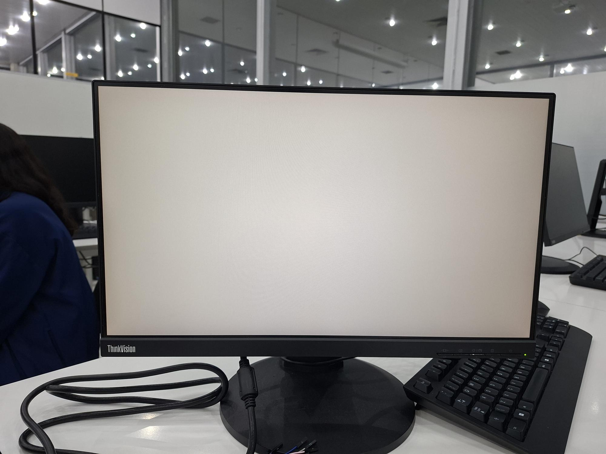

# Relatório técnico - Codificação de linha Manchester em VHDL

**Faculdade Engenheiro Salvador Arena**  
Disciplina: Comunicação de Dados — Sistemas Reconfiguráveis  
Professor: Vinicius Borges  
7º Semestre — Grupo 3

| Integrante | RA | GitHub |
|---|---|---|
| Emanuel Carneiro da Silva | 082230017 | https://github.com/emanuel71silva |
| José Gabriel de Morais Souza | 082230001 | https://github.com/Gabriieu |
| Lucas Daiki Honda Kuniyosi | 082230020 | https://github.com/LucasKuniyosi |

## 1. Resumo

Foram organizados dois projetos VHDL para codificação Manchester e Manchester
Diferencial na Basys 3, com entrada de 16 bits e saídas simultâneas em LEDs,
PMOD e VGA. Foram adotados contador síncrono, captura de um switch por bit e saídas
registradas. A avaliação foi estruturada em simulação comportamental e ensaios de
bancada com Analog Discovery 3 e monitor VGA. Segundo o grupo, os dois codificadores funcionaram na simulação e nos testes de LEDs, PMOD e VGA. As evidências reunidas registraram a simulação e a programação dos dois projetos, além de uma aquisição parcial no osciloscópio e os dois estados de cor na bancada VGA.

## 2. Introdução e objetivos

A codificação de linha representa dados binários em um sinal adequado à transmissão.
Sequências longas sem transições dificultam a recuperação de temporização em códigos
como NRZ-L. O trabalho teve como objetivo implementar dois códigos com transição
central obrigatória e analisar sua relação com os dados de entrada [1].
Os objetivos específicos foram manter a leitura SW15..SW0 cíclica, preservar cada bit
capturado, validar reset e transições, observar os níveis nos LEDs e observar os sinais codificados no osciloscópio, além de apresentar níveis por cores VGA.

## 3. Fundamentação teórica

### 3.1 Manchester

Adotou-se a convenção IEEE 802.3 explicitada no enunciado [1, p. 1]: 0 é alto/baixo
e 1 é baixo/alto. A informação está no sentido da transição central. A convenção
G. E. Thomas emprega sentidos opostos e não foi usada neste trabalho.
Com h=0 na primeira metade e h=1 na segunda, a saída é bit XNOR h.

### 3.2 Manchester Diferencial

Foi adotada a regra do enunciado [1, p. 2]: 0 inverte no início, 1 mantém o nível;
ambos invertem no meio. O estado inicial após reset é baixo. O receptor observa
mudanças relativas, de modo que a inversão global de polaridade não altera a
presença/ausência dessas mudanças, desde que a referência e os limites dos bits
sejam interpretados de forma consistente. Manchester convencional, decodificado
com a mesma convenção após inversão global, troca a interpretação de 0 e 1.

### 3.3 Exemplo calculado, não medido

Para 10110010, cada par abaixo representa primeira e segunda metades:

| Bit | Manchester | Diferencial (nível anterior inicial 0) |
|---|---|---|
| 1 | 01 | 01 |
| 0 | 10 | 01 |
| 1 | 01 | 10 |
| 1 | 01 | 01 |
| 0 | 10 | 01 |
| 0 | 10 | 01 |
| 1 | 01 | 10 |
| 0 | 10 | 10 |

A figura, calculada a partir das regras do enunciado, mostra as fronteiras dos bits nas linhas contínuas e as transições centrais nas linhas pontilhadas.

### 3.4 Sincronismo, componente DC e banda

Os dois códigos garantem transição central e facilitam recuperar a temporização;
a implementação deste trabalho é somente transmissora, sem circuito de recuperação
de clock. Em cada bit, há tempos iguais em níveis alto e baixo. Na representação
bipolar ideal isso produz média nula por bit. Na saída física unipolar 0–3,3 V,
a média é aproximadamente 1,65 V: não se deve afirmar que a tensão DC medida é zero.

As metades exigem intervalos de sinal de Tbit/2; o enunciado apresenta como regra
comparativa aproximadamente o dobro da largura de banda do NRZ à mesma taxa [1, p. 1].
Isso não define uma banda exata universal: a largura útil depende da forma de pulso,
do canal e do critério espectral. Pulsos retangulares ideais não têm espectro limitado.

## 4. Metodologia

Foram reunidos os módulos anteriormente separados em um top por codificação,
conservando um controlador VGA local. Foram mantidos projetos independentes,
com documentação própria. A sequência de trabalho foi estudo, organização VHDL,
simulação no XSim, síntese, implementação, programação e aquisição de evidências.

Foram utilizados Vivado 2025.2, Windows 11 Education 25H2, Basys 3 e Analog Discovery 3 com WaveForms 3.24.4.

## 5. Desenvolvimento e decisões

Foram disponibilizados 100.000.000 ciclos por bit no modo lento (1 s) e 10.000 no rápido (100 µs). A captura diferencial apresentada no osciloscópio utilizou o modo lento. BTNU selecionou o período seguinte, mantendo a duração integral
do bit corrente. A referência NRZ foi disponibilizada em JA2 e o codificado em JA1.
Foi escolhido o mesmo top para todas as saídas para reduzir arquivos e evitar troca
de constraints. A captura no início protegeu a consistência lógica durante o bit;
os switches, porém, permaneceram sem sincronizador adicional.

A regra central do Manchester dependeu do bit capturado; a diferencial usou o nível
anterior. O reset levou as saídas a zero e reiniciou a seleção em SW15. A VGA usou
640×480 e aproximadamente 59,52 Hz, exibindo preto/branco pelo nível codificado.

## 6. Resultados

### 6.1 Simulação

O ambiente registrado foi Vivado 2025.2 (64 bits), em Windows 11 Education, versão 25H2, compilação 26200.9711.

*Ambiente de desenvolvimento registrado pelo grupo.*

*Waveform compatível com Manchester IEEE 802.3; janela de aproximadamente 0 a 1 µs.*

A captura exibe clock de 10 ns, período de bit de 20 ns, padrões B2C5/4D3A, troca de dados e novo pulso de reset. O primeiro bit 1 apresenta nível baixo seguido de alto. A janela não mostra o console final de assertions; sim_done aparece FALSE. Portanto, o sucesso completo é informação do grupo e não uma conclusão extraída somente desta imagem. Os sinais `tb_bit_idx` e `tb_bit` são as referências do testbench e `data_raw` é o dado registrado pelo circuito. A captura diferencial apresenta o mesmo conjunto de sinais.

*Simulação diferencial com período de bit de 20 ns e sim_done ainda FALSE na janela mostrada.*

### 6.2 FPGA e LEDs

*Montagem física compartilhada da bancada.*

*Programação Manchester concluída, estado Programmed.*

*Programação diferencial concluída, arquivo manchester_dif.bit e estado Programmed.*

O [vídeo de demonstração](video_demo.mp4) mostra a Basys 3 e os LEDs em operação no início de cada trecho, identificado como Manchester (00:00) ou Manchester Diferencial (00:26).

### 6.3 Osciloscópio

*Scope diferencial: 2 s/div, 800 amostras/s; canal 2 permanece próximo de zero.*

Foi observado o sinal diferencial no canal 1 com base de 2 s/div. O canal 2 permaneceu próximo de zero. O vídeo também registrou as formas de onda no osciloscópio por volta de 00:20 (Manchester) e 00:42 (diferencial). A comparação simultânea com o NRZ prevista no enunciado [1, p. 4] ficou fora do material apresentado por decisão do grupo.

### 6.4 VGA

*VGA: estado preto registrado.*

*VGA: estado branco registrado.*

As fotos registraram os dois estados da bancada. O vídeo mostra a alternância de cores por volta de 00:14 no Manchester e de 00:34 no diferencial, conforme o [índice dos trechos](README.md).

### 6.5 Síntese e implementação

Foram executadas síntese, implementação, geração do bitstream e programação. As capturas de Hardware Manager registram os dois arquivos programados. A análise de utilização de recursos e de timing não foi incluída neste relatório; não se declara fechamento de timing.

## 7. Análise e discussão

| Aspecto | Manchester | Manchester Diferencial | NRZ-L |
|---|---|---|---|
| Informação | Sentido da transição central | Inversão ou manutenção no início | Nível do bit |
| Transição central | Sempre | Sempre | Não obrigatória |
| Fronteira de bits | Transição se bits consecutivos iguais | Transição para bit atual 0 | Transição se dado muda |
| Polaridade invertida | Inverte interpretação com convenção fixa | Preserva relação de transições | Inverte interpretação |
| Memória no transmissor | Bit e fase | Bit, fase e nível anterior | Bit |
| Sincronismo | Transição garantida | Transição garantida | Longas sequências constantes são desfavoráveis |
| Banda comparativa | Maior que NRZ | Maior que NRZ | Menor na comparação do enunciado |

Manchester e diferencial apresentam uma transição central e podem ter outra na
fronteira, enquanto NRZ-L pode ficar sem transições por vários bits. O diferencial
não elimina o custo de banda; sua característica adicional é a codificação relativa.

Na simulação, cada metade ocupou 10 ns. Na placa, o modo lento foi configurado para 0,5 s por metade. A aquisição parcial do diferencial exibiu mudanças de nível compatíveis com essa escala, enquanto a saída NRZ no mesmo ensaio ficou sem registro válido para comparar as transições nas fronteiras.

O testbench fornecido não cobriu automaticamente VGA nem troca de velocidade.
A observação de LEDs aparentemente simultâneos no rápido deve ser confrontada com
o modo lento ou com medição; a persistência visual não é prova de erro lógico.

## 8. Conclusões

A implementação reuniu LEDs, PMOD e VGA em um top e um XDC por codificação. As formas de onda ilustraram a transição central e as diferenças entre os códigos na fronteira dos bits. O registro de bancada incluiu a programação e a operação dos dois projetos. Identificaram-se como limitações a captura direta dos switches, a ausência de debounce e a cobertura automática restrita ao codificador.

## Referências

[1] BORGES, Vinicius. Enunciado: Trabalho Prático - Codificação de Linha Manchester em VHDL (Vivado). Material fornecido, 8 p.

[2] BORGES, Vinicius. Guia de Documentação do Trabalho. Material fornecido, 11 p.

[3] BORGES, Vinicius. Guia de Entrega via GitHub. Material fornecido, 5 p.

[4] DIGILENT. Basys-3-Master.xdc. Disponível em: https://raw.githubusercontent.com/Digilent/digilent-xdc/master/Basys-3-Master.xdc . Consultado em 19 nov. 2026.

[5] DIGILENT. Getting started with the Analog Discovery 3. Disponível em: https://files.digilent.com/manuals/WaveForms/3.24.4/start10.html . Consultado em 19 nov. 2026.

[6] Código VHDL e testbench deste projeto, nas pastas src/ e sim/. Código analisado; sucesso funcional informado pelo grupo. Evidências experimentais parcialmente anexadas.
