# Relatório técnico — Codificação de linha Manchester em VHDL

**Faculdade Engenheiro Salvador Arena**  
Disciplina: Comunicação de Dados — Sistemas Reconfiguráveis  
Professor: Vinícius S. Borges  
Semestre 2026/2 — Grupo 1

| Integrante | RA |
|---|---|
| Eduardo Souza Urbanovicz Bastiani | 082230018 |
| João Vitor Maciel Nai | 082230004 |
| Ronaldo de Oliveira Santos | 082230031 |

## 1. Resumo

Foram desenvolvidos dois projetos VHDL independentes para a placa Basys 3: um codificador **Manchester** (convenção IEEE 802.3) e um codificador **Manchester Diferencial**. Em ambos, os 16 switches definiram a sequência transmitida ciclicamente de SW15 a SW0, e o sinal codificado foi apresentado simultaneamente nos LEDs, no conector PMOD JA e na saída VGA, a partir de um único bitstream por projeto. A arquitetura adotou contador síncrono de ciclos, captura de um switch por bit, sincronização dos botões e saídas registradas. Os dois testbenches, com verificação automática por `assert`, terminaram sem erros no Vivado Simulator 2026.1. Na implementação, os dois projetos atenderam todas as restrições de timing (WNS de +2,436 ns e +2,239 ns) e ocuparam menos de 0,5% dos recursos da FPGA. Na bancada, o funcionamento foi observado nos LEDs, no osciloscópio (Analog Discovery 3) e no monitor VGA.

## 2. Introdução e objetivos

A codificação de linha define como bits são representados em um sinal elétrico. No código NRZ-L, mais simples, longas sequências de bits iguais produzem um sinal constante, e o receptor perde a referência de onde começa cada bit. Os códigos Manchester resolvem esse problema garantindo uma transição no meio de todo bit, ao custo de maior largura de banda [1].

O objetivo geral foi desenvolver, simular e implementar em FPGA os codificadores Manchester e Manchester Diferencial. Os objetivos específicos foram:

- transmitir ciclicamente SW15..SW0, lendo cada switch no início do seu bit;
- apresentar o sinal no LED acima do switch em transmissão, com os demais apagados;
- implementar reset pelo BTNC e respeitar o nível baixo após o reset no diferencial;
- validar os circuitos por testbench com verificação automática;
- disponibilizar o sinal codificado e o dado original no PMOD e representar o nível por cores na VGA.

## 3. Fundamentação teórica

### 3.1 Manchester

O intervalo de bit é dividido em duas metades e há sempre uma transição no meio; o **sentido** dessa transição carrega a informação. Adotou-se a convenção **IEEE 802.3**, exigida pelo enunciado [1]: bit 0 = alto → baixo; bit 1 = baixo → alto. A convenção de G. E. Thomas usa sentidos opostos e não foi empregada. Chamando de `h` a metade (0 na primeira, 1 na segunda), a saída é `bit XNOR h`.

### 3.2 Manchester Diferencial

Também há transição obrigatória no meio do bit, usada apenas para sincronismo. A informação está na **presença** (bit 0) ou **ausência** (bit 1) de transição no **início** do bit [1]. A regra depende do nível anterior, o que exige memória no transmissor; o nível após o reset foi definido como baixo. Como o receptor observa mudanças relativas, uma inversão global de polaridade não altera a decodificação, ao contrário do Manchester convencional, em que a inversão troca 0 por 1.

### 3.3 Exemplo calculado

Para a sequência 10110010, cada par indica primeira e segunda metades:

| Bit | NRZ | Manchester | Diferencial (nível inicial 0) |
|---|---|---|---|
| 1 | 11 | 01 | 01 |
| 0 | 00 | 10 | 01 |
| 1 | 11 | 01 | 10 |
| 1 | 11 | 01 | 01 |
| 0 | 00 | 10 | 01 |
| 0 | 00 | 10 | 01 |
| 1 | 11 | 01 | 10 |
| 0 | 00 | 10 | 10 |

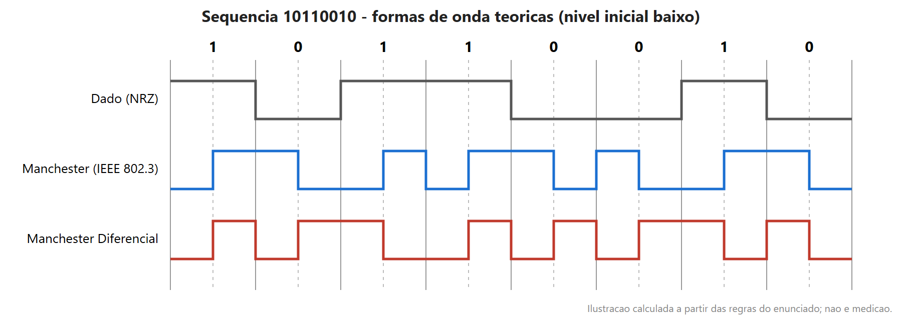

*Figura 1 — Formas de onda teóricas de 10110010 em NRZ, Manchester e Manchester Diferencial. Linhas contínuas marcam o início e tracejadas o meio de cada bit. Ilustração calculada, não medida.*

### 3.4 Autossincronização, componente DC e largura de banda

Como todo bit tem ao menos uma transição, o receptor pode recuperar o relógio a partir do próprio sinal (autossincronização). Este trabalho implementou apenas o transmissor, sem recuperação de clock. Em cada bit, o sinal passa metade do tempo em nível alto e metade em baixo; em representação bipolar ideal, isso resulta em média nula por bit. Na saída física unipolar de 0 a 3,3 V, a média é de aproximadamente 1,65 V.

As metades têm duração Tbit/2, de modo que, para a mesma taxa de bits, o sinal muda até duas vezes mais rápido que o NRZ e exige aproximadamente o dobro da largura de banda [1]. O valor exato depende do critério espectral adotado e do formato do pulso.

## 4. Metodologia

O trabalho foi organizado nas etapas: estudo do enunciado e dos guias → descrição do circuito em VHDL → simulação comportamental no XSim → síntese e implementação → geração do bitstream e gravação → ensaios de bancada (LEDs, osciloscópio e VGA) → documentação.

| Ferramenta | Uso |
|---|---|
| AMD Vivado 2026.1 (Windows 11) | Síntese, implementação, simulação e programação |
| Digilent Basys 3 (`xc7a35tcpg236-1`, 100 MHz) | Plataforma de implementação |
| Digilent Analog Discovery 3 + WaveForms | Observação do sinal no PMOD |
| Monitor VGA | Observação das cores pulsantes |

## 5. Desenvolvimento e decisões de projeto

**Um top por codificação.** Optou-se por um único módulo de topo por projeto (`manchester` e `manchester_diferencial`) gerando LEDs, PMOD e VGA ao mesmo tempo, com um único XDC. Com isso, não foi preciso trocar constraints nem regravar a placa para observar cada saída. Cada projeto recebeu sua própria cópia de `vga_sync.vhd`, mantendo-os independentes.

**Duração do bit.** Adotou-se `CYCLES_PER_BIT = 100.000.000` (1 s por bit, 0,5 s por metade), dentro da faixa de 1 a 2 s recomendada para os LEDs. Para o osciloscópio, acrescentou-se o generic `FAST_CYCLES_PER_BIT = 10.000` (100 µs por bit, 10 kbit/s), selecionado enquanto o BTNU está pressionado. A troca de velocidade só é aplicada no início de um bit, para que nenhum bit tenha metades de durações diferentes. Os dois generics devem ser pares, condição verificada por `assert`.

**Captura do bit.** O valor do switch é copiado para o registrador `bit_r` no início de cada bit, de modo que alterá-lo durante a transmissão só afeta a próxima passagem por aquela posição, como exige o enunciado.

**Codificadores.** No Manchester, a saída recebe `NOT bit` no início e `bit` no meio. No diferencial, um flip-flop (`lvl`) armazena o nível atual: no início, ele é invertido se o bit for 0 e mantido se for 1; no meio, é sempre invertido. O reset leva `lvl` a zero.

**Sincronização e saídas registradas.** BTNC e BTNU passam por dois flip-flops em série (`ASYNC_REG`). Todas as saídas (`data_out`, `data_raw`, `led`, cor VGA e sincronismos) saem de flip-flops, evitando *glitches* visíveis no osciloscópio.

**Dificuldade encontrada — timing.** Na primeira versão, os limites do contador (`período − 1` e `período / 2 − 1`) eram calculados a cada ciclo a partir do período selecionado. Esse caminho combinacional ultrapassava o período de 10 ns e o Vivado reportou violação de timing. A solução foi pré-calcular esses valores em registradores (`last_r` e `half_r`), atualizados apenas no início de cada bit. Após a mudança, o projeto Manchester passou a fechar timing com WNS de +2,436 ns e o diferencial com +2,239 ns.

**VGA.** Implementou-se a temporização 640x480 com *clock enable* de 25 MHz (≈ 59,52 Hz). As cores escolhidas foram azul/verde no Manchester e vermelho/amarelo no diferencial, o que facilitou identificar no vídeo qual projeto estava gravado.

## 6. Resultados

### 6.1 Simulação

Os testbenches usaram clock de 10 ns, `TB_CYCLES_PER_BIT = 2` (bit de 20 ns) e os padrões `B2C5` e `4D3A`, com troca de padrão no meio do bit SW8, dois quadros completos e um reset no meio da sequência. Ambos terminaram em 1220 ns com as mensagens:

```
Note: SIMULACAO CONCLUIDA: nenhum erro (Manchester IEEE 802.3).
Note: SIMULACAO CONCLUIDA: nenhum erro (Manchester Diferencial).
```

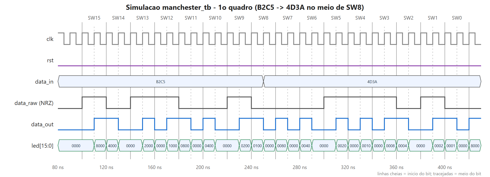

*Figura 2 — Simulação Manchester, primeiro quadro. O bit SW15 = 1 começa baixo e sobe no meio; SW14 = 0 começa alto e desce. O vetor muda de B2C5 para 4D3A no meio de SW8 sem alterar o bit corrente.*

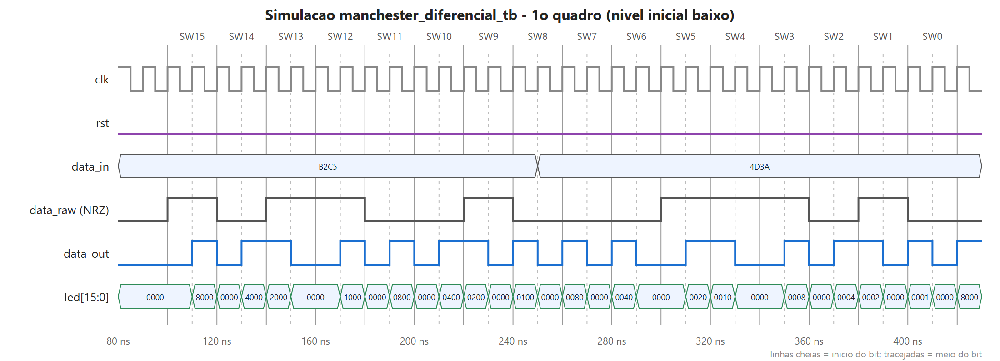

*Figura 3 — Simulação Manchester Diferencial, primeiro quadro. A saída parte do nível baixo; bits 0 invertem o nível no início e bits 1 o mantêm; todos invertem no meio.*

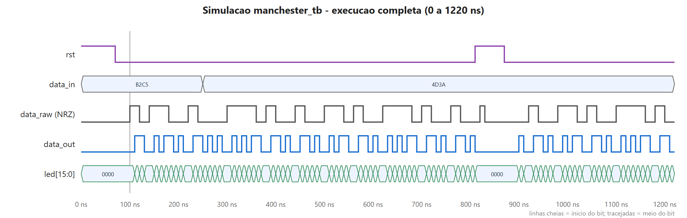

*Figura 4 — Execução completa do testbench Manchester, com o segundo reset entre 810 e 870 ns (saídas em zero) e o reinício em SW15.*

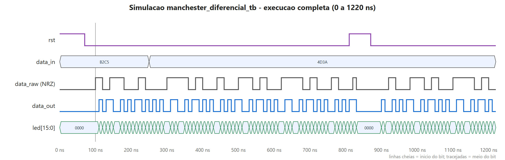

*Figura 5 — Execução completa do testbench diferencial.*

As Figuras 2 a 5 foram geradas a partir dos arquivos VCD exportados pelo XSim, com os mesmos sinais que aparecem na janela de waveform do Vivado.

### 6.2 Síntese e implementação

| Item | Manchester | Manchester Diferencial |
|---|---|---|
| WNS (setup) | +2,436 ns | +2,239 ns |
| WHS (hold) | +0,131 ns | +0,122 ns |
| Restrições de timing | todas atendidas | todas atendidas |
| Slice LUTs | 88 (0,42%) | 86 (0,41%) |
| Slice Registers | 93 (0,22%) | 93 (0,22%) |

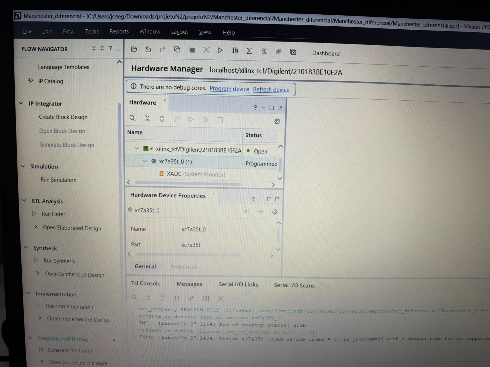

*Figura 6 — Hardware Manager do projeto Manchester_diferencial com o dispositivo `xc7a35t_0` em estado Programmed.*

### 6.3 FPGA e LEDs

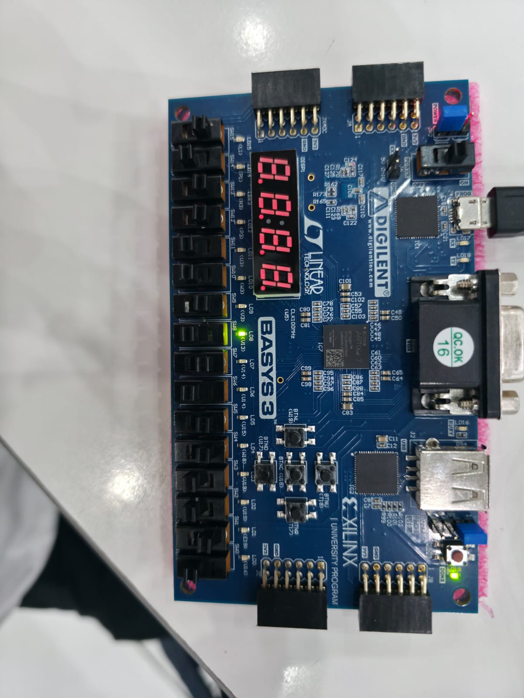

*Figura 7 — Projeto Manchester na placa: apenas LD8 aceso, durante a metade em nível alto do bit de SW8.*

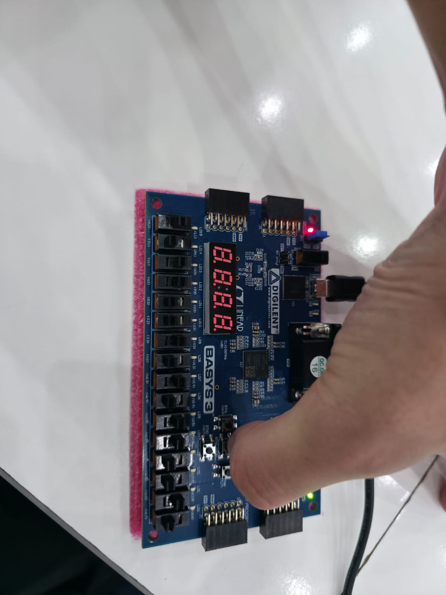

*Figura 8 — BTNC pressionado: transmissão parada e LEDs apagados.*

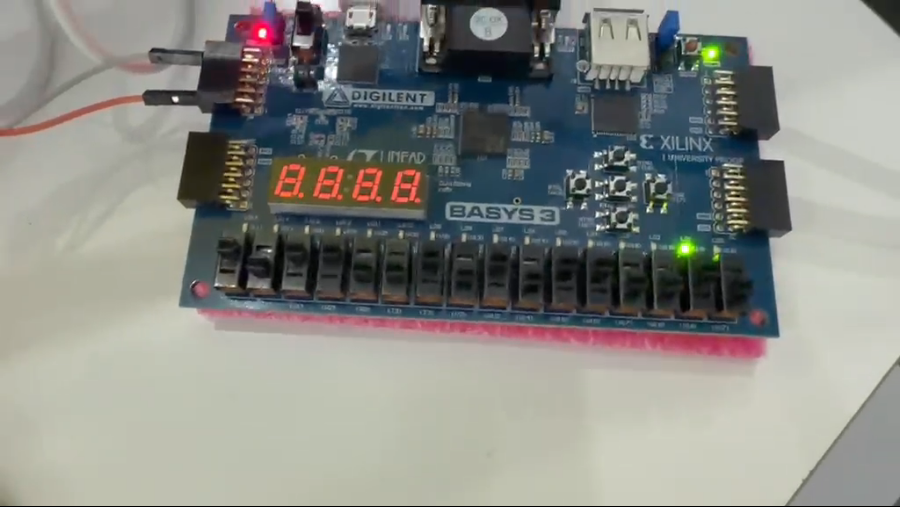

*Figura 9 — Projeto Manchester Diferencial na placa, com o LED ativo aceso e os fios do osciloscópio no JA.*

Observou-se o LED ativo percorrendo LD15 a LD0 e reiniciando em LD15, com cada posição exibindo as duas metades do bit conforme o switch abaixo dela. A alteração de switches durante a transmissão passou a valer na volta seguinte, sem regravar a placa.

### 6.4 Osciloscópio e VGA

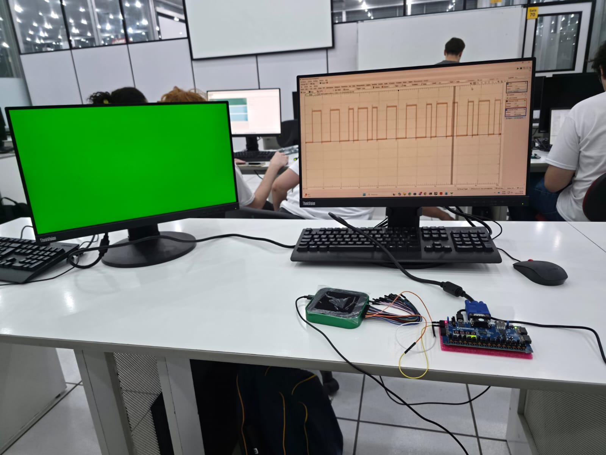

*Figura 10 — Bancada com o projeto Manchester: Analog Discovery 3 no conector JA, WaveForms exibindo o sinal codificado (monitor da direita) e a tela VGA verde, nível 1 (monitor da esquerda).*

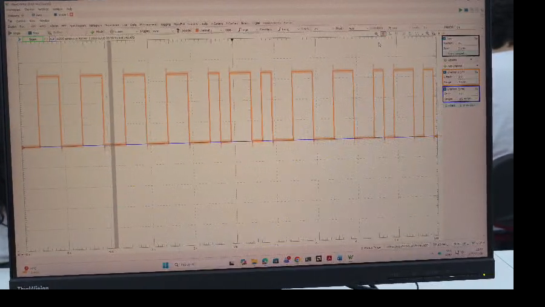

*Figura 11 — WaveForms com o sinal Manchester no canal 1 (modo lento).*

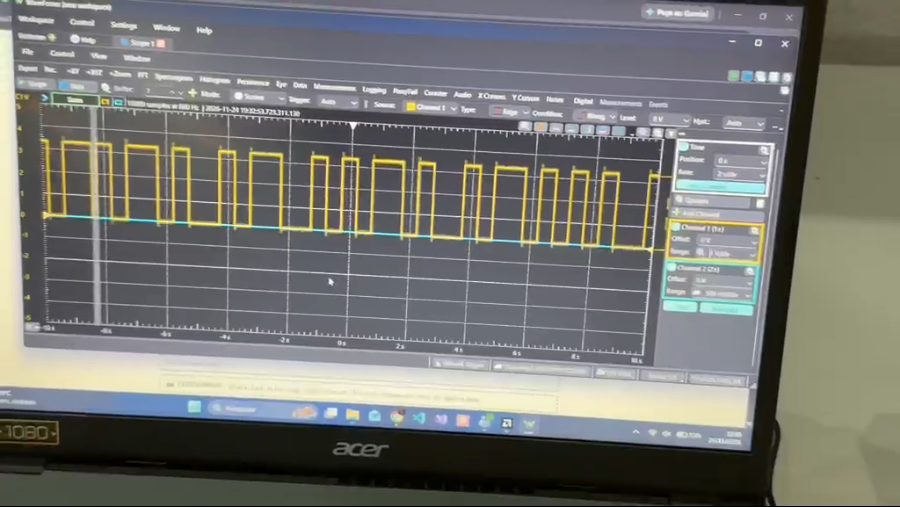

*Figura 12 — WaveForms com o sinal Manchester Diferencial no canal 1 (2 s/div).*

Nos dois códigos, o canal 1 exibiu uma onda retangular de dois níveis com uma transição no meio de cada bit. No Manchester, pulsos largos aparecem entre bits diferentes e estreitos entre bits iguais; no diferencial, a largura depende da presença ou ausência de transição no início de cada bit. Os ensaios usaram o modo lento e o canal 1; o dado original permaneceu disponível em JA2.

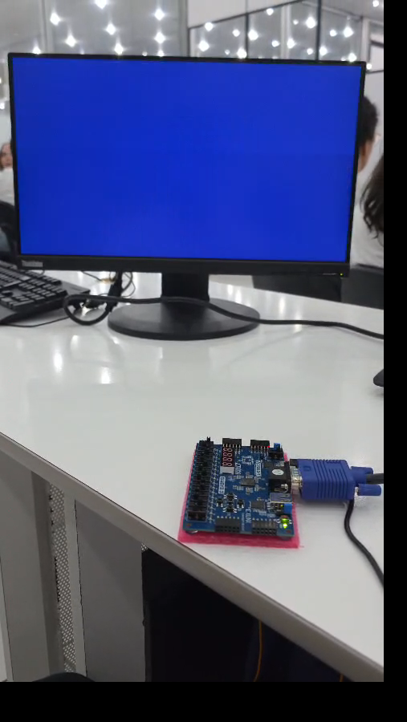

*Figura 13 — Manchester: tela VGA em azul (nível 0). A figura da bancada completa mostra o verde (nível 1).*

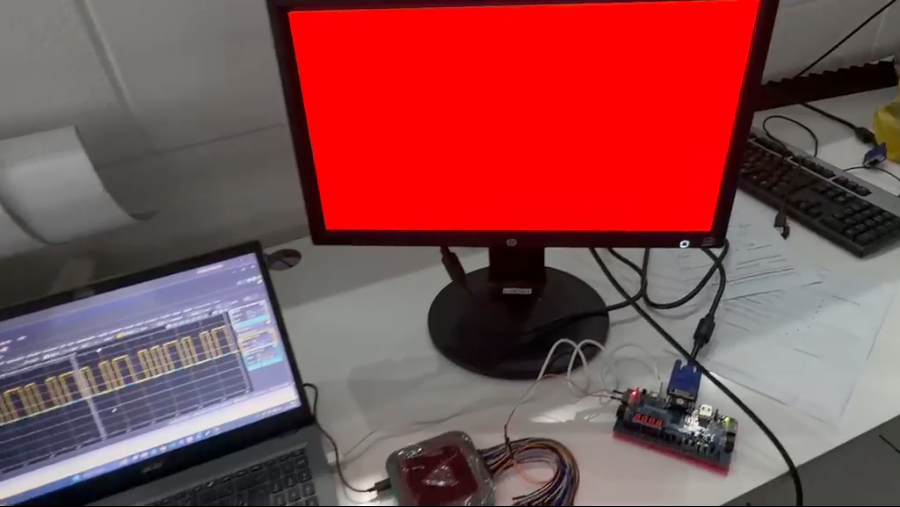

*Figura 14 — Manchester Diferencial: tela VGA em vermelho (nível 0), com o WaveForms no notebook.*

A tela VGA alternou entre as duas cores de cada projeto acompanhando o LED ativo. As demonstrações dinâmicas estão nos vídeos listados em [../README.md](../README.md).


## 7. Análise e discussão

### 7.1 Manchester × Manchester Diferencial × NRZ

| Aspecto | Manchester | Manchester Diferencial | NRZ-L |
|---|---|---|---|
| Onde está a informação | Sentido da transição central | Transição (ou não) no início | Nível do bit |
| Transição no meio | Sempre | Sempre | Não |
| Transições por bit | 1 ou 2 | 1 ou 2 | 0 ou 1 |
| Polaridade invertida | Troca 0 e 1 | Não afeta | Troca 0 e 1 |
| Memória no transmissor | Bit e metade | Bit, metade e nível anterior | Bit |
| Sincronismo | Garantido | Garantido | Perde-se em sequências longas iguais |
| Largura de banda | ≈ 2× NRZ | ≈ 2× NRZ | Referência |

No Manchester, há transição na fronteira apenas entre bits iguais; no diferencial, apenas antes de bits 0. Os dois códigos têm a mesma ocupação de banda; a vantagem do diferencial é a imunidade à inversão de polaridade, e a desvantagem é a dependência do histórico: um erro de nível se propaga para a interpretação do bit seguinte.

### 7.2 Simulação × placa

O comportamento observado na placa coincidiu com o da simulação: mesma ordem de transmissão, mesma regra de codificação, mesmo efeito do reset e da troca de switches. A diferença é apenas de escala de tempo (20 ns por bit na simulação, 1 s na placa), obtida pelo `generic map` sem alterar o código do circuito. A troca de velocidade e a VGA, que o testbench não verifica automaticamente, foram validadas apenas na bancada. No modo rápido, os LEDs parecem todos acesos por persistência visual; isso não indica erro lógico e foi confirmado no osciloscópio.

## 8. Conclusões

Os dois codificadores foram implementados, verificados por simulação com `assert` e validados na placa, com as três saídas funcionando simultaneamente a partir de um único bitstream por projeto. O principal aprendizado técnico foi a importância de manter caminhos combinacionais curtos em um projeto síncrono: o pré-cálculo dos limites do contador eliminou a violação de timing da primeira versão.

Como limitações, os switches não passam por sincronizador (a captura uma vez por bit garante consistência lógica, mas não elimina metaestabilidade), os botões não têm *debounce* e o testbench não cobre a VGA nem a troca de velocidade. Como trabalhos futuros, sugerem-se: sincronizar as entradas dos switches, ampliar o testbench, mostrar o índice do bit no display de sete segmentos e implementar o decodificador correspondente com recuperação de clock.

## Referências

[1] BORGES, Vinícius. *Enunciado: Trabalho Prático — Codificação de Linha Manchester em VHDL (Vivado)*. Material fornecido, 8 p.

[2] BORGES, Vinícius. *Guia de Documentação do Trabalho*. Material fornecido, 11 p.

[3] BORGES, Vinícius. *Guia de Entrega via GitHub*. Material fornecido, 5 p.

[4] FOROUZAN, Behrouz A. *Comunicação de dados e redes de computadores*. 4. ed. Porto Alegre: AMGH, 2010.

[5] IEEE. *IEEE Std 802.3 — Standard for Ethernet*. New York: IEEE.

[6] DIGILENT. *Basys 3 Reference Manual*. Disponível em: https://digilent.com/reference/programmable-logic/basys-3/reference-manual .

[7] DIGILENT. *Basys-3-Master.xdc*. Disponível em: https://github.com/Digilent/digilent-xdc .

[8] Código VHDL, testbenches e relatórios do Vivado deste trabalho, nas pastas `src/`, `sim/` e `vivado_project/` de cada projeto.

## Vídeo de demonstração

Os vídeos e o índice de trechos estão em [../README.md](../README.md).
